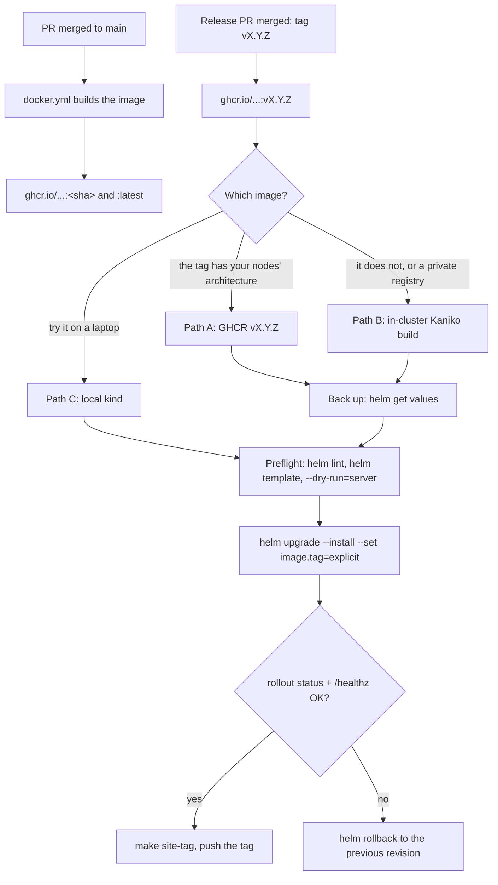

# Deploying study to Kubernetes with Helm

The operator guide: from an image to a running, verified release, and back if it goes wrong. It assumes
you run your own cluster; nothing here needs access to the maintainer's.

The content is baked into the image (`deploy/Dockerfile`), so the pod has no state to migrate except the
small bot-stats counters volume. **Publishing new content = a new image + `helm upgrade`.**



- [Prerequisites](#prerequisites)
- [1. Your values file](#1-your-values-file)
- [2. Pick the image](#2-pick-the-image)
- [3. Preflight](#3-preflight)
- [4. Deploy with an explicit tag](#4-deploy-with-an-explicit-tag)
- [5. Verify](#5-verify)
- [6. Roll back](#6-roll-back)
- [7. Tag what is published](#7-tag-what-is-published)
- [The bot-stats volume is ReadWriteOnce](#the-bot-stats-volume-is-readwriteonce)
- [Upgrade notes](#upgrade-notes)

## Prerequisites

| Need | Why | Check |
|---|---|---|
| Kubernetes 1.27+ and `kubectl` pointed at it | the chart uses `apps/v1`, `batch/v1` CronJob | `kubectl version` |
| Helm 3.13+ | `--dry-run=server` | `helm version --short` |
| A StorageClass for the bot-stats PVC (or turn it off) | 128Mi, ReadWriteOnce | `kubectl get storageclass` |
| Gateway API CRDs + a Gateway with an HTTPS listener (only with `gateway.enabled`) | the chart creates an `HTTPRoute` | `kubectl get gateway -A` |
| cert-manager + a ClusterIssuer (only with `gateway.tls.enabled`) | the chart creates a `Certificate` in the Gateway's namespace | `kubectl get clusterissuer` |
| DNS for your host pointing at the Gateway | public access | `dig +short study.example.com` |

The examples below use the release name `study` and the namespace `teach-plat`, the same ones
`make deploy-local` uses. The Deployment and Service are then `study-app`.

```bash
NS=teach-plat
```

## 1. Your values file

Copy the example once and fill it in; `deploy/helm/values-local.yaml` is gitignored and holds your secret.

```bash
cp deploy/helm/values-study.example.yaml deploy/helm/values-local.yaml
chmod 600 deploy/helm/values-local.yaml
$EDITOR deploy/helm/values-local.yaml
```

What to set (every value in the example is a placeholder):

| Key | What | Example |
|---|---|---|
| `image.repository` | where the image comes from (step 2) | `ghcr.io/villadalmine/study-cybercirujas` |
| `image.tag` | leave it to the command line (step 4), never `latest` | — |
| `gateway.name` / `gateway.namespace` | your existing Gateway | `my-gateway` / `gateway-system` |
| `gateway.host` / `gateway.extraHosts` | the public name, plus any internal one | `study.example.com` |
| `gateway.tls.*` | the Secret name and your ClusterIssuer | `study-tls` / `letsencrypt-prod` |
| `env.TEACH_SECRET` | session signing key, random, 32+ characters | `openssl rand -hex 32` |
| `botStats.storageClass` | your StorageClass; `""` = the cluster default | `""` |
| `nodeSelector` | only if the image or the volume needs a given node | see [the RWO note](#the-bot-stats-volume-is-readwriteonce) |

Changing `env.TEACH_SECRET` later logs every session out; generate it once and keep it.

## 2. Pick the image

### Path A: the public GHCR image, by version tag

`ghcr.io/villadalmine/study-cybercirujas` is built by `.github/workflows/docker.yml`. Every push to `main`
gets `:<short-sha>` and `:latest`; every release also gets `:vX.Y.Z` (see
[CONTRIBUTING → Releases](../CONTRIBUTING.md#releases)). Deploy a **`vX.Y.Z`** tag: it names a release
whose changelog you can read, and it does not move.

```bash
TAG=v0.3.0                       # the release you are deploying: gh release list
docker buildx imagetools inspect ghcr.io/villadalmine/study-cybercirujas:$TAG   # one "Platform:" line per architecture
```

**Check the architecture before you deploy.** Tags up to and including `v0.3.0` are built for
`linux/amd64` only (a single manifest, no `Platform:` lines). Releases built after `docker.yml` went
multi-arch ([#185](https://github.com/villadalmine/study-cybercirujas/pull/185)) list both
`linux/amd64` and `linux/arm64`. Deploying an amd64-only tag on arm64 nodes (Raspberry Pi, RK3588
boards, Graviton, Apple silicon under kind) fails with `exec format error`: use a multi-arch tag, or
path B.

### Path B: build in your cluster (no image for your architecture, or a private registry)

`make image-cluster` sends your working copy to a Kaniko pod over stdin and pushes to an in-cluster
registry, so the image is built on, and for, your nodes' architecture. It needs a `kaniko` namespace and a
registry your nodes can pull from (the target pushes with `--insecure`, so a plain HTTP registry works).

```bash
git switch --detach v0.3.0       # build exactly the release, not whatever is checked out
TAG=v0.3.0
make image-cluster TAG=$TAG REGISTRY=registry.example.internal:5000
```

Then set `image.repository: registry.example.internal:5000/teach-plat` in your values. Pass the **same
explicit `TAG=`** to every target: `TAG` defaults to a fresh timestamp per invocation, so omitting it
builds one tag and deploys another. An image built from a working copy that has rendered videos
(`media/**/*.mp4`, gitignored) includes them; the GHCR image does not, and the site simply hides the
video buttons.

### Path C: try it locally with kind

No registry, no Gateway, no secrets to keep. Good for checking a chart change before it reaches a cluster.

```bash
docker build -t study:dev -f deploy/Dockerfile .
kind create cluster --name study
kind load docker-image study:dev --name study
helm install study deploy/helm -n teach-plat --create-namespace \
  --set image.repository=study --set image.tag=dev --set image.pullPolicy=Never \
  --set botStats.storageClass="" \
  --set-string env.TEACH_SECRET="$(openssl rand -hex 32)" \
  --wait --timeout 5m
kubectl -n teach-plat port-forward svc/study-app 8080:80 &
curl -fsS localhost:8080/healthz
kind delete cluster --name study          # when you are done
```

`gateway.enabled` is already `false` by default; kind's default StorageClass serves the PVC.

## 3. Preflight

Back up what is running first: the values (they include the secret, so keep the file out of the repo) and
the revision you would return to.

```bash
helm -n $NS history study --max 5
helm -n $NS get values study -o yaml > ~/study-values-$(date -u +%Y%m%dT%H%M%SZ).yaml
chmod 600 ~/study-values-*.yaml
```

Then check the change without applying it:

```bash
helm lint deploy/helm -f deploy/helm/values-local.yaml --set image.tag=$TAG
helm template study deploy/helm -n $NS -f deploy/helm/values-local.yaml --set image.tag=$TAG > /tmp/study.yaml
grep -n 'image:' /tmp/study.yaml          # the tag you meant, in the Deployment and the CronJob
helm upgrade --install study deploy/helm -n $NS -f deploy/helm/values-local.yaml \
  --set image.tag=$TAG --dry-run=server   # the API server validates every object, nothing is created
```

`--dry-run=server` is the one that catches what `helm template` cannot: a missing CRD (Gateway API,
cert-manager), an admission policy that rejects the pod, a namespace you cannot write to.

## 4. Deploy with an explicit tag

```bash
helm upgrade --install study deploy/helm -n $NS --create-namespace \
  -f deploy/helm/values-local.yaml --set image.tag=$TAG \
  --wait --timeout 5m
```

`make deploy-local TAG=$TAG` runs the same upgrade without `--wait`. Never deploy `:latest`: it is
whatever `main` was at the last push, two deploys of it are not the same thing, and a rollback to it
rolls back nothing.

## 5. Verify

```bash
kubectl -n $NS rollout status deploy/study-app --timeout=180s
kubectl -n $NS get pods -l app=study-app -o wide
kubectl -n $NS get deploy study-app -o jsonpath='{.spec.template.spec.containers[0].image}{"\n"}'

kubectl -n $NS port-forward svc/study-app 8080:80 &
curl -fsS localhost:8080/healthz          # {"ok":true,"certs":N}, N > 0
curl -fsS localhost:8080/api/catalog | head -c 200; echo
kill %1

curl -fsS https://study.example.com/healthz   # through the Gateway, with TLS
```

If the rollout does not finish: `kubectl -n $NS describe pod -l app=study-app` (image pull, scheduling,
volume) and `kubectl -n $NS logs deploy/study-app`.

## 6. Roll back

```bash
helm -n $NS history study
helm -n $NS rollback study <REVISION> --wait --timeout 5m
kubectl -n $NS rollout status deploy/study-app --timeout=180s
```

A rollback re-applies the manifests Helm stored for that revision, image tag included; it does not
re-render the chart, so it works even when the current chart would refuse the old values. It does not
touch the bot-stats volume (counters only). If you restore the backed-up values instead, pass them with
`-f` to a normal `helm upgrade`.

## 7. Tag what is published

After the verification passes, tag the commit the image was built from, so anyone can see what the site
runs with `git tag -l 'site-*'` ([CONTRIBUTING → Merging and deploying the site](../CONTRIBUTING.md#merging-and-deploying-the-site)).

```bash
make site-tag SITE_REF=v0.3.0 IMAGE_TAG=$TAG     # creates site-YYYY-MM-DD (UTC) on that commit
git push origin site-2026-10-20                  # the target prints the exact command
```

The tag is annotated with the release it came from (`git describe` of `SITE_REF`) and the image tag. A
second deploy on the same day: `SITE_SUFFIX=.2`. The target only creates the tag locally; pushing it is
your decision.

## The bot-stats volume is ReadWriteOnce

With `botStats.enabled: true` (the default) the pod mounts a 128Mi `ReadWriteOnce` PVC. That has three
consequences:

- **Keep `app.replicas: 1`.** A second replica cannot share the volume unless it lands on the same node.
- **A rolling update needs the new pod on the old pod's node.** The Deployment starts the new pod before it
  stops the old one. With a node-local volume (local-path, hostPath) the scheduler already places it there.
  With a network volume that attaches to one node at a time (Longhorn, a cloud disk) a new pod scheduled
  elsewhere waits with `Multi-Attach error` while the old one still holds the volume, and the rollout stalls.
  Either pin the pod with `nodeSelector`, or delete the old pod by hand when that happens (a few seconds of
  downtime).
- **Not needed for a try-out.** `--set botStats.enabled=false` drops the PVC; the counters then live in the
  container and reset on every restart, which is fine anywhere but production.

## Upgrade notes

Read the section for every release between the one you run and the one you deploy. Changes still in an
open PR are marked **pending**; they apply from the first release that contains them.

### First release after v0.3.0

- **The image runs as uid 10001** ([#176](https://github.com/villadalmine/study-cybercirujas/pull/176),
  merged). The chart sets `fsGroup: 10001`, so the kubelet makes the bot-stats volume group-writable on the
  next start. Storage that ignores `fsGroup` (hostPath, some NFS setups) needs the directory writable by
  gid 10001 beforehand; otherwise the pod fails at start. An admission policy that requires non-root now
  passes.
- **`env.TEACH_SECRET` is required**
  ([#175](https://github.com/villadalmine/study-cybercirujas/pull/175), merged). The chart refuses to render
  without a value of 32+ characters that is not a placeholder (`change-me`, the example's). Set a real one
  in `deploy/helm/values-local.yaml` before upgrading, and use `--set-string`, not `--set`, if you pass it
  on the command line (a digits-only value would become a number).
- **pending: proxy trust for the rate limit**
  ([#173](https://github.com/villadalmine/study-cybercirujas/pull/173)). `/api` gets a per-client rate
  limit, and the chart sets `env.TEACH_TRUST_PROXY: "1"` so the client is read from `X-Forwarded-For` as
  appended by the Gateway. Keep it only when the pod is reachable exclusively through a proxy you control;
  set `"0"` if it is exposed any other way (NodePort, a LoadBalancer Service). The limits are
  `TEACH_RATE_API` and `TEACH_RATE_SEARCH` ([OPERATING → Environment variables](OPERATING.md#environment-variables)).
