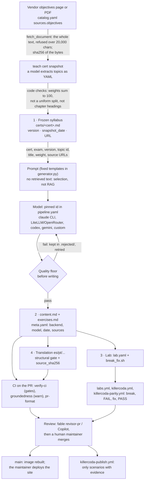

# FAQ — how the ecosystem works, honestly

**New here? Read [HOW-IT-WORKS](HOW-IT-WORKS.md) first**: one diagram per flow, from the big picture to the scripts. [ISSUE-TO-RELEASE](ISSUE-TO-RELEASE.md) is how an issue becomes a release (labels, milestones, review). [GUARDRAILS](GUARDRAILS.md) lists what is checked and what is only a convention. This FAQ answers the specific questions.

Short answers, each pointing to the doc and the code that prove it. Where the
code does less than a doc says, the answer says so and the gap is listed in
[Known gaps](#known-gaps). Line numbers are those of the commit that added this
file; follow the file if they have moved.

**Keeping it true.** A PR that changes how something described here works
updates this FAQ in the same PR ([CONTRIBUTING → Pull requests](../CONTRIBUTING.md#pull-requests)).

- [Content generation](#content-generation)
- [Determinism and provenance](#determinism-and-provenance)
- [Hallucination and groundedness](#hallucination-and-groundedness)
- [Sources and licensing](#sources-and-licensing)
- [Translations](#translations)
- [Labs and the runner](#labs-and-the-runner)
- [Killercoda](#killercoda)
- [The web app and the study bot](#the-web-app-and-the-study-bot)
- [Quality score](#quality-score)
- [Reviews: AI and human](#reviews-ai-and-human)
- [Contributing](#contributing)
- [Releases, milestones and the board](#releases-milestones-and-the-board)
- [Deployment](#deployment)
- [Security](#security)
- [Known gaps](#known-gaps)

## The generation pipeline in one picture

## Content generation

**What is the process to generate the material?**
Four steps, each one command: snapshot the official syllabus once per
certification, author each topic in English, translate, and check. The order
and the budget live in [`pipeline.yaml`](../pipeline.yaml); the commands are in
[OPERATING.md](OPERATING.md) and the cycle in [docs/WORKFLOW.md](WORKFLOW.md).

1. **Syllabus.** `teach cert snapshot` fetches the vendor's objectives page
   or PDF, asks a model to return the topics as YAML, then checks the answer in
   code before saving it: weights are renormalised and must sum to 100, a
   uniform split nobody published is refused, chapter headings in place of
   objectives are refused, and `scripts/check_syllabus.py` checks it again (`teach/core/tracker.py:514-621`, prompt at
   `:532-563`). The result is frozen in `certs/<cert>.md` and is never changed
   by a sync ([OPERATING → Checking curriculum updates](OPERATING.md#checking-curriculum-updates)).
2. **Author.** For each topic, three completions: content, exercises and the
   lab script (`teach/core/generator.py:663-822`).
3. **Translate.** From the English original, never re-authored
   (`teach/core/generator.py:943-1045`).
4. **Check.** The free checks in `make verify-ci` and the PR checks in CI
   ([CONTRIBUTING → Checks that must pass](../CONTRIBUTING.md#checks-that-must-pass)).

**What goes into the prompt?**
Only the syllabus entry: certification, exam, version, topic id and title,
the exam weight, and the topic's source URLs (`_topic_context`,
[`generator.py:652-660`](../teach/core/generator.py#L652-L660)), plus a fixed
system prompt with the code-block rules learned from real defects
([`:616-649`](../teach/core/generator.py#L616-L649)) and a fixed instruction
per file (content [`:732-737`](../teach/core/generator.py#L732-L737),
exercises `:756-759`, lab `:791-795`). The prompts are in Spanish on purpose:
the corpus was produced with them, and changing them is a content decision
([`generator.py:25-30`](../teach/core/generator.py#L25-L30)).

**Does the model read the official documents while writing?**
No. The source URLs are in the prompt, but their text is not: the model writes
from what it knows and must end with a *References* section of official URLs.
Whether the text agrees with those sources is checked afterwards (citations,
sources, groundedness, review), not enforced at write time. See [Known gaps](#known-gaps) G1.

**Which models and backends?**
`pipeline.yaml → generation` pins the authoring model by full id
(`claude-opus-5`, effort `xhigh`) for every path: timer, `make next`, a
hand-typed command ([`generator.py:425-447`](../teach/core/generator.py#L425-L447)).
Backends: the `claude` CLI (tools disabled, JSON envelope), LiteLLM / any
OpenAI-compatible API such as OpenRouter, `codex`, `gemini`, or a `custom`
command ([OPERATING → Generation backends](OPERATING.md#generation-backends)).
Translation may use a cheaper model, which was measured safe because its
failures are mechanical ([TRANSLATION_STUDY.md](TRANSLATION_STUDY.md)).

**Temperature and seed?**
None are set for authoring. The `claude` CLI does not expose them, and the
LiteLLM call passes only model and messages
([`generator.py:378-384`](../teach/core/generator.py#L378-L384)). Only the
measurement tools fix them (`scripts/probe_models.py`, the groundedness judge).

**What if the model returns something weak?**
It is not written. The quality floor in `pipeline.yaml → quality` (minimum
bytes, starts with a heading, a References section, a `
` answers
block) runs before anything is saved; the rejected text is kept under
`.rejected/` for diagnosis and the topic is retried
([`generator.py:297-332`](../teach/core/generator.py#L297-L332),
`teach/core/quality.py`). The floor proves the material is not a stub, never
that it is correct ([WORKFLOW → 2c](WORKFLOW.md#2c-what-quality-can-and-cannot-be-proven-mechanically)).

## Determinism and provenance

**How do you know generating the content is deterministic?**
It is not, and the project does not claim it. LLM sampling is not
reproducible bit for bit, not even at temperature 0, and authoring here does
not even fix the temperature. Run the same prompt twice and you get two
different texts. What the project calls deterministic is everything around
the model ([PRINCIPLES §3](PRINCIPLES.md#3-determinism)):

| Deterministic, and enforced | How |
|---|---|
| The inputs are pinned | frozen syllabus (`certs/<cert>.md`), prompt templates in code, model id in `pipeline.yaml` |
| Everything a student or contributor *uses* (site, API, CLI, validators, lab checks) | `make determinism` ([`tests/test_determinism.py`](../tests/test_determinism.py)): runs each twice in fresh processes, byte for byte, with the network blocked, model keys removed and the model CLIs replaced by tripwires |
| Every validator's verdict | the same test runs each check twice and compares the verdicts |
| Generated files (docs/STATUS.md, README and API tables, `quality:` blocks) | regenerated by scripts with `--check` in CI (`make verify-ci`) |
| Whether a link of the chain changed | `chain_sha256` (name, NUL, bytes, NUL; CRLF read as LF), [`teach/core/certs.py:29-46`](../teach/core/certs.py#L29-L46) |
| The CI decision on a PR | the same tree gives the same pass/fail |

| Not deterministic, or not enforced | Why |
|---|---|
| The text a model writes | sampling; a regeneration gives other words and possibly other facts |
| That a regeneration keeps the same structure | the quality floor checks a minimum, not equality; there is no regeneration-stability test (G9) |
| The groundedness gate | `mode: warn` ([`groundedness.yaml:20`](../groundedness.yaml)); it never fails a PR ([#41](https://github.com/villadalmine/study-cybercirujas/issues/41)) |

**What is recorded about each topic?**
`meta.yaml` per topic and language: `generated_at`, `lang`, `backend`,
`model` (the model that actually answered, read from the CLI's envelope),
`sources` ([`generator.py:335-352`](../teach/core/generator.py#L335-L352),
[`:527-533`](../teach/core/generator.py#L527-L533)); a translation adds
`translated_from` and `source_sha256` (`:1035-1044`); a hand edit appends
`human_edits` ([CONTRIBUTING → Provenance is mandatory](../CONTRIBUTING.md#provenance-is-mandatory));
a review appends `reviews` ([REVIEWS.md](REVIEWS.md#recording-a-review-in-the-material));
and `make quality` writes the `quality:` block. The API returns the same as
`generated_by` ([`teach/core/certs.py:213-238`](../teach/core/certs.py#L213-L238)).
Not recorded: effort, prompt version, temperature, CLI version (G5), and
older topics name only the CLI (`claude`, `agy`) instead of a model (G3).

**Can a topic be traced back to where it came from?**
Each link of the [source chain](PRINCIPLES.md#7-the-source-chain) must
declare its origin, and `scripts/check_source_chain.py` fails CI when one does
not; a declared hash that no longer matches is reported as STALE. Artefacts
older than 2026-10-15 are excused one by one in
`tests/fixtures/source_chain_baseline.txt`, a list that may only shrink.

## Hallucination and groundedness

**Is there RAG?**
Not in generation. The prompt carries the syllabus entry and the source URLs,
not retrieved text ([`generator.py:652-660`](../teach/core/generator.py#L652-L660)).
The study bot does not use RAG either: the student picks the topic, so the
whole file is sent ("explicit selection replaces retrieval",
[STUDY_BOT_DESIGN.md](STUDY_BOT_DESIGN.md#the-insight-explicit-selection-replaces-retrieval)).
The only retrieval in the repository is inside the groundedness *check*: a
word-overlap search for the 3 most similar 200-word windows of the cited
documents for each claim ([`groundedness.yaml`](../groundedness.yaml),
`retrieval:`). The README shows how a student can build a local RAG over the
corpus with Ollama and Open WebUI; that is the student's tool, not the pipeline.

**What keeps the material from being invented?**
Layers, none of which proves an explanation true
([AUDITOR_DESIGN.md](AUDITOR_DESIGN.md), [WORKFLOW → 2c](WORKFLOW.md#2c-what-quality-can-and-cannot-be-proven-mechanically)):

| Layer | Catches | Where | Blocks? |
|---|---|---|---|
| Quality floor | stubs, a missing References or answers section | generator, before writing; `make verify-ci` | yes |
| Sources | References that are not official project domains | `scripts/check_sources.py`, `docs/sources.yaml` | yes (`verify-ci`) |
| Manifests and Kubernetes APIs | YAML/JSON that does not parse, removed APIs | `scripts/check_manifests.py`, `scripts/check_k8s_apis.py` | yes |
| API facts for the tracked release | manifests using APIs that release does not serve | `scripts/check_api_facts.py` | no (network, run by hand) |
| Citations resolve | invented URLs (about 1–3% measured) | `scripts/check_citations.py` | no (network, not in CI) |
| Groundedness | sentences the cited sources do not support | `scripts/check_groundedness.py`, CI job `groundedness` | no, `mode: warn` |
| Claim sampling | a cited page that does not cover the subject | `scripts/check_claims.py` | no (costs quota, sampling) |
| Labs | content whose lab cannot break and be fixed | labs runner, Killercoda parity | for publishing a scenario |
| Review | anything a reader catches | fable `revisor-pr`, Copilot, the maintainer | the human merge |

**How does the groundedness check work?**
Claims are the sentences of `content.md` (code, headings, tables and
References removed); premises are the frozen syllabus entry and the documents
the topic cites, downloaded into a cache. A pinned classifier (GLiClass,
revision and sha256 in `groundedness.yaml`) scores each claim against its best
windows; below 0.5 it is "unsupported". `--deep` confirms suspects with Granite
Guardian 4.1 8B at temperature 0, seed 42. Measured on 50 labelled claims:
0.96 accuracy for the prefilter. It finds a number, list or output the source
does not say; it does not find a wrong design or a wrong source
([PRINCIPLES §7](PRINCIPLES.md#7-the-source-chain), [CONTRIBUTING → Groundedness](../CONTRIBUTING.md#groundedness-advisory)).

**Does it block a PR?**
No. `mode: warn`: CI reports in the job summary and uploads the updated
`meta.yaml` as an artifact, but does not commit it, so the corpus records no
groundedness result yet (G2). Switching to block waits for a measured
baseline: [#41](https://github.com/villadalmine/study-cybercirujas/issues/41),
after the fixes in [#120](https://github.com/villadalmine/study-cybercirujas/issues/120).

## Sources and licensing

**Where do the objectives come from?**
From the public page or PDF each vendor publishes, named in `catalog.yaml →
sources.objectives`. `tracked_version` is the curriculum the material was
built against; what upstream publishes today goes in the cert's `upstream:`
block and `upstream_status` (`current` | `outdated`), written by
`teach tracker sync` (which never moves `tracked_version`) or by hand in an
upgrade milestone's first PR (#63). The frozen syllabus is compared by
`scripts/check_versions.py`
([OPERATING → Checking curriculum updates](OPERATING.md#checking-curriculum-updates)).
Changing a tracked version needs its own milestone and `Scope: exam-version`
([CONTRIBUTING → How big is my change?](../CONTRIBUTING.md#how-big-is-my-change)).

**Are the official documents pinned by hash?**
The internal links are (content → translation, content → lab, syllabus →
video). The vendor document is now hashed when it is read: `teach cert snapshot`
records the sha256 of the bytes as `source_sha256` and refuses a document over
its 20,000-character window instead of truncating it, and the CNCF PDFs frozen
in `syllabi/` record theirs. Syllabi frozen before that carry no hash, and the
cited pages are not pinned at all (G6).

**Which sources are accepted?**
Official, public documentation. `scripts/check_sources.py` reads
`docs/sources.yaml` to say whose domain each citation is, and the `sources`
check needs at least half of them from catalogued projects
(`quality_weights.yaml → sources_min_catalogued`). No braindumps and no NDA
material, ever ([CONTRIBUTING → No braindumps](../CONTRIBUTING.md#no-braindumps)).

**Licence?**
Code and material under Apache 2.0 ([LICENSE](../LICENSE)); contributors sign
the DCO, there is no CLA ([CONTRIBUTING → Sign your commits](../CONTRIBUTING.md#sign-your-commits-dco)).

## Translations

**How are the Spanish and Portuguese versions made?**
English is authored; every other language is translated from it with
`teach cert translate`. The translator is told to copy code, flags, URLs and
headings verbatim, and `_verify_translation` checks it in code: same number of
code blocks and identical apart from comments, no source URL missing, same
number of headings, length ratio 0.6–1.6
([`generator.py:881-940`](../teach/core/generator.py#L881-L940)). A failing
translation is not saved. The result records `translated_from` and
`source_sha256` of the English files, so a later change to the English makes
the translation STALE in `check_source_chain.py`. Translations made before
2026-10-15 carry no `source_sha256` and are excused in the baseline, so for
them a change to the English is not detected (G12). `generate --lang es` is a
different thing: it re-authors from the syllabus and is used only for the
authoring language ([OPERATING → Languages](OPERATING.md#languages)). Part of
the older Spanish and Portuguese corpus was written that way, before English
became the authoring language: those files have no `translated_from`, are
separate documents with their own structure, and no gate compares them with
the English (G12).

**What is `lang_fallback`?**
When a topic has no file in the language asked for, the site and the API
serve English, then Spanish, and say which one in `lang_fallback`; provenance
shown is that of the file actually served
([`teach/core/certs.py:194-241`](../teach/core/certs.py#L194-L241), `FALLBACK_LANGS` at `:62`).

**Who reviews a translation?**
The structural gate, plus a person reading three paragraphs picked with a seed
stated in the PR ([CONTRIBUTING → Reviews and merging](../CONTRIBUTING.md#reviews-and-merging)).

## Labs and the runner

**What is a lab?**
A `lab.yaml` plus a `break_fix.sh` with `break`, `verify` and `cleanup` modes,
run in a throwaway container by `study-lab`
([LABS-RUNNER.md](LABS-RUNNER.md)). A lab is proven when `verify` fails after
`break`, the reference fix makes it pass, and cleanup leaves nothing.

**Are the labs tested?**
The contract of every lab is validated in CI (`labs.yml`). Running the full
cycle is recorded per lab in `lab.yaml → verified`, and only those count as
`lab: pass` in the quality score ([`scripts/quality_score.py:149-161`](../scripts/quality_score.py#L149-L161)).
Most labs do not yet have a full `break | verify | cleanup` contract
([LABS-RUNNER → State of the curated labs](LABS-RUNNER.md#state-of-the-548-curated-labs-validate-2026-10-15),
[#46](https://github.com/villadalmine/study-cybercirujas/issues/46)); known
broken ones are listed in `tests/fixtures/labs_known_broken.txt`.

**Can I write a lab without AI?**
Yes: `teach lab new <cert> <topic>` scaffolds it and `teach lab validate`
holds it to the same contract as a generated one
([PRINCIPLES §4](PRINCIPLES.md#4-with-ai-or-without-ai-the-same-pipeline-and-the-same-validator)).

## Killercoda

**How does a lab get to Killercoda?**
Killercoda is an export target, never the source. `study-lab export --target
killercoda` turns a lab into a scenario; CI runs the generated scenario on an
Ubuntu 24.04 VM like Killercoda's (`killercoda-parity.yml`): `verify` must fail,
the reference fix in `deploy/killercoda/fixes/` must make it pass, cleanup must
be idempotent. The evidence (`tested.json`) is tied to the scenario hash and to
the environment Killercoda runs on that date. On merge,
`killercoda-publish.yml` proves again and publishes only scenarios with valid
evidence ([RUN-A-LAB-ANYWHERE.md](RUN-A-LAB-ANYWHERE.md)).

**Is Killercoda required, and which labs are on it?**
No: Killercoda is an optional publishing channel and never blocks a PR
([RFC #210](https://github.com/villadalmine/study-cybercirujas/issues/210)).
It offers a kubeadm cluster and an Ubuntu VM, nothing else, so not every
certification can have a lab there; which labs have been tried, and where, is
`deploy/lab-evidence.yaml`. Every lab has one of two Killercoda statuses. **`tested`**: it has
evidence on a `killercoda-*` or `human-killercoda` target in
`deploy/lab-evidence.yaml`. **`loaded-untested`**: it stays in the repo and runs
locally with `study-lab`, but nothing proves it on Killercoda yet. A loaded-untested
lab is never a CI failure and is never pushed to the mirror repository Killercoda
reads; a failing or skipped Killercoda job never fails a PR, for any certification.

**How many are published?**
Only a `tested` lab reaches the mirror, and the publish gate needs both a passing
`tested.json` and a recorded `killercoda-*` entry in `deploy/lab-evidence.yaml` for the
lab's current hash (a lab under `failed:` is refused; when a lab changes, its proof is
recorded again). Three are tested today: `cka/1.1`,
`ckad/5.2` and `lpic-2/200.1` (the human test of `lpic-2/200.1` predates a change to the lab, so a re-test of the
current version is pending; publishing needs only the CI proof). A proof for an older version of a lab is reported as stale
in the CI log (`killercoda.yml`) and stops counting until the lab is re-proven. Of the 51 CKA and CKAD labs, the batch run of
2026-10-20 found 2 that pass, 1 that fails (`ckad/4.4`, its fix does not fit the
1-CPU node) and 48 with no reference fix yet, so they cannot be proven. More
fixes: [#98](https://github.com/villadalmine/study-cybercirujas/issues/98).

**Where was a lab proven, and what does that prove?**
A lab is agnostic: it never knows where it runs. Each proof names its **target**
(`kind`, `k3s-incus`, `docker-linux`, `killercoda-kubeadm`, `killercoda-ubuntu`,
`human-killercoda`), the date, the lab hash, a run link or log sha256 and the runner,
in `deploy/lab-evidence.yaml`. A blank cell means "not tested there", never "does
not work". A pass on `kind` or `k3s-incus` proves the lab but is not evidence for
Killercoda; only the `killercoda-*` and `human-killercoda` targets allow publishing
to the Killercoda mirror, which is an optional channel, never required. The ids and their exact meaning live in one file,
`deploy/lab-targets.yaml`, and an unknown id fails the tests
([#103](https://github.com/villadalmine/study-cybercirujas/issues/103)).

**What does a scenario say about itself?**
Certification, domain and objective from the frozen syllabus, whether a person
or an AI wrote it and who reviewed it, the quality level and where it was
tested ([RUN-A-LAB-ANYWHERE → What each scenario says about itself](RUN-A-LAB-ANYWHERE.md#what-each-scenario-says-about-itself)).

## The web app and the study bot

**Does the site need an account or call third parties?**
No. Site, API and CLI run offline with no account, key or telemetry, and the
tests prove it with the network blocked (`tests/test_smoke.py`,
`tests/netguard/`) ([PRINCIPLES §1](PRINCIPLES.md#1-information-sovereignty)).
Every topic page shows which model wrote it (the API's `generated_by`).

**How does the study bot work, and where is my key?**
You paste your own OpenRouter key; it is stored in your browser's
`localStorage` and sent only to openrouter.ai, never to this server
(`teach/web/index.html`, around line 571). The page loads the topic you picked
and puts the whole file in the prompt; there is no vector database
([STUDY_BOT_DESIGN.md](STUDY_BOT_DESIGN.md)). It is the one feature that uses
a third party, labelled as not sovereign in the README. Its model list
(`models.yaml`) is checked against OpenRouter by a weekly CronJob that runs
`scripts/check_models.py` (`make check-models` locally)
([OPERATING → Unattended generation timer](OPERATING.md#unattended-generation-timer)).

**Can I use the corpus from my own agent?**
Yes, through the read-only MCP server (`teach/mcp_server.py`, `make mcp-check`).

## Quality score

**What does the score mean?**
`scripts/quality_score.py` writes a `quality:` block per topic and language:
one entry per check, each `pass`, `fail` or `not_run`, with weight and
evidence. Score = 100 × earned / possible; `not_run` earns half its weight,
`fail` nothing ([`quality_weights.yaml`](../quality_weights.yaml)). Levels:
*Verified* needs 85+ **and** a passed lab and independent review; *AI beta*
needs 60+ with floor and provenance; otherwise *Draft*. CI fails if a block is
not what the files give (`quality_score.py --check`).

**Why is nearly everything "AI beta"?**
Because most topics have not been through a lab run, an independent review or
a recorded groundedness run, and an unmeasured check is never counted as
fine. On 2026-10-20 no topic is *Verified* (G8). The way up is in
[CONTRIBUTING → Raising a topic's quality score](../CONTRIBUTING.md#raising-a-topics-quality-score).

## Reviews: AI and human

**Who reviews a change?**
CI first (the gates). Then an independent model: the `revisor-pr` agent
running on a different model from the author (fable), or Copilot code review;
neither can approve or merge. The author triages every finding in the PR, with
a findings ledger. Then the maintainer, a human, merges; an agent never does
([REVIEWS.md](REVIEWS.md), [CONTRIBUTING → Reviews and merging](../CONTRIBUTING.md#reviews-and-merging)).

**Does a review count for the material?**
Yes, when recorded: a `reviews:` entry in the topic's `meta.yaml` (`by`,
`link`, `date`, `result`) feeds `independent_review`; the latest review wins
([`scripts/quality_score.py:164-176`](../scripts/quality_score.py#L164-L176)).
A person's edit is a `human_edits:` entry and feeds `human_review`.

## Contributing

**Do I need an AI key?**
No. Every check runs without keys or models, and without network beyond
installing dependencies and pulling base images for the chart smoke test
([CONTRIBUTING → Checks that must pass](../CONTRIBUTING.md#checks-that-must-pass)).

**What do I have to declare?**
Every commit is signed off (`git commit -s`, the [DCO](../DCO)). The PR's
*Provenance* says `Author: human` or `Author: ai`, with backend and model for
AI, also when an AI only helped; `scripts/check_pr.py` compares it with the
`meta.yaml` of every topic touched and fails on a mismatch
(`disclosure`, [`scripts/check_pr.py:252`](../scripts/check_pr.py#L252); DCO at `:595`).
Run `make pr-check` before pushing.

**I found a wrong explanation.**
Open a *Content error* issue with the sentence and the official source that
shows it is wrong; the link is what makes it actionable.

**Can I audit the repo myself, and can I change what is audited?**
Yes. [`docs/audit/rubric.yml`](audit/rubric.yml) is the self-audit: criteria with fixed ids, a 0/1/2 scale and the
foundations F1-F8 with their weights. Anyone, a person or an AI agent, scores every criterion with verifiable
evidence and always a proposal, and submits `docs/audit/results/<date>-<auditor>.yml` by PR.
[`scripts/audit_compare.py`](../scripts/audit_compare.py) compares auditors offline (disagreements, proposals side
by side, a ranking by a fixed formula) and refuses a criterion without a proposal
(tests: [`tests/test_audit_compare.py`](../tests/test_audit_compare.py)). To propose a criterion open an *Audit
criterion* issue; it gets a new id, existing ids are never renamed
([how](audit/README.md#propose-a-new-criterion)). The audit is not CI-enforced: results are evidence to read, not a gate.

## Releases, milestones and the board

**How are releases made?**
release-please keeps one open Release PR from the Conventional Commit titles;
merging it is the human gate that tags `vX.Y.Z` and publishes the image
([CONTRIBUTING → Releases](../CONTRIBUTING.md#releases)).

**Who writes the release notes?**
The changelog is release-please's. The Highlights, Upgrade notes and Thanks
on top of a GitHub Release come from `docs/release-notes/NEXT.md` (PR authors add lines; the Release PR fails while a release with a `feat`, a
`fix` or a breaking change has none) plus the authors of the
merged PRs, found by `scripts/release_notes.py` when the release is created; a small PR then empties NEXT.md
([CONTRIBUTING → Releases](../CONTRIBUTING.md#releases)).

**How does a curriculum upgrade work?**
When a vendor publishes a new curriculum version, the cert gets an upgrade milestone
(`<CERT> v<version> upgrade`) and the process of
[#63](https://github.com/villadalmine/study-cybercirujas/issues/63) runs, with no model until phase 2:
`scripts/curriculum_diff.py extract` freezes the official PDF, pinned by commit and hashed, in `syllabi/`;
`plan` diffs it against the frozen syllabus the material was built on and gives every topic one class by rules in
the code (`keep`, `revalidate`, `regenerate`, `new`, `retire`), down to the sections and version lines in scope; the
plan and its report live in `docs/upgrades/` and CI checks they are what their inputs produce. Each phase-2 PR may
change only what the plan lists (`guard`, with provenance in `meta.yaml`), and the final PR moves `tracked_version`.
A CI gate (`scripts/check_curriculum_consistency.py`) keeps every cert's curriculum citations and `sources` links equal to the catalog's `tracked_version` and pinned objectives URL (read from the catalog, so any cert, with the patterns as data in `scripts/curriculum_patterns.yaml`), so the repo cannot say two versions at once; the plan lists those lines, `upgrade_versions.py --scope citations --cert <cert>` fixes them, and the switch fails while any disagrees (#220). The first run, CKA & CKAD v1.37, regenerated nothing: [docs/upgrades/README.md](upgrades/README.md).

**What are milestones for?**
`vX.Y.0` milestones plan a release. `<CERT> <version> upgrade` milestones are
the only place a tracked exam version may change, enforced by `check_pr.py`
([#63](https://github.com/villadalmine/study-cybercirujas/issues/63)).
`.github/workflows/milestone.yml` keeps them current: a merged PR or a completed issue without a
milestone gets the open `v*` one due first (a plan, since the version is not known yet). A release milestone is
created or completed at release time from what actually shipped: publishing `vX.Y.Z` creates the milestone if it
was never planned (a patch, say; release-please picks the version only then), puts into it every PR merged and issue
closed as completed since the previous tag, moves what is still open to the next milestone and closes it. It can be
re-run for a past release from Actions (Milestones, input `tag`); upgrade milestones are never touched. The living "Follow-ups" umbrella issues (#120-#124) carry no release
milestone on purpose, so they never block a release.

**Where is the plan?**
Epics and follow-ups are issues: start at
[#125](https://github.com/villadalmine/study-cybercirujas/issues/125)
(roadmap and how to pick an issue) and the quality epic
[#166](https://github.com/villadalmine/study-cybercirujas/issues/166);
[docs/ROADMAP.md](ROADMAP.md) explains the order.

## Deployment

**How does the site get published?**
Content is baked into the image. A merge to `main` publishes
`ghcr.io/villadalmine/study-cybercirujas:<sha>` and `:latest`, and each release
adds `:vX.Y.Z`; no PR deploys production. The maintainer deploys a release tag
`:vX.Y.Z` with `helm upgrade`, never `:latest`, after checking that the tag
lists the architecture of the cluster's nodes (or builds the image in the
cluster instead), and then runs `make site-tag` to tag the deployed commit
`site-YYYY-MM-DD` with its release and image. The procedure, preflight and
rollback are in [DEPLOY.md](DEPLOY.md)
([CONTRIBUTING → Merging and deploying the site](../CONTRIBUTING.md#merging-and-deploying-the-site)).

**Can I run my own copy?**
Yes: `make setup && make serve`, or the public image
([docs/DEVELOPERS.md](DEVELOPERS.md)).

## Security

**High level, what protects the project?**
A pre-commit hook refuses committed keys; the chart refuses to render without
a real session secret; every action in every workflow is pinned to a full commit
SHA (`tests/test_actions_pinned.py` enforces it) and workflows run with
read-only tokens where they can; the Killercoda deploy key reaches only the mirror;
changes to `.github/`, the `Makefile` and `scripts/check_*` are the
maintainer's decision; external PRs are triaged security-first
([OPERATING → Generation backends](OPERATING.md#generation-backends), [Deploying to Kubernetes](OPERATING.md#deploying-to-kubernetes),
[CONTRIBUTING → Triage and response times](../CONTRIBUTING.md#triage-and-response-times)).

**How do I report a vulnerability?**
Privately to the maintainer, answered within 48 hours. There is no
`SECURITY.md` yet (G10).

## Known gaps

Found by reading the code against the docs on 2026-10-20. Each is either an
existing issue or a proposed one (title in *italics*); none is hidden.

| # | Gap | Evidence | Issue |
|---|---|---|---|
| G1 | Authoring is not grounded at write time: the model gets URLs, not their text, and chooses its own References. [PRINCIPLES §7](PRINCIPLES.md#7-the-source-chain) says a model "never supplies the source"; that holds for the syllabus, not for the cited pages | `generator.py:652-660`, `:728-740` | proposed: *docs(principles): say authoring is not retrieval-grounded; evaluate feeding the source text* |
| G2 | Groundedness never blocks and its results are not committed: no topic records a groundedness result | `groundedness.yaml:20`, `.github/workflows/groundedness.yml` uploads an artifact only | [#41](https://github.com/villadalmine/study-cybercirujas/issues/41), [#120](https://github.com/villadalmine/study-cybercirujas/issues/120) |
| G3 | `provenance` passes when `model` is a CLI or alias name (`claude`, `agy`, `cheap`), which is most of the older corpus; OPERATING says the real model is enforced | `scripts/quality_score.py:81-87`, `scripts/check_provenance.py:99-103` | proposed: *check_provenance: a CLI or alias name is not a model id* |
| G4 | Some English `meta.yaml` files say `lang: es` (e.g. `certs/cka/1.1/en/meta.yaml`): their provenance is a copy of the Spanish record | `scripts/check_provenance.py` does not compare `lang` with the directory | proposed: *check_provenance: meta.yaml lang must match its directory* |
| G5 | `meta.yaml` does not record effort, prompt version or hash, temperature or CLI version; effort lives only in the local usage log | `generator.py:198-207`, `:335-352` | proposed: *meta.yaml: record effort and a prompt hash* |
| G6 | Syllabi frozen before 2026-10-20 do not record the vendor document's hash (new snapshots do, and refuse a truncated text); cited pages are not pinned, so a page can change under its URL | `check_source_chain.py:106-123`, `tracker.py:93-106` | proposed: *snapshot: record the objectives document's sha256 and refuse a truncated text*; cited pages: [AUDITOR_DESIGN step 3](AUDITOR_DESIGN.md#what-i-would-build-in-order) (crawl + diff), proposed issue |
| G7 | `citations_resolve` and `check_api_facts.py` need the network and are not in CI, so `citations_resolve` is `not_run` everywhere | `quality_weights.yaml` (`citations_resolve`), `Makefile` `verify-ci` | proposed: *ci: scheduled citation and API-facts run that records results* |
| G8 | No topic is *Verified*: no recorded independent review, few verified labs, almost no human review | `quality:` blocks; `make quality` | [#46](https://github.com/villadalmine/study-cybercirujas/issues/46), [#98](https://github.com/villadalmine/study-cybercirujas/issues/98), [#166](https://github.com/villadalmine/study-cybercirujas/issues/166) |
| G9 | No test measures how much a regeneration changes structure or facts | — | proposed: *test: regeneration stability on a fixed sample (paid, by hand)* |
| G10 | No `SECURITY.md`, which CONTRIBUTING refers to | `CONTRIBUTING.md` (Triage table) | proposed: *docs: add SECURITY.md* |
| G11 | Docs that describe an older state: WORKFLOW says real translation "does not exist yet" and that groundedness and labs are not implemented; AUDITOR_DESIGN says "nothing built"; the RUN-A-LAB-ANYWHERE diagram says "manual push"; `quality_weights.yaml:31` says groundedness is always `not_run` | `docs/WORKFLOW.md:30-34`, `:225`, `:255-266`; `AUDITOR_DESIGN.md:3`; `RUN-A-LAB-ANYWHERE.md:22` | [#124](https://github.com/villadalmine/study-cybercirujas/issues/124), [#120](https://github.com/villadalmine/study-cybercirujas/issues/120) (the `quality_weights.yaml` line) |
| G12 | Most translations predate `source_sha256` (baseline), so a changed English original is not flagged for them; older Spanish and Portuguese files authored separately have no `translated_from` and are compared with nothing | `scripts/check_source_chain.py --report`; `tests/fixtures/source_chain_baseline.txt` | proposed: *translations: re-derive or re-translate the legacy es/pt so every translation records its source* |
| G13 | `docs/STATUS.md` can drift from the tree unnoticed: `status_matrix.py --check` is left out of `make verify-ci` (it counts gitignored videos), and `gen_readme_table.py --check` compares the README with the committed docs/STATUS.md | `Makefile` (`verify-ci` comment), `scripts/status_matrix.py --check` | proposed: *ci: check docs/STATUS.md without the video columns* |
