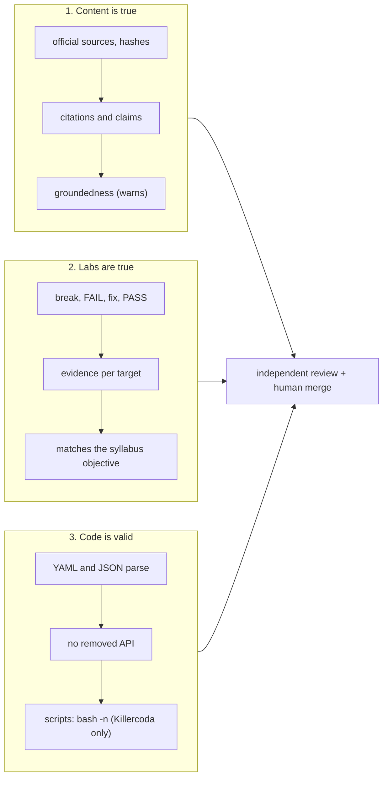
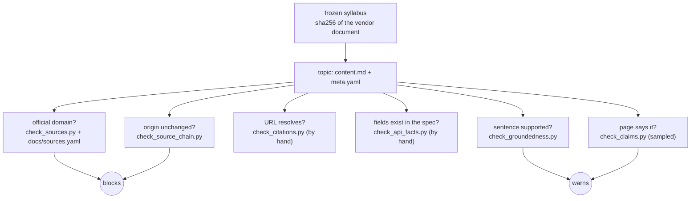
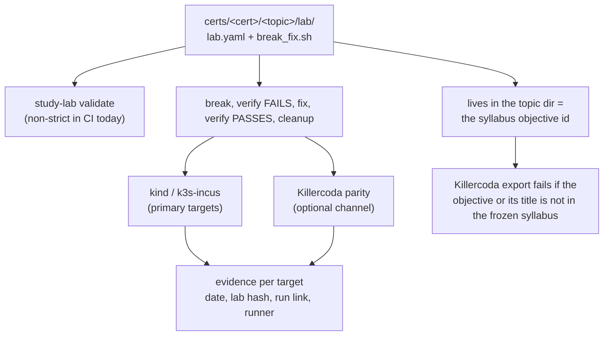
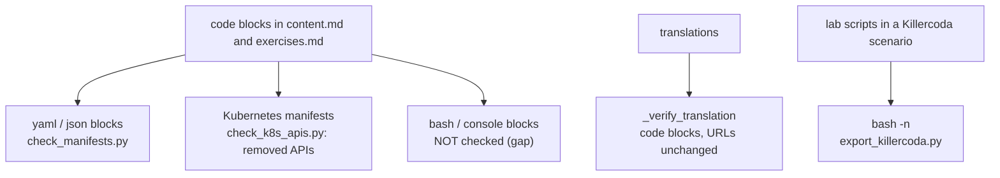

# Guardrails: what is checked, what blocks, and what is only a convention

The material is written by AI, so the project says plainly what makes it trustworthy. Quality is three separate questions, and each has
its own checks, its own gaps and its own honest status:

1. **Is the content true?** Official sources are cited and nothing is invented.
2. **Are the labs and exercises true?** They really break and fix, and they belong to the objective they sit in.
3. **Is the code valid?** Every command, manifest and script is syntactically sound.

"Blocks" means the pull request cannot merge while the check is red (the required checks are `verify`, `e2e` and `pr-format`).
"Warns" means it is reported and a person decides. "Convention" means it is a rule with no automatic check yet. How the flows fit
together is in [HOW-IT-WORKS](HOW-IT-WORKS.md); the short answers are in the [FAQ](FAQ.md); the reasoning is in
[PRINCIPLES](PRINCIPLES.md) and the audit in [AUDITOR_DESIGN](AUDITOR_DESIGN.md). This page does not repeat them.

## 1. The content is true

**Guarantee:** every topic cites the official documentation of its project and says where it comes from; what cannot be backed by a
source is not written.

| Check | What it establishes | Path | Today |
| :--- | :--- | :--- | :--- |
| Syllabus is frozen and hashed | the syllabus covers the exam's objectives, not only its table of contents, and a change is visible | `catalog.yaml`, `scripts/check_syllabus.py`, `scripts/curriculum_diff.py` | **blocks** (`make verify-ci`: `check_syllabus.py` and `tests/test_curriculum_diff.py`; `curriculum_diff.py` itself runs by hand) |
| Citations come from an official project | the domain belongs to a catalogued project | `scripts/check_sources.py`, `docs/sources.yaml` | **blocks** |
| The chain syllabus, content, labs, translations declares its origin | nothing drifted from its source unnoticed | `scripts/check_source_chain.py` | **blocks** |
| Curriculum citations are consistent | every citation names the tracked version and the pinned objectives document, one value per certification | `scripts/check_curriculum_consistency.py` | **blocks** (`make verify-ci`) |
| Provenance is complete | model, date, sources and edits are recorded | `scripts/check_provenance.py` | **blocks** |
| Cited URLs resolve | no invented documentation URL | `scripts/check_citations.py` | by hand: network check, not in CI (flaky third-party sites) |
| Field names match the project's own spec | no invented API field | `scripts/check_api_facts.py` | by hand, not in CI |
| The cited page says what the text claims | the source supports the claim | `scripts/check_claims.py` | sampling, costs a model completion per citation, not in CI |
| Each sentence is supported by its sources | a number, list or output the source does not say | `scripts/check_groundedness.py`, `.github/workflows/groundedness.yml`, `groundedness.yaml` | **warns** (`mode: warn`) |
| The explanation is true | nothing | | **convention** plus review: no check exists |

**Known gaps**
- Groundedness only warns; moving it to block needs a measured baseline ([#41](https://github.com/villadalmine/study-cybercirujas/issues/41)).
- Validating that every cited source is reachable, official and pinned, in CI and not by hand: [#208](https://github.com/villadalmine/study-cybercirujas/issues/208).
- A library of official sources that a model can query to verify claims: [#209](https://github.com/villadalmine/study-cybercirujas/issues/209).
- A confident, well-cited, wrong explanation passes every check ([AUDITOR_DESIGN](AUDITOR_DESIGN.md)). That is why review and the "AI-generated" notice exist.

## 2. Labs and exercises are true

**Guarantee:** a lab really breaks something, its check fails while broken and passes once fixed, and it sits in the topic whose
syllabus objective it teaches.

| Check | What it establishes | Path | Today |
| :--- | :--- | :--- | :--- |
| The lab declares break, verify and cleanup | it can be judged | `teach/lab/spec.py` (`study-lab validate`), `.github/workflows/labs.yml` | **warns**: runs on PRs that touch labs or the runner (`teach/lab/**`, `certs/**/lab/**`, `deploy/study-lab/**`, `tests/lab/**`), not a required check, and non-strict (only some labs have the full contract) |
| The cycle runs for real | break, FAIL, fix, PASS in a container or kind | `teach/lab/runner.py`, `labs.yml` | **warns**: runs on PRs that touch labs or the runner (`teach/lab/**`, `certs/**/lab/**`, `deploy/study-lab/**`, `tests/lab/**`), not a required check, and does not run verify then fix on every lab |
| Proven on a Killercoda-like VM | the same cycle on the generated scenario | `.github/workflows/killercoda-parity.yml`, `teach/lab/kc_test.py` | never fails a PR (optional channel) |
| Only a proven scenario is published | a passing `tested.json` and a `killercoda-*` entry in the evidence file for the lab's current hash; a forged `tested.json` is refused | `.github/workflows/killercoda-publish.yml`, `teach/lab/export_killercoda.py`, `deploy/killercoda/publish.sh` | **blocks the publish** |
| Evidence says where it was proven | per target (`kind`, `k3s-incus`, a Killercoda target): a blank means "not tested there", never "broken" | `deploy/lab-targets.yaml`, `deploy/lab-evidence.yaml`, `teach/lab/kc_scope.py`, [RUN-A-LAB-ANYWHERE](RUN-A-LAB-ANYWHERE.md), [#103](https://github.com/villadalmine/study-cybercirujas/issues/103) | **blocks** (tests) on an unknown target or a malformed entry; **warns** on stale evidence (`killercoda.yml`). The 1.37 upgrade records its `kind` and `k3s-incus` proofs per target with logs in `docs/upgrades/`; CI does not produce them yet |
| The lab belongs to its syllabus objective | the objective id and exact title exist in the frozen syllabus | `teach/lab/kc_meta.py` (`syllabus()`), `teach/lab/spec.py` (`derived_from`) | **blocks the Killercoda export**; for the lab content itself, **convention** plus review |
| A person ran it on Killercoda | a dated observation, tied to the lab hash it was run for | `deploy/killercoda/human_tested.yaml` | recorded, not required; stale once the lab changes |

The labs are grouped in tiers ([RFC #210](https://github.com/villadalmine/study-cybercirujas/issues/210)): **A**, real break/fix
labs proven on our own infrastructure (Kubernetes, Linux); **B**, cloud certifications, code-only (linters, `terraform validate` and
plan, Terraform with LocalStack); **C**, theory only. Killercoda is an optional publishing channel, never required and never blocking.

**Known gaps**
- `scripts/quality_score.py` gives the lab check full credit for a self-declared `verified: true`; it should count only evidence with a run link and the lab hash: [#217](https://github.com/villadalmine/study-cybercirujas/issues/217).
- `labs.yml` validates non-strict (only 229 of 549 labs have the full contract, [#46](https://github.com/villadalmine/study-cybercirujas/issues/46)) and the CI end-to-end does not run verify then fix on each lab: [#218](https://github.com/villadalmine/study-cybercirujas/issues/218).
- 48 of 51 CKA and CKAD labs have no reference fix, so they cannot be proven on Killercoda: [#98](https://github.com/villadalmine/study-cybercirujas/issues/98).
- Per-target evidence for tier A (`kind`, `k3s-incus`) is recorded by hand or by the upgrade work, not yet produced by CI: [#103](https://github.com/villadalmine/study-cybercirujas/issues/103), [#210](https://github.com/villadalmine/study-cybercirujas/issues/210).

## 3. Code and syntax are valid

**Guarantee:** a command, manifest or script in the material does not fail because of its syntax, and does not teach an API that
was removed.

| Check | What it establishes | Path | Today |
| :--- | :--- | :--- | :--- |
| YAML and JSON blocks parse | the student can copy a manifest that parses | `scripts/check_manifests.py` | **blocks** (`make verify-ci`) |
| No removed Kubernetes API is taught | no removed or deprecated core Kubernetes API (for example `extensions/v1beta1` Ingress) in the material | `scripts/check_k8s_apis.py` | **blocks** |
| A translation keeps the code | code blocks, URLs, headings and length are kept from the source | `teach/core/generator.py` (`_verify_translation`) | **blocks** the translation from being saved |
| Lab scripts in a Killercoda scenario parse | `bash -n` on every script and a shebang | `teach/lab/export_killercoda.py` | **blocks** the export |
| `bash` and `console` blocks in the material | nothing | | **gap** |
| Manifests validate against the real schema | nothing (`kubeconform` or `kubectl --dry-run=client` is not used) | | **gap** |
| Shell scripts of the labs are linted | nothing (`shellcheck` is not used) | | **gap** |

**Known gaps** (one issue, [#207](https://github.com/villadalmine/study-cybercirujas/issues/207)): syntax-check every command and
code block in the material, deterministically and locally. The material has thousands of `bash` and `console` blocks that no check
reads; the same issue covers the schema validation of manifests and linting of lab scripts, so there is one place to track them.

## How the three fit together

The three dimensions are independent: a topic can cite perfect sources and teach a broken command, and a lab can be valid and
unrelated to its objective. So each has its own checks and none stands in for another. Independent review (a second model, then a
person) is the layer for what no check reaches, and the [charter](CHARTER.md)
says which rules never bend. Anything that is only a convention above is listed so that it can become a check.
