# How it works

This page explains the system from the big picture down to the scripts. Read the levels in order and stop when you have enough.
What is checked, and what only a convention, is in [GUARDRAILS](GUARDRAILS.md). Questions with short answers are in the [FAQ](FAQ.md); the rules that never change are in the [charter](CHARTER.md). This page
does not repeat the FAQ: it shows the shape, and the FAQ links go to the details.

- [Level 0: the whole thing in one picture](#level-0-the-whole-thing-in-one-picture)
- [Level 1: the five flows](#level-1-the-five-flows)
- [Level 2: each flow, with the scripts and what blocks](#level-2-each-flow-with-the-scripts-and-what-blocks)
- [Glossary](#glossary)
- [Where we are now](#where-we-are-now)

## Level 0: the whole thing in one picture

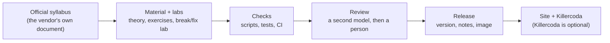

Everything starts from the vendor's official syllabus, frozen in git with a hash. From each objective an AI drafts the material and a
lab that breaks something on purpose. Scripts check what a script can check, a second model reviews every pull request, and a person
merges. A release packages what was merged; the site is built from it, and labs can also be published to Killercoda, a hosted lab
service, as an optional extra.

## Level 1: the five flows

### 1. Content generation

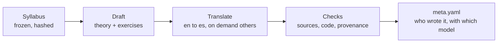

The syllabus is snapshotted once per certification. A model drafts each topic in English, then translations reuse that text instead
of rewriting it. Every topic carries a `meta.yaml` that says which model wrote it and from which sources, so any claim can be traced.
Nothing is published until the checks pass.

### 2. Labs

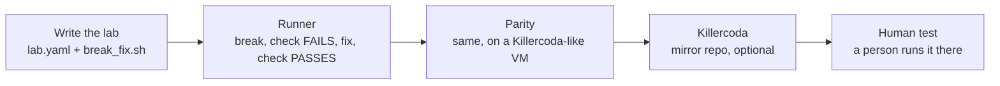

A lab is a folder with a script that has three modes: break, verify and cleanup. It is proven by running the cycle for real: break
something, see the check fail, fix it, see the check pass. The same lab is proven on a Killercoda-like environment before it is
published there. Killercoda is an optional channel: a lab that is not proven there stays in the repo and still runs locally. The
labs are grouped in three tiers ([RFC #210](https://github.com/villadalmine/study-cybercirujas/issues/210)): A, real break/fix labs
proven on our own infrastructure (Kubernetes and Linux); B, cloud certifications, code-only (linters, validate and plan); C,
theory only.

### 3. Pull request lifecycle

The rules of the flow, the milestones and every label are in [ISSUE-TO-RELEASE](ISSUE-TO-RELEASE.md).

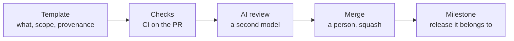

Every change is a pull request with a template that asks for the scope, who or what wrote it, and where it ran. CI checks it, a
second model (not the author) reviews it and leaves findings, and the maintainer (or the maintainer's session, under fixed rules) merges. After the merge the pull request is attached
to the open release milestone automatically.

### 4. Release

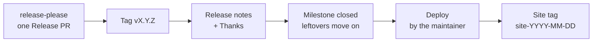

The Release PR is opened and kept up to date by a bot from the titles of merged pull requests. Merging it is the human decision to
release: it creates the tag, the GitHub Release and the image. The human summary and the thanks are added to the release, the
milestone closes, and later the maintainer deploys the site and tags what is live.

### 5. Curriculum upgrade

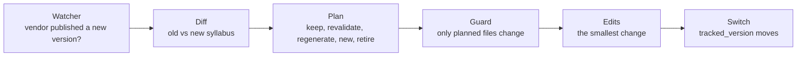

When a vendor publishes a new exam version, a script compares the old and new syllabus and classifies every topic. Most topics
need nothing or a small edit. A guard (run by hand; its logic is unit-tested) refuses edits outside the plan, and only the last pull request moves the version that the site
claims to follow.

## Level 2: each flow, with the scripts and what blocks

"Blocks" means the pull request cannot merge while it is red (the required checks are `verify`, `e2e` and `pr-format`). "Warns"
means it shows up in the job summary or as a red-but-optional job and the person merging decides.

### Content generation, in detail

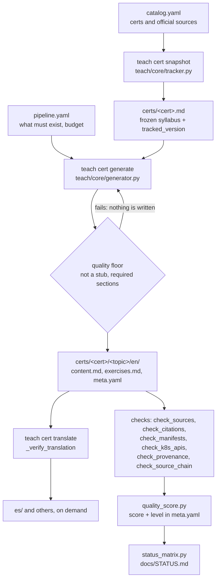

| Step | Script or workflow | Blocks | Warns |
| :--- | :--- | :--- | :--- |
| Quality floor (before writing) | `teach/core/generator.py` | a stub is never saved | |
| Cited sources belong to an official, catalogued project | `scripts/check_sources.py` (`make verify-ci`) | in `verify.yml` | |
| Cited URLs resolve, API facts match the project's spec | `scripts/check_citations.py`, `scripts/check_api_facts.py` | | run by hand (`make verify`): network checks, left out of CI because third-party sites are flaky |
| Embedded YAML parses, no removed Kubernetes API | `scripts/check_manifests.py`, `scripts/check_k8s_apis.py` | in `verify.yml` | |
| Provenance and source chain | `scripts/check_provenance.py`, `scripts/check_source_chain.py` | in `verify.yml` | |
| The score in `meta.yaml` is current | `scripts/quality_score.py --check` | in `verify.yml` | |
| The status page is what the tree gives | `tests/test_determinism.py` (compares `docs/STATUS.md` with `scripts/status_matrix.py`), part of the unit tests `make verify-ci` runs | in `verify.yml` | |
| Curriculum citations name the tracked version and the pinned objectives document | `scripts/check_curriculum_consistency.py` (`make verify-ci`) | in `verify.yml` | |
| Does the cited page say what the text claims | `scripts/check_claims.py` | | not in CI: sampling, costs a model completion per citation |
| Is each sentence supported by its sources | `scripts/check_groundedness.py` (`groundedness.yml`) | | `mode: warn`, not required |
| Is the explanation true | no check | | the gap; see [GUARDRAILS](GUARDRAILS.md) and [AUDITOR_DESIGN](AUDITOR_DESIGN.md) |

### Labs, in detail

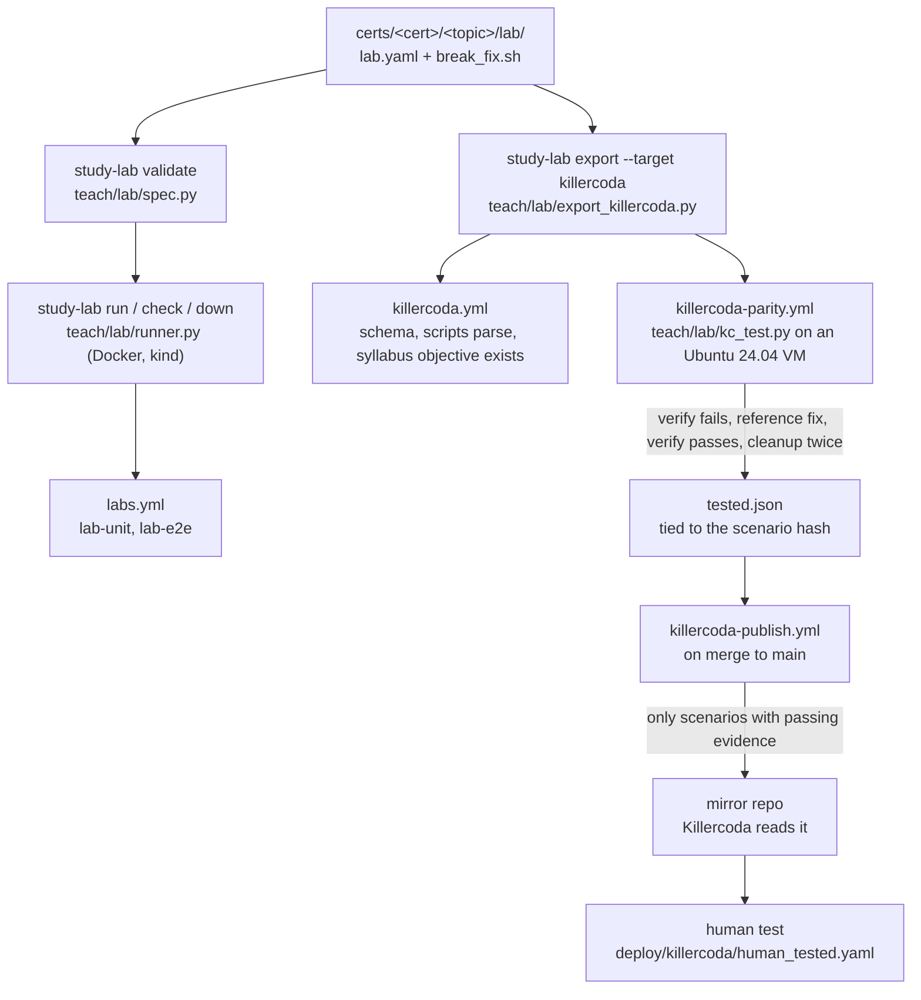

| Step | Script or workflow | Blocks | Warns |
| :--- | :--- | :--- | :--- |
| Lab files are valid, all three modes exist | `study-lab validate` (`labs.yml`) | | runs on PRs that touch labs or the runner (`teach/lab/**`, `certs/**/lab/**`, `deploy/study-lab/**`, `tests/lab/**`), not a required check; non-strict today: only some labs have the full contract |
| The cycle runs for real (Docker, kind) | `labs.yml` (`lab-e2e`) | | runs on PRs that touch labs or the runner (`teach/lab/**`, `certs/**/lab/**`, `deploy/study-lab/**`, `tests/lab/**`), not a required check; it does not run verify then fix on every lab ([#218](https://github.com/villadalmine/study-cybercirujas/issues/218)) |
| The generated Killercoda scenario is well formed | `killercoda.yml` (`--check`) | | optional channel |
| Break, FAIL, fix, PASS on a Killercoda-like VM | `killercoda-parity.yml` | | never fails a PR (optional channel) |
| Only proven scenarios reach the mirror | `killercoda-publish.yml` + `deploy/killercoda/publish.sh` | nothing without a passing `tested.json` and a `killercoda-*` entry in `deploy/lab-evidence.yaml` for the lab's current hash (targets: `deploy/lab-targets.yaml`) | a skipped lab is a warning |
| Evidence for a lab that has changed since | `python -m teach.lab.kc_scope` (`killercoda.yml`) | | one warning per stale entry; it never fails |
| A person ran it on Killercoda | `deploy/killercoda/human_tested.yaml` | | shown in the scenario banner |

### Pull request lifecycle, in detail

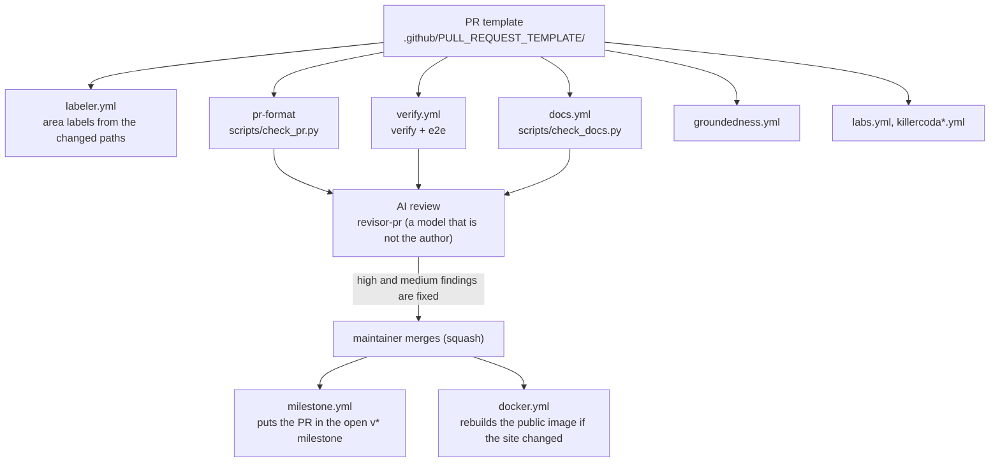

| Step | Script or workflow | Blocks | Warns |
| :--- | :--- | :--- | :--- |
| Description has every section, scope, provenance, DCO sign-off, a green run linked | `scripts/check_pr.py` (`pr-format`) | yes | |
| Unit tests, offline smoke, determinism, quality | `verify.yml` (`verify`, `e2e`) | yes | |
| Docs links, anchors, paths and generated files are current | `scripts/check_docs.py` (`docs.yml`) | | runs on PRs, not a required check; a stale code graph is only a warning |
| Groundedness of the topics the PR changes | `groundedness.yml` | | `mode: warn` ([#41](https://github.com/villadalmine/study-cybercirujas/issues/41)) |
| An independent review with findings in a ledger | `revisor-pr`, [REVIEWS.md](REVIEWS.md) | high and medium findings | low findings go to an umbrella issue |
| Merge | the maintainer, or the maintainer's session under the charter's rules (no blocking findings, green CI, merge pinned to the reviewed head); never the author | the maintainer-controlled merge | |

### Release, in detail

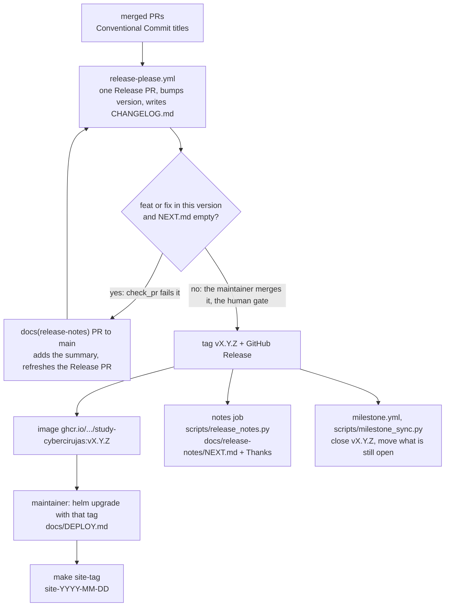

| Step | Script or workflow | Blocks | Warns |
| :--- | :--- | :--- | :--- |
| Nobody edits the changelog or version by hand | `scripts/check_pr.py` | yes (except the bot PRs) | |
| The Release PR passes the same required checks | `release-please.yml` (GitHub App token) | yes | |
| A release with a `feat` or a `fix` has its human summary in NEXT.md | `scripts/check_pr.py` (`release_notes_ready`) | yes, on the Release PR | |
| Release notes and Thanks | `release_notes.py publish` | | a failure leaves the changelog-only release; re-run |
| The release milestone is settled from what shipped (patches too) | `milestone.yml`, `scripts/milestone_sync.py` | | a PR without `Closes`/`Part of` gets a warning |
| Deploy and site tag | `docs/DEPLOY.md`, `make site-tag` | no PR deploys production | |

### Curriculum upgrade, in detail

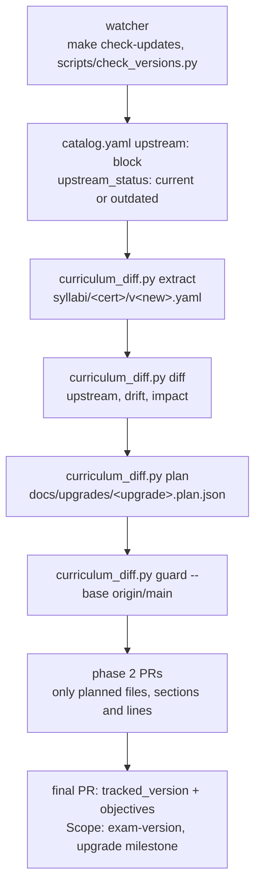

| Step | Script or workflow | Blocks | Warns |
| :--- | :--- | :--- | :--- |
| The vendor document is frozen with its hash | `scripts/curriculum_diff.py extract` | refuses a tree with no domains or weights not summing to 100 | |
| The committed plan and report are what their inputs produce | `tests/test_curriculum_diff.py`, run by `make verify-ci` | in `verify.yml` | |
| An upgrade PR changes only planned files | `curriculum_diff.py guard --base origin/main` | | run by hand; its logic is unit-tested, but no workflow runs it on each PR |
| The version bump touches only the lines the plan lists | `scripts/upgrade_versions.py` | | a scripted edit, checked with `--check`; by hand |
| The version the site follows moves once | `scripts/check_pr.py` (Scope: exam-version, only the milestone's final PR) | yes | |
| The detail and the v1.37 case | [upgrades/README.md](upgrades/README.md) | | |

## Glossary

| Term | Meaning |
| :--- | :--- |
| **tracked_version** | The exam version the material follows, in `catalog.yaml`. It moves only in an upgrade's final pull request. |
| **upstream** | What the vendor publishes now. `upstream_status` says if our tracked version is `current` or `outdated` against it. |
| **frozen syllabus** | `certs/<cert>.md`: the official objectives snapshotted into git with a hash, so material can be checked against a fixed text. |
| **scope label** | The size of a change on the PR template: `small`, `medium`, `large` or `exam-version`. `exam-version` is only for an upgrade milestone's final PR. |
| **provenance** | Who wrote a thing: author, tool, model, date, sources, human edits. Kept in `meta.yaml` per topic and in the PR. |
| **verified** | A lab marked as having run its cycle (break, FAIL, fix, PASS). It is a claim in `lab.yaml`; the proof is the per-target evidence. |
| **human_tested** | A person ran the published scenario on Killercoda and it behaved; recorded with their GitHub login and the date. |
| **parity** | How close the CI machine is to the real Killercoda environment: `measured` when its versions were read from a probe run on Killercoda, `partially-measured` when some are assumed. |
| **evidence / target** | A proof of a lab, with the place it ran (`kind`, `k3s-incus`, a Killercoda target), the date and the lab hash. No entry means "not tested there", never "broken". |
| **tested / loaded-untested** | A lab with Killercoda evidence is `tested`; one without it is `loaded-untested`: it stays in the repo and is never pushed to the Killercoda mirror. |
| **tier A, B, C** | Labs by what can be proven: A real break/fix on our infra, B code-only for clouds, C theory only ([#210](https://github.com/villadalmine/study-cybercirujas/issues/210)). |
| **umbrella issue** | One issue that collects many small findings or tasks (low review findings, an epic's children) so none is lost and none needs its own PR. |
| **epic** | A long-lived umbrella: #124 docs, #166 quality, #167 labs. |
| **milestone** | A release plan: `vX.Y.0` is the next release; `<CERT> <version> upgrade` is a curriculum upgrade. |
| **Release PR** | The one pull request release-please keeps open; merging it releases. |
| **site tag** | `site-YYYY-MM-DD`: marks the commit that is live at study.cybercirujas.club. |
| **groundedness** | A check that each sentence is supported by the sources the topic cites. It warns today; it does not block. |
| **DCO** | The `Signed-off-by` line on every commit (`git commit -s`). |

## Where we are now

The work in flight is organised in [milestones](https://github.com/villadalmine/study-cybercirujas/milestones) and the epics above.
What changed in each release: [CHANGELOG](../CHANGELOG.md) and the [releases page](https://github.com/villadalmine/study-cybercirujas/releases).
Completeness per language: [STATUS](STATUS.md). What is next and why: [ROADMAP](ROADMAP.md).
