# From issue to release

How work flows through the repository: who does what, in which order, and which label or milestone says where a thing is.
[CONTRIBUTING](../CONTRIBUTING.md) is the how-to-contribute (set up, conventions, templates, DCO); this page is the how-it-flows
and does not repeat it. The content pipeline (syllabus, drafting, translation) is [WORKFLOW](WORKFLOW.md); the picture of every
flow is [HOW-IT-WORKS](HOW-IT-WORKS.md).

```mermaid
flowchart LR
    I["Issue<br/>form + labels"] --> P["One small PR<br/>off main, Closes or Part of #N"]
    P --> C["Checks<br/>make pr-check, then CI"]
    C --> R["One independent review<br/>highs and mediums block"]
    R --> M["Squash merge<br/>maintainer-controlled"]
    M --> MS["Milestone<br/>milestone.yml"]
    MS --> RP["Release PR<br/>release-please"]
    RP --> T["Tag + notes + changelog"]
    T --> D["Deploy<br/>by the maintainer"]
    D --> S["Site tag<br/>site-YYYY-MM-DD"]
```

## The rules of the flow

1. **One issue at a time**, chosen by the audit's priority ranking (the weight of the [charter](CHARTER.md) rules each one serves). At most **two workstreams** are open at once (the WIP limit): finish and merge before starting a third.
2. **One small PR per issue**, always off `main` and never stacked on another PR. If it is over the size limit, the issue is
   too big: split the issue. The PR says `Closes #N` (it finishes the issue) or `Part of #N` (it moves an epic or umbrella).
3. **`make pr-check` before pushing**; the PR then links the green CI run on its head commit.
4. **One independent review** by a model that is not the author. High and medium findings block the merge and are fixed in the
   PR; low findings go to the area's umbrella issue (`Follow-ups: ...`) with `from-review` and a `severity:` label, not to new PRs.
5. **Squash merge, controlled by the maintainer.** The PR title becomes the one commit on `main`, so it is a Conventional Commit. Merges are done by the maintainer, or by the maintainer's session under the charter's rules (no blocking findings, green CI, the merge pinned to the reviewed head commit); the author of a change never merges it.
6. **The milestone is automatic**: `milestone.yml` (`scripts/milestone_sync.py`) puts a merged PR, and an issue closed as completed, in the
   open `v*` milestone due first. **release-please** keeps the Release PR; merging it is the human release decision, and it makes the
   tag, the changelog and the notes.
7. **Labels are code** (`.github/labels.yml`): CI sets `scope:*`, `site:*`, `type:` by path and `lang:`; exception labels are set only
   by the maintainer; `triage:needed` marks something from outside the project that nobody has looked at yet.

## Milestones

| Milestone | What it is | Rule |
| :--- | :--- | :--- |
| `vX.Y.0` (with a due date) | the planning unit of a release | the Release PR is what actually happened; the milestone of a release, patches included, is created or completed at release time from what shipped, what is still open moves to the next `v*` milestone and `vX.Y.0` closes |
| `<CERT> <version> upgrade` | one curriculum upgrade (for example CKA and CKAD v1.37) | separate from the releases; `scripts/check_pr.py` reads it by name, and only its final PR may be `Scope: exam-version` |
| none | epics and umbrellas (#124 docs, #166 quality, #167 labs, the `Follow-ups: ...` issues) | they are long-lived; they have no milestone and the stale workflow never touches them |

## Review and exceptions

- The review leaves findings with a severity in the PR's ledger (`docs/REVIEWS.md`); a finding is fixed, rejected with a reason, or
  moved to the umbrella.
- `size-exception` (more than 400 changed lines of code) and `scope-exception` (several topics or labs, or material and code in one PR)
  are the maintainer's waivers. They are fine for a mechanical or generated change that cannot be split (a move, a rename, a
  regeneration) and not for convenience. Nobody else sets them, and `scripts/check_pr.py` never does.
- Changes to `.github/`, the `Makefile` and `scripts/check_*` are the maintainer's decision alone.

## Someone from outside the project

Their issue or PR carries `triage:needed` from the moment it is opened. A maintainer replies within 3 working days and does one of
four things: accepts it (sets `type:`, `area:`, `priority:`, a milestone if it enters a release), asks for what is missing
(`triage:needs-info`, 14 days), redirects it (a question to Discussions, a rule change to an RFC, an exam-version change to its
upgrade milestone), or closes it with the reason. Outside PRs are triaged security-first. The response times, credit and the stale
rules are in [CONTRIBUTING](../CONTRIBUTING.md#triage-and-response-times).

## Every label, who sets it

This table is checked against `.github/labels.yml` by `tests/test_issue_to_release_doc.py`: a label added or removed there without
this page fails CI. To change a label, edit that file (the *Sync labels* workflow applies it).

| Label | Meaning | Who sets it |
| :--- | :--- | :--- |
| `type:bug` | Something is broken | the issue form or a maintainer |
| `type:feature` | New capability or improvement | the issue form or a maintainer |
| `type:content` | Topic content, exercises or translation | CI, by path (`.github/labeler.yml`) |
| `type:lab` | A lab under certs/*/lab | CI, by path |
| `type:video` | Video material | CI, by path |
| `type:docs` | Documentation only | CI, by path |
| `type:code` | teach/, scripts/, tests/, deploy/ | CI, by path |
| `type:ci` | CI: .github/ and checks | CI, by path |
| `type:question` | Support question: answer, then close or move to Discussions | the issue form or a maintainer |
| `type:rfc` | Proposal that changes how the project works (GOVERNANCE) | the issue form or a maintainer |
| `area:cncf` | Kubernetes / CNCF certifications | a maintainer |
| `area:linux` | Linux / LPI / LF certifications | a maintainer |
| `area:cloud` | AWS, Azure, Google, Terraform certifications | a maintainer |
| `area:ai` | AI certifications and AI-backend generation | a maintainer |
| `area:site` | teach app, API, deploy, image | a maintainer |
| `area:labs-infra` | Lab runners, exporters, Killercoda, spec (not a lab's content) | a maintainer |
| `area:quality` | Quality score, groundedness, graph, provenance | a maintainer |
| `priority:high` | Broken main, security, data loss, blocks the next release | a maintainer |
| `priority:medium` | Planned for the next release | a maintainer |
| `priority:low` | Backlog; welcome from contributors | a maintainer |
| `severity:high` | Severity of a review finding (only with from-review) | the reviewer |
| `severity:medium` | Severity of a review finding (only with from-review) | the reviewer |
| `severity:low` | Severity of a review finding (only with from-review) | the reviewer |
| `from-review` | Follow-up found by a code review | the reviewer |
| `scope:small` | Change scope (deterministic, see change_rules.yaml) | CI (`scripts/check_pr.py`), never by hand |
| `scope:medium` | Change scope (deterministic, see change_rules.yaml) | CI, never by hand |
| `scope:large` | Change scope (deterministic, see change_rules.yaml) | CI, never by hand |
| `scope:exam-version` | Change scope (deterministic, see change_rules.yaml) | CI, never by hand |
| `size-exception` | Maintainer waiver: more than 400 changed lines of code (CONTRIBUTING) | the maintainer only |
| `scope-exception` | Maintainer waiver: several topics/labs, or material + code (CONTRIBUTING) | the maintainer only |
| `site:none` | Set by scripts/check_pr.py from the changed files: no image rebuild | CI (`scripts/check_pr.py`), never by hand |
| `site:image-rebuild` | Set by scripts/check_pr.py from the changed files: image rebuild | CI, never by hand |
| `lang:en` | Language of the changed material | CI, by path |
| `lang:es` | Language of the changed material | CI, by path |
| `lang:other` | Language of the changed material | CI, by path |
| `triage:needed` | Not looked at by a maintainer yet | the issue forms and `triage.yml`; a maintainer removes it |
| `triage:needs-info` | Waiting for the author (14 days) | a maintainer |
| `status:blocked` | Waiting on something external; link it in a comment | a maintainer |
| `lifecycle:stale` | No activity; will close unless someone answers | the stale workflow (`stale.yml`) |
| `lifecycle:frozen` | Never marked stale | a maintainer |
| `good first issue` | Small, explained, tests ready; a maintainer will mentor | a maintainer |
| `help wanted` | Agreed work where outside help is welcome | a maintainer |
| `duplicate` | Already tracked (link it) | a maintainer |
| `autorelease: pending` | release-please: its open Release PR (do not set by hand; it finds the PR by this label) | release-please, never by hand |
| `autorelease: tagged` | release-please: a merged Release PR that already has its tag (do not set by hand) | release-please, never by hand |
