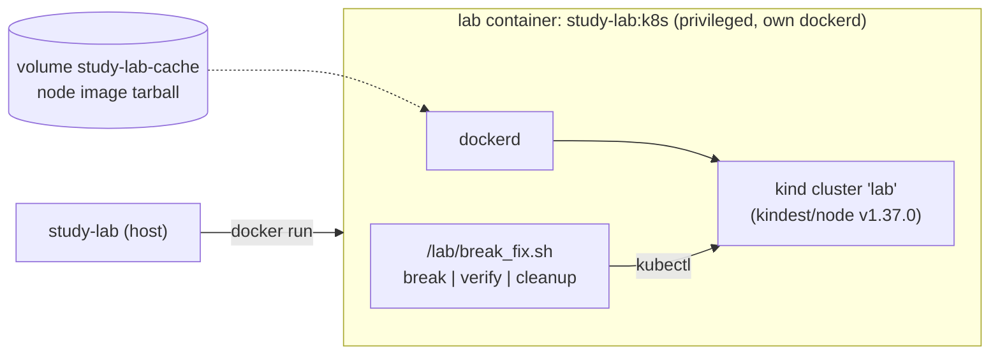

# study-lab — break/fix labs in a throwaway container

`study-lab` runs any study lab with one command, entirely inside a container:
it brings up the environment the lab needs (a kind cluster, or a Debian with
systemd), runs the lab's `break`, lets you fix it, checks your fix with the
lab's `verify`, and removes everything with `down`. Nothing runs on your host
except `docker` (and `git clone` for labs from other repositories). Nothing of
this touches the website.

Status (2026-10-15): prototype. Pilot on CKA 1.1, 3.3, 3.4 and 3.5, all four
**verified** in the runner (break -> check FAIL -> reference fix -> check PASS).

## Quick start

```bash
make install                        # or: pip install --require-hashes -r requirements.lock && pip install --no-deps -e .
make lab-images                     # builds study-lab:k8s and study-lab:linux (once)

study-lab run cka 1.1               # environment + break (idempotent: run it again, nothing changes)
study-lab shell cka 1.1             # a shell inside, kubectl pointing at the lab cluster
study-lab hint cka 1.1 -n 2         # progressive hints from lab.yaml
study-lab check cka 1.1             # runs verify: FAIL until you fix it, then PASS
study-lab down cka 1.1              # runs cleanup and removes the container (and its inner dockerd/kind)
```

Without installing the package: `scripts/study-lab ...` (needs python3, PyYAML, jsonschema).

| Command | What it does |
| :--- | :--- |
| `run <cert> <topic>` | curated lab from `certs/<cert>/<topic>/lab/` |
| `run --from <git-url> <path>` | lab from any repository that follows the template (shallow clone in `~/.cache/study-lab/repos`) |
| `run ./folder` | lab from a local folder |
| `shell`, `exec <target> -- <cmd>` | interactive shell, or one command, inside the lab |
| `check` | the lab's verify; exit 0 = solved, 1 = not yet |
| `down [--purge-cache]` | cleanup + `docker rm -f -v`; `--purge-cache` also drops the node-image cache volume |
| `hint` | hints from `lab.yaml` |
| `list [cert]` | running labs, or the labs of a certification with their contract (`BVC`) and verified state |
| `validate <path> [--strict] [--report f.json]` | schema + contract, one lab or a whole tree |
| `migrate <path> [--write]` | prints (or writes) the v2 version of a v1 `lab.yaml` |
| `new <dir> --cert --topic --title [--requires kind\|linux]` | scaffolds a lab that already passes `validate --strict` |
| `build k8s\|linux` | builds a runner image locally |

Every `run` prints where the lab comes from (**curated**, **external repo** with
URL and commit, or **local folder**) and warns when it is **not verified**.

## How it works



- **One container per lab** (`study-lab-<cert>-<topic>`, labelled `study-lab=1`).
  Labs from other repos and local folders get a prefix with a hash of their
  source, so they never collide with the curated one.
- **kind labs** use Docker-in-Docker: the kind cluster lives in the lab
  container's own dockerd, never in the host's. That needs `--privileged`
  (kind nodes run systemd and containerd), but the alternative — mounting the
  host's docker socket — would give every break script root on the host
  daemon. `down` (`docker rm -f -v`) takes the inner dockerd, kind and its
  anonymous volume with it.
- **linux labs** run Debian 12 with systemd as PID 1, **without** `--privileged`:
  private cgroup namespace made writable with `--security-opt writable-cgroups=true`
  (tested on Docker 29.8), tmpfs on `/run`.
- **Node image cache**: the first kind run pulls `kindest/node` by digest and
  saves it to the `study-lab-cache` volume; later runs `docker load` it. The
  volume is the only thing `down` keeps; `down --purge-cache` removes it.
- **Idempotent**: `run` compares a hash of the lab directory + image with the
  running container's label. Same hash and already broken -> nothing to do;
  different or stopped -> the container is recreated. `down` twice is a no-op.

### Measured (WSL2 Ubuntu 24.04 on the workstation, Docker 29.8, 2026-10-15)

| | Time | RAM of the lab container |
| :--- | ---: | ---: |
| `run cka 1.1`, first time (node image pulled by digest and cached) | 123–126 s | 1.30 GiB |
| `run cka 1.1`, cached node image | 62–69 s | 0.72 GiB |
| `run cka 3.3` (installs metrics-server from the internet) | 135 s | 1.04 GiB |
| `run cka 3.4` / `3.5` | 98 s / 81 s | 0.94 / 0.82 GiB |
| second `run` of the same lab (idempotent no-op) | 0.5 s | — |
| `check` | 0.6 s (1.1) | — |
| `down` | 12–49 s | — |
| linux e2e (template lab, run + check x2 + fix + down) | ~4 s | < 100 MiB |
| `validate certs` (548 labs, from /mnt/c) | 69 s | — |

The limit per kind lab is 3 GiB (`limits.ram_mb`), 2 CPUs.

## The template: `lab.yaml` v2 + `break | verify | cleanup`

A lab is a folder with `lab.yaml` and a script. The contract:

| Mode | Must |
| :--- | :--- |
| `break` | leave the environment broken on purpose and print the symptom |
| `verify` | exit 0 **only** when solved (or print a line matched by `modes.verify.success.output_regex`) |
| `cleanup` | remove what `break` created; idempotent |

Schema: [`teach/lab/schema/lab.v2.schema.json`](../teach/lab/schema/lab.v2.schema.json)
(JSON Schema 2020-12). v2 is a strict superset of v1: a file without
`schema_version` is v1 and validates unchanged; the runner infers the rest.

```yaml
schema_version: 2
cert: cka
topic: '1.1'                 # always a string
title: Implement storage classes and dynamic volume provisioning
requires: kind               # kind | k3s | linux  -> picks study-lab:k8s or study-lab:linux
kubernetes: '1.37'           # optional: kind node version (1.34-1.37 with kind v0.33.0; any other minor fails, never falls back)
nodes: 0                     # optional: kind workers
script: break_fix.sh
run_in: runner               # runner (kubectl from the lab container) | node (inside the kind control plane)
run_as: root                 # root | student
modes:                       # map the contract onto the script's own verbs
  break:   {args: [break]}
  verify:  {args: [check], success: {output_regex: 'TODO RESUELTO'}}
  cleanup: {args: [clean], stdin: "y\n"}
env: {FORCE: '1'}            # answers to "is this disposable?" checks
ports: [{container: 8080}]   # published on 127.0.0.1
limits: {ram_mb: 3072, cpus: 2}
timeout: {up: 600, break: 300, verify: 120, cleanup: 300}
hints: ["...", "..."]
goals:                       # what the student has to fix, without the commands
  fix: ["The CPU is busy on an idle box: stop the process for good.", "..."]
  solved: what verify checks, in plain words
level: beginner | intermediate | advanced
origin: {kind: curated | community | generated, repo: ..., author: ..., generated_by: ...}
derived_from: {syllabus: 'certs/cka.md#1.1', content: certs/cka/1.1/en/content.md, content_sha256: <chain hash>}  # labs in certs/: required (scripts/check_source_chain.py)
verified: {status: true, date: '2026-10-15', method: runner | ci | human, by: ..., runner_image: ...}
license: Apache-2.0
safety:                      # only labs that do more than break a throwaway container
  risks: [modifies-host]     # modifies-host | billable-cloud | public-exposure
  warning: >-                # what it changes and where to run it
    Edits /etc/hosts on the machine it runs on. Run it only on a disposable VM.
x-anything: {}               # free extension keys
```

`safety` is shown before the lab runs: `teach lab up` prints it and starts only after
an explicit `yes` (or `STUDY_LAB_ACCEPT_RISKS=yes` for unattended runs; a non-interactive
run without it refuses). The lab's `README.md`, the header of its `break_fix.sh` and the
Killercoda intro repeat the same text (`teach/lab/safety.py`, `tests/test_lab_safety.py`).
Today: AZ-900 2.2 and 2.3 (billable Azure resources, 2.2 with a public IP) and 2.4
(edits `~/.azure`, `/etc/hosts` and a route).

`goals` tells the student what to fix before they start, and what Check looks at. The Killercoda
intro and *Fix it* step render it, and the lab's `README.md` carries the same text
(`teach/lab/goals.py`; `tests/lab/test_export_killercoda.py` fails if they drift).

New behaviour is added here, as metadata, never as runner code: CKA 3.4's
script uses `check`/`clean` and reads `TEACH_PLAT_LAB_CONFIRMED`; CKA 3.5's
`check` always exits 0 — both joined the contract with `modes`, `env` and
`success.output_regex` only.

### State of the 548 curated labs (validate, 2026-10-15)

- **548/548 pass the schema** (v1, unchanged). The only failure of the first
  version of the schema was KCA 3.3, whose real syllabus title is `jp` (a
  Kyverno subcommand): `title` now only needs one character.
- **225/548 offer break + verify + cleanup** (detected from the scripts' verbs);
  207 lack verify and cleanup, 90 lack verify, 26 lack cleanup. Those run, but
  `check` cannot judge them: they need a `verify` mode in the script, or a
  `modes:` mapping in `lab.yaml`. Get the list with
  `study-lab validate certs --report labs.json` (`missing_modes` per lab).
- 297 are `linux`, 251 `kind` (inferred: the script uses `kubectl`). Several
  CKA domain 2 and 4 labs need a kubeadm node (`/etc/kubernetes`, `systemctl
  kubelet`): those are what `run_in: node` is for, still to be proven.
- `study-lab migrate <lab> --write` writes the v2 file with explicit `requires`
  and `modes`; the pilot labs were migrated and completed by hand.

Found and fixed by running the pilot for real:

- `cka/1.1`: the reference solution recreated the StorageClass with
  `volumeBindingMode: Immediate`; kind's local-path provisioner only works with
  `WaitForFirstConsumer` (`configuration error, no node was specified`). The
  solution and a hint now say so.
- `cka/3.4`: `check` compared restart counts while the old Pod was still
  Terminating and reported a correct fix as broken. It now waits for the 3 live Pods.
- The scripts were checked out with CRLF on Windows (`core.autocrlf=true`) and
  bash refused them; `.gitattributes` now forces LF for `*.sh`, and `validate`
  rejects CRLF scripts.

## Create a lab that follows the template

```bash
study-lab new labs/netpol --cert cka-extra --topic 2.3 --title "NetworkPolicy demo" --requires kind
$EDITOR labs/netpol/break_fix.sh          # replace the example scenario
study-lab validate labs/netpol --strict
study-lab run ./labs/netpol && study-lab check ./labs/netpol   # must FAIL
study-lab exec ./labs/netpol -- <your fix> && study-lab check ./labs/netpol   # must PASS
study-lab down ./labs/netpol
```

Then set `verified: {status: true, method: runner, date: ...}`. Scripts must
use LF line endings.

## Run a lab from another repository

```bash
study-lab run --from https://github.com/someone/labs cka-extra/2.3
study-lab check --from https://github.com/someone/labs cka-extra/2.3
study-lab down  --from https://github.com/someone/labs cka-extra/2.3
```

The path may point to the folder with `lab.yaml` or to its parent with a `lab/`
inside. The lab is validated before running, shown as "repo externo" with its
commit, flagged when not verified, and confined to its container like any other.

### Validate your repo in CI (reusable action)

```yaml
# .github/workflows/labs.yml in YOUR repository
on: [push, pull_request]
jobs:
  validate:
    runs-on: ubuntu-latest
    steps:
      - uses: actions/checkout@11d5960a326750d5838078e36cf38b85af677262  # v4.4.0
      - uses: villadalmine/study-cybercirujas/.github/actions/validate-lab@main
        with:
          path: labs          # one lab or a tree
          strict: "true"      # break + verify + cleanup required
```

Static only (schema + contract); it never executes the scripts. This repo runs
the same action on `certs/` in `.github/workflows/labs.yml`.

## Tests

| Flow | Test | Command |
| :--- | :--- | :--- |
| schema: valid v2, invalid cases, v1 compatibility, CRLF, path escape | `tests/lab/test_schema.py` | `make test` |
| migration v1 -> v2 | `test_schema.py::test_migrate_v1_to_v2_validates`, `test_cli.py::test_migrate_write_roundtrip` | `make test` |
| create a lab from the template (`new`) passes `validate --strict` | `test_cli.py::test_new_scaffold_passes_strict_validate` | `make test` |
| `validate` of a tree, JSON report, `--strict` | `test_cli.py::test_validate_*` | `make test` |
| all 548 curated labs pass the schema | `test_cli.py::test_all_curated_labs_pass_the_schema` | `make test` |
| `--from` a git repo (fixture repo, idempotent fetch, no path escape) | `test_cli.py::test_resolve_from_git_repo_is_idempotent`, `test_from_repo_path_cannot_escape` | `make test` |
| run + break, check FAIL, fix, check PASS, run x2 idempotent, down without leftover containers/volumes/networks (linux) | `test_e2e.py::test_linux_lab_from_template` | `make test-e2e` |
| the same, from a git repo | `test_e2e.py::test_linux_lab_from_git_repo` | `make test-e2e` |
| the same, kind family | `test_e2e.py::test_kind_lab_from_template` | `STUDY_LAB_E2E_K8S=1 make test-e2e` |
| pilot CKA labs with their reference fixes | `scripts/prove_labs_cka_pilot.sh` | `TOPICS="1.1 3.3" scripts/prove_labs_cka_pilot.sh` |

CI: `.github/workflows/labs.yml`, jobs `lab-unit` (unit + action on every
push/PR touching labs) and `lab-e2e` (linux always, kind on `workflow_dispatch`).
The `lab-` prefix keeps them apart from `verify.yml`'s `verify` and `e2e`,
which are the ones branch protection and *Where it ran* refer to.

## Pinned versions

`deploy/study-lab/k8s/Dockerfile`: `docker:29.9.0-dind`, kind `v0.33.0`,
kubectl `v1.37.1`, helm `v4.3.0` (all sha256-checked), node
`kindest/node:v1.37.0@sha256:a1ed…` (the v1.37 exam: CKA and CKAD). `deploy/study-lab/linux/Dockerfile`:
`debian:bookworm-20261005`. Bump them together, with the node table in
`teach/lab/runner.py` (`KIND_NODES`, from the kind release notes).

## Other places to run it

`study-lab export --target killercoda` turns the verified labs into Killercoda scenarios, one course per certification. See [RUN-A-LAB-ANYWHERE.md](RUN-A-LAB-ANYWHERE.md).

## Not done yet

- `requires: k3s` (the schema accepts it; the image only implements kind).
- `run_in: node` is wired but not proven with a kubeadm-style lab (CKA 2.x, 4.x).
- Published images (`ghcr.io/...`) and signatures; today `run` builds them locally if missing.
- A machine-readable reference fix per lab (`solution`), so CI can keep `verified` true by itself.
- Bringing the 323 labs without a full contract to `break | verify | cleanup`.
