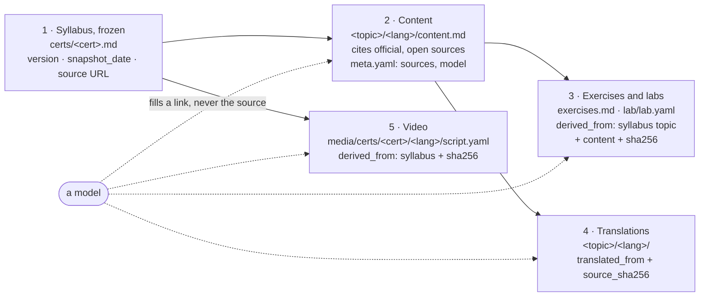

# Principles

> **Knowledge has no owner and no borders. We build it together, for everyone.**
>
> *El conocimiento no tiene dueño ni fronteras. Lo construimos entre todos, para todos.*

Information sovereignty: study material you can read, run, check and rebuild
on your own hardware — with AI or without it.

These are the rules the project holds itself to. Each one is enforced by a
test or a check where it can be; where it cannot, it says so. Changing them
follows [GOVERNANCE.md](../GOVERNANCE.md).

## 1. Information sovereignty

Everything a student needs runs on their own machine, with no account, no
key, no telemetry and no third-party service: the site, the API, the CLI, the
labs, and the material itself as plain markdown under an open licence.

*Enforced by:* `tests/test_smoke.py` and `tests/e2e/clone_and_run.sh` run the
site, the API and the CLI with every external connection blocked
(`tests/netguard/`). The one feature that uses a third party — the study bot,
with the student's own OpenRouter key — is labelled as such and optional.

## 2. Curriculum-as-Code

The curriculum is a repository, and it is treated like software:

| Software | Here |
|---|---|
| source of truth in git | `catalog.yaml`, `certs/<cert>.md` (syllabus snapshotted from the vendor), `certs/<cert>/<topic>/<lang>/*.md` |
| declarative configuration | `pipeline.yaml` — which certifications and languages must exist, the quality floor, the budget |
| tests and linters | the check ladder (`make verify-ci`): quality floor, citations, manifests, Kubernetes APIs, provenance, lab contract |
| build metadata | `meta.yaml` per topic: model, date, official sources |
| build artefacts | the site, the API, the Docker image, STATUS.md, the README table — all derived, never hand-kept |
| CI | `.github/workflows/verify.yml` runs the same targets a contributor runs |

Inputs are public and attributable: the corpus is derived from the public
official syllabi and documentation it cites, never from leaked exam questions
(*braindumps*) or material under NDA — such contributions are refused
([CONTRIBUTING → No braindumps, no NDA material](../CONTRIBUTING.md#no-braindumps)).

## 3. Determinism

Everything that is *used* — serving, studying, validating, running a lab —
gives the same result every time and needs no model. The same tree produces
the same bytes.

*Enforced by:* `make determinism` (`tests/test_determinism.py`) derives
STATUS.md, MODELS.md, the README and API tables and the API responses twice,
in fresh processes, and compares them byte for byte; it runs every validator
twice and compares the verdicts; and it does all of it with the network
blocked, model credentials removed and the model CLIs replaced by tripwires
that fail the test if called. It runs in CI on every push.

## 4. With AI or without AI: the same pipeline and the same validator

AI is a tool for **authoring, translating and drafting labs**, nothing else.
Whoever uses it goes through the same pipeline as whoever writes by hand, and
the result meets the same validators:

- material written by a model must carry its provenance (`meta.yaml`) and pass
  the quality floor and every check;
- material written by a person passes exactly the same checks, and records the
  person instead of a model;
- a lab created with `teach lab new` (no model) and one drafted by a model are
  held to the same contract (`teach lab validate`).

Without AI is sovereignty in its purest form: you can contribute, use and
rebuild everything by hand. With AI is a faster way to the same place, never a
different place.

## 5. Honest about limits

Passing every check does not make an explanation true. The project says so on
every page ([docs/AUDITOR_DESIGN.md](AUDITOR_DESIGN.md)), names the model that
wrote each topic, and points to the official source as the authority. A known
gap is written down — in a test fixture, a checklist or the backlog — rather
than hidden.

## 6. Open by default

Code and material under Apache 2.0. Decisions in the repository, not in
someone's head. Anyone can propose a change to any of this, including to these
principles ([GOVERNANCE.md](../GOVERNANCE.md)).

## 7. The source chain

Everything here is derived, in a fixed order, from public official syllabi.
Each link rests **only** on the link before it, and **declares which one**.
What a model produces fills a link; it never supplies the source. That is why
the ecosystem does not hallucinate quietly: every claim can be walked back to
a document the vendor published, and a link whose origin changed says so.

| Link | Rests on | Declares | Checked by |
|---|---|---|---|
| 1 syllabus | the vendor's published objectives | `version` (or `unknown` when the vendor publishes none), `snapshot_date`, the source URL | `check_source_chain.py`, `check_syllabus.py`, `check_versions.py` |
| 2 content | the syllabus topic | `meta.yaml` `sources` and model; a *References* section citing official, open documentation | `check_source_chain.py`, `check_provenance.py`, `check_sources.py` (whose domain), `check_citations.py` (does the URL exist; network) |
| 3 exercises and labs | the content and the syllabus objective | a lab's `cert`/`topic` match its directory and a syllabus topic; a v2 `lab.yaml` adds `derived_from` (syllabus topic, content file, its sha256) | `check_source_chain.py`, `teach lab validate` / `study-lab validate` |
| 4 translations | the authoring-language original | `translated_from` and `source_sha256` (content + exercises) | `check_source_chain.py`, the translation gate (`_verify_translation`) |
| 5 video | the syllabus (certification videos narrate its domains) | `derived_from`: the syllabus file and its sha256 | `check_source_chain.py` |

*Enforced by:* `scripts/check_source_chain.py`, in `make verify` and
`make verify-ci` (CI). It fails when a link does not declare its origin, and it
reports a link as **STALE** when the origin it declared has changed since — a
warning, like a topic marked stale when its syllabus changes: the material
may still be right, and a person decides. Artefacts made before origins were
recorded (2026-10-15) are listed one by one in
`tests/fixtures/source_chain_baseline.txt`; that list only shrinks.

*Measured on 2026-10-15, before this was enforced* (`check_source_chain.py --report`):

| Link | Declared its origin | Not yet |
|---|---|---|
| 1 syllabus | 41 of 41 with topics (16 say `version: unknown`, as their vendor publishes none; `cba` has no topics yet) | 0 |
| 2 content | 1153 of 1155 (sources in `meta.yaml` and a References section with URLs); 1155 of 1155 have URLs under References | 2 (backfilled metadata, `backend: unknown`: baseline) |
| 3 labs | 548 of 548 name a cert/topic that matches their directory and the syllabus; 0 of 4 v2 labs said what content they derive from | 4 → migrated here (`derived_from` added) |
| 4 translations | 367 of 367 say `translated_from`; 0 recorded which version of the source | 367 (baseline) |
| 5 videos | 53 of 53 certification scripts say cert and language; 0 recorded the syllabus version | 53 (baseline) |

*Not enforced:* that a sentence is *true* to the source it cites. The chain
proves where each link comes from and when its origin moved; correctness is
the quality floor, the citation and source checks, and review.
