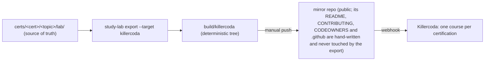

# Run a lab anywhere

A lab is one folder: `lab.yaml` plus a script with three modes, `break`, `verify` and `cleanup`
([docs/LABS-RUNNER.md](LABS-RUNNER.md)). The lab never knows where it runs. Where it runs is a thin layer
around it, and every layer runs the same code.

| Where | You need | Command | Cost |
| :--- | :--- | :--- | :--- |
| **Your PC, in Docker** | Docker | `study-lab run cka 1.1`, `study-lab check cka 1.1`, `study-lab down cka 1.1` | free |
| **Killercoda** (a browser tab) | an account | open the scenario (see below); press *Check* | free plan: about 1 hour per session, one scenario at a time (as documented by Killercoda; not measured by us) |
| **Your own cluster or VM** | a disposable machine | `I_UNDERSTAND_THIS_IS_A_DISPOSABLE_VM=yes bash certs/cka/1.1/lab/break_fix.sh break`, then `... verify`, then `... cleanup` | yours |
| **Someone else's repo** | Docker | `study-lab run --from <git-url> <path>` | free |

The solution is commented at the end of each script. Do not read it before you try.

## Killercoda is an export target, never the source



`study-lab export --target killercoda` reads `lab.yaml` and the lab script and writes, for each lab, a scenario:
`intro` (with the lab's `break` as a background script; its symptom is printed in the terminal), a *Read the
symptom* step, a *Fix it* step with the lab's hints and a **verify** that runs the lab's own `verify` mode
(exit 0, plus `modes.verify.success.output_regex` when the lab declares one), and a *finish* page with the
reference solution. The script is shipped as a scenario asset, with its commented solution removed from the
file (it appears in *finish* instead). Each certification is a Killercoda course (`structure.json` and a
README that links to the certification). Each page ends with a plain line: source and full course.

Mapping: `requires: linux` -> `ubuntu`; `requires: kind|k3s` -> `kubernetes-kubeadm-1node` (`nodes: 1` ->
`kubernetes-kubeadm-2nodes`). Not exported (printed by the command, with the reason): labs with `run_as`
other than root, more workers than Killercoda has, labs without a full `break | verify | cleanup` contract
(323 of 548 on 2026-10-16: they cannot be judged by Check), and labs whose script contains secret-like or
maintainer-only text (the guard that keeps the export clean). Labs not yet verified in the runner are exported
too, marked "not yet verified" in their intro.

### How a lab gets proven before it is published

`kind` is not Killercoda: it runs Ubuntu 24.04 VMs with kubeadm. So a scenario is proven on a host like that.
`study-lab test --target killercoda <cert>/<topic>` takes the GENERATED scenario and runs it as Killercoda does:
assets to `/root`, `background.sh`, wait for `/tmp/finished`, **`verify.sh` must fail**, the reference fix
(`deploy/killercoda/fixes/<cert>-<topic>.sh`), **`verify.sh` must pass**, `cleanup.sh` twice. It writes
`tested.json`: the sha256 of the scenario, the environment (image, OS, Kubernetes patch version, CNI) and its
`parity` (`assumed` until the values in `deploy/killercoda/killercoda_envs.yaml` are `measured` on Killercoda), the
runner (CI run URL, or local host), the date and the result of each stage.

- **CI:** `.github/workflows/killercoda-parity.yml` on a GitHub-hosted `ubuntu-24.04` runner (a VM). The k8s family
  gets a kubeadm cluster at the version Killercoda runs today (`deploy/killercoda/bootstrap-kubeadm.sh`).
- **Locally:** an Ubuntu 24.04 VM where you are root (multipass, Incus `--vm`, or a cloud VM), then
  `make killercoda-test LAB=cka/1.1`. A WSL Ubuntu 24.04 works for the linux family.
- **The gate:** `study-lab export --target killercoda --evidence DIR` keeps a scenario only if its `tested.json` is a
  pass for the same scenario hash and for the environment Killercoda runs on that date (the schedule in
  `killercoda_envs.yaml`: Kubernetes 1.36 until 2026-10-25, then 1.37). Change a lab, the exporter or the date past a
  Killercoda bump and the evidence no longer matches: the scenario is retested or not published. No evidence, no publish.
- A lab without a reference fix in `deploy/killercoda/fixes/` cannot be proven, so it is not published.

Known limits of the proof: `parity: assumed` (the image details below are not documented by Killercoda); the
scenario must still be run once by a human on Killercoda (`tested_on_killercoda`, later).

### What Killercoda documents about limits (checked 2026-10-16)

Sources: [FAQ](https://killercoda.com/faq), [pricing](https://killercoda.com/pricing),
[creators](https://killercoda.com/creators/get-started), [contribute](https://killercoda.com/creators/contribute).
Session: one hour on the free plan, four with a paid membership; no daily or monthly usage limits (FAQ). Free
accounts can create public scenarios (pricing). **Not documented anywhere we can read:** number of scenarios or
courses per creator, repository, asset or file sizes, background-script time limits, RAM/CPU/disk of each
`imageid`, the Kubernetes version of the kubeadm images and when it changes, CNI and default StorageClass, and the
terms for commercial use, branding and links (the Terms/AGB are a separate page). Ask Killercoda support, and
meanwhile measure the images with the probe scenario (below) instead of guessing.

### Publish (manual on purpose)

CI never writes to the mirror: that would need a secret with write access, which is the owner's call. The
`killercoda-export` workflow only generates the tree, checks that two runs are byte-identical and, if a
read-only `KILLERCODA_MIRROR_READ_TOKEN` secret exists, reports whether the mirror differs.

```bash
make killercoda-export                                  # build/killercoda
git clone git@github.com:villadalmine/study-cybercirujas-killercoda.git ../study-cybercirujas-killercoda
rsync -a --delete --exclude .git --exclude .github --exclude README.md --exclude CONTRIBUTING.md \
  --exclude CODEOWNERS --exclude .gitattributes build/killercoda/ ../study-cybercirujas-killercoda/
cd ../study-cybercirujas-killercoda && git switch -c export-<sha> && git add -A \
  && git commit -m "export: <study sha>" && git push -u origin HEAD   # then a PR, squash
make killercoda-diff                                    # from the study checkout: "mirror is up to date"
```

Killercoda syncs on every push through the webhook of the mirror repo.

### Limits and open questions

- No branding or banner beyond the "source and full course" line: Killercoda's rules on branding, links and
  commercial use are not on the creator page and must be asked before adding more (issue #43).
- Killercoda images use their own Kubernetes version; a lab pinned to `kubernetes: '1.35'` runs on whatever the
  image has. Check it when a kubeadm lab behaves differently from kind.
- The `kind` labs were proven in kind, not on kubeadm. Until a lab is run on Killercoda it is "exported",
  not "verified there".
