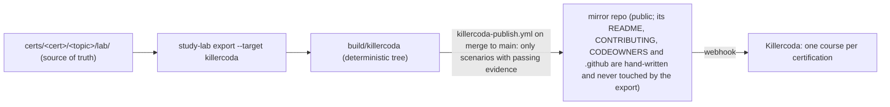

# Run a lab anywhere

A lab is one folder: `lab.yaml` plus a script with three modes, `break`, `verify` and `cleanup`
([docs/LABS-RUNNER.md](LABS-RUNNER.md)). The lab never knows where it runs. Where it runs is a thin layer
around it, and every layer runs the same code.

| Where | You need | Command | Cost |
| :--- | :--- | :--- | :--- |
| **Your PC, in Docker** | Docker | `study-lab run cka 1.1`, `study-lab check cka 1.1`, `study-lab down cka 1.1` | free |
| **Killercoda** (a browser tab) | an account | open the scenario (see below); press *Check* | free plan: about 1 hour per session, one scenario at a time (as documented by Killercoda; not measured by us) |
| **Your own cluster or VM** | a disposable machine | `I_UNDERSTAND_THIS_IS_A_DISPOSABLE_VM=yes bash certs/cka/1.1/lab/break_fix.sh break`, then `... verify`, then `... cleanup` | yours |
| **Someone else's repo** | Docker | `study-lab run --from <git-url> <path>` | free |

The solution is commented at the end of each script. Do not read it before you try.

## Killercoda is an export target, never the source



`study-lab export --target killercoda` reads `lab.yaml` and the lab script and writes, for each lab, a scenario:
`intro` (with the lab's `break` as a background script; its symptom is printed in the terminal), a *Read the
symptom* step, a *Fix it* step with the lab's `goals` (also in the intro, when the lab declares them) and hints, and a **verify** that runs the lab's own `verify` mode
(exit 0, plus `modes.verify.success.output_regex` when the lab declares one), and a *finish* page with the
reference solution. The script is shipped as a scenario asset, with its commented solution removed from the
file (it appears in *finish* instead). Each certification is a Killercoda course (`structure.json` and a
README that links to the certification). Each page ends with a plain line: source and full course.

Mapping: `requires: linux` -> `ubuntu`; `requires: kind|k3s` -> `kubernetes-kubeadm-1node` (`nodes: 1` ->
`kubernetes-kubeadm-2nodes`). Not exported (printed by the command, with the reason): labs with `run_as`
other than root, more workers than Killercoda has, labs without a full `break | verify | cleanup` contract
(323 of 548 on 2026-10-16: they cannot be judged by Check), and labs whose script contains secret-like or
maintainer-only text (the guard that keeps the export clean). Labs not yet verified in the runner are exported
too, marked "not yet verified" in their intro.

### Evidence per target

A lab is agnostic; each proof says where it ran. `deploy/lab-targets.yaml` is the only list of targets (`kind`, `k3s-incus`,
`docker-linux`, `killercoda-kubeadm`, `killercoda-ubuntu`, `human-killercoda`) with, for each: the environment, what is pinned, who
runs it, what a pass proves, what it does NOT prove, and whether it allows publishing to the Killercoda mirror (only
`killercoda-*` and `human-killercoda`). `deploy/lab-evidence.yaml` records `<cert>/<topic>: {<target>: {date, lab_hash, evidence,
runner}}`; `teach/lab/kc_scope.py` rejects an unknown target, a missing field, a bad date or a hash that is not a sha256
(`tests/lab/test_kc_scope.py`). No entry for a target means "not tested there", never "does not work", and a pass on `kind` or
`k3s-incus` proves the lab, not the Killercoda scenario (#103). Each target has a `role` there: `primary` (`kind`, `k3s-incus`,
`docker-linux`) is where a lab is really proven, on our own infra; `optional-channel` (`killercoda-*`, `human-killercoda`) is a
publishing channel, never required, never blocking, and the only evidence that allows pushing a scenario to the Killercoda
mirror ([RFC #210](https://github.com/villadalmine/study-cybercirujas/issues/210)).

### How a lab gets proven before it is published

`kind` is not Killercoda: it runs Ubuntu 24.04 VMs with kubeadm. So a scenario is proven on a host like that.
`study-lab test --target killercoda <cert>/<topic>` takes the GENERATED scenario and runs it as Killercoda does:
assets to `/root`, `background.sh`, wait for `/tmp/finished`, **`verify.sh` must fail**, the reference fix
(`deploy/killercoda/fixes/<cert>-<topic>.sh`), **`verify.sh` must pass**, `cleanup.sh` twice. It writes
`tested.json`: the sha256 of the scenario, the environment (image, OS, Kubernetes patch version, CNI) and its
`parity` (`measured`: the values in `deploy/killercoda/killercoda_envs.yaml` come from a probe run on Killercoda), the
runner (CI run URL, or local host), the date and the result of each stage.

- **CI:** `.github/workflows/killercoda-parity.yml` on a GitHub-hosted `ubuntu-24.04` runner (a VM). The k8s family
  gets a kubeadm cluster like the one measured on Killercoda: 1.36.1, Cilium, containerd 2.2.1, local-path default
  (`deploy/killercoda/bootstrap-kubeadm.sh`), with the runner limited to 1 CPU. RAM is not lowered (a runner has 16 GB; Killercoda
  has about 2.2 GB), so out-of-memory behaviour is only proven on Killercoda itself.
- **Locally:** an Ubuntu 24.04 VM where you are root (multipass, Incus `--vm`, or a cloud VM), then
  `make killercoda-test LAB=cka/1.1`. A WSL Ubuntu 24.04 works for the linux family.
- **The gate:** `study-lab export --target killercoda --evidence DIR` keeps a scenario only if its `tested.json` is a
  pass for the same scenario hash and for the environment Killercoda runs on that date (the schedule in
  `killercoda_envs.yaml`: Kubernetes 1.36 until 2026-10-25, then 1.37). Change a lab, the exporter or the date past a
  Killercoda bump and the evidence no longer matches: the scenario is retested or not published. No evidence, no publish.
- A lab without a reference fix in `deploy/killercoda/fixes/` cannot be proven, so it is not published.

**Probe first (lesson of 2026-10-19, issue #99).** Killercoda documents nothing about its images, so the first version of
`killercoda_envs.yaml` assumed kubeadm 1.36.5 with flannel. The probe scenarios (`deploy/killercoda/probe/`), run by hand,
showed Kubernetes 1.36.1, **Cilium** (not flannel), containerd 2.2.1, local-path as default StorageClass, 1 CPU and about
2 GB. Two assumptions, two errors, and every green parity run was proving a cluster that Killercoda does not run. Rule:
before pinning any fact about a third-party environment, measure it with a probe and record who ran it and when
(`source: measured`); anything not measured stays `reported` or `assumed`, and only a fully measured image yields
`parity: measured` (`partially-measured` while the Cilium version, pinned per Kubernetes row, is assumed; a row whose minor no pinned Cilium lists fails loudly, which is the case of the 1.37 row today: from that date `--print-env` exits 2 and the publish plan leaves the k8s family out with a `::warning::` naming the reason, while the linux family is still proven and published; the mirror keeps its k8s files because publish is additive, but the root `structure.json` stops listing a course that has no valid evidence until a Cilium is pinned and re-proven; dry run: `study-lab test --target killercoda --plan --today 2026-10-26`, or the `today` input of the workflow). Still assumed: the Cilium version (the probe did not print it; v1.20.3 is the newest that supports
Kubernetes 1.36) and the 1.37 switch date (as reported).

Known limits of the proof: the Cilium version and the 1.37 switch are not measured; RAM is not constrained in CI; the
scenario must still be run once by a human on Killercoda (`tested_on_killercoda`, later).

### What Killercoda documents about limits (checked 2026-10-16)

Sources: [FAQ](https://killercoda.com/faq), [pricing](https://killercoda.com/pricing),
[creators](https://killercoda.com/creators/get-started), [contribute](https://killercoda.com/creators/contribute).
Session: one hour on the free plan, four with a paid membership; no daily or monthly usage limits (FAQ). Free
accounts can create public scenarios (pricing). **Not documented anywhere we can read:** number of scenarios or
courses per creator, repository, asset or file sizes, background-script time limits, RAM/CPU/disk of each
`imageid`, the Kubernetes version of the kubeadm images and when it changes, CNI and default StorageClass, and the
terms for commercial use, branding and links (the Terms/AGB are a separate page). Ask Killercoda support, and
meanwhile measure the images with the probe scenario (below) instead of guessing.

### What each scenario says about itself

Every published scenario opens with its certification and syllabus objective, read from `catalog.yaml` and the frozen
syllabus `certs/<cert>.md`: **CKA v1.35 · Domain 1: Storage · Objective 1.1: <exact syllabus title>**, with links to the
site and the official curriculum, then a banner built from the lab's metadata (`meta.yaml` quality checks and
`lab.yaml` origin): *AI-generated (tool/model), not independently reviewed yet*, *AI-assisted ... recorded review*,
*Written by a human* or *Authorship not recorded*, with the quality level of the site (Verified, AI beta, Draft), and the
"Tested" line from `tested.json`. Next to `index.json` goes a `metadata.json` (cert, exam_version, domain, objective,
objective_sha256, curriculum, source path and commit, lab_hash, license, provenance, tested). The scenario title is
`<domain id> | <domain title> - <objective id> <title>` and a course lists its scenarios in syllabus order. **The export
fails** for a lab whose cert is not in the catalog, whose objective is not in the frozen syllabus or whose title is not the
syllabus title. On every PR that touches labs, `killercoda.yml` runs `study-lab export --target killercoda --check`
(schema of `index.json`, referenced files, `bash -n` on every script, courses list real folders) and puts the scenario
diff against the base branch in the job summary.

### Publish: automatic on merge

`.github/workflows/killercoda-publish.yml` runs on a push to `main` that changes labs, the exporter or
`deploy/killercoda/`, and on demand. Jobs: `plan` (labs with a reference fix), `prove` (one VM per lab, evidence as an
artifact), `publish` (runs only if every `prove` job ran to the end; evidence is the fresh one plus the `tested.json` the mirror
already has, so scenarios that were not re-proven keep theirs; export with `--evidence`, so only passing scenarios; then
`deploy/killercoda/publish.sh`: a commit `export: study@<sha>` on the mirror, none if the tree is identical, and nothing
touched if no scenario has valid evidence). Concurrency group, actions pinned by commit, `contents: read`, and the deploy key
(`KILLERCODA_DEPLOY_KEY`, write access to the mirror only) is visible to the last step of the last job. If the mirror's
`main` is protected and the key cannot bypass it, the job pushes `export/study-<sha>` and says so in its summary.

### Publish by hand (the same thing, when you want to see it)

```bash
make killercoda-export                                  # build/killercoda (add --evidence DIR to publish only proven scenarios)
git clone git@github.com:villadalmine/study-cybercirujas-killercoda.git ../study-cybercirujas-killercoda
STUDY_SHA=<sha> bash deploy/killercoda/publish.sh build/killercoda ../study-cybercirujas-killercoda   # adds and updates, commits, never deletes
cd ../study-cybercirujas-killercoda && git switch -c export-<sha> && git push -u origin HEAD   # then a PR, squash
make killercoda-diff                                    # from the study checkout: "mirror is up to date"
```

`publish.sh` refuses an export with no scenario (exit 3) and never deletes: a scenario that was not re-proven keeps its
files, and `structure.json` of the export decides what Killercoda lists. A scenario whose lab was removed is cleaned from the
mirror by hand.

Killercoda syncs on every push through the webhook of the mirror repo.

### Limits and open questions

- No branding or banner beyond the "source and full course" line: Killercoda's rules on branding, links and
  commercial use are not on the creator page and must be asked before adding more (issue #43).
- Killercoda images use their own Kubernetes version; a lab pinned to `kubernetes: '1.35'` runs on whatever the
  image has. Check it when a kubeadm lab behaves differently from kind.
- The `kind` labs were proven in kind, not on kubeadm. Until a lab is run on Killercoda it is "exported",
  not "verified there".
