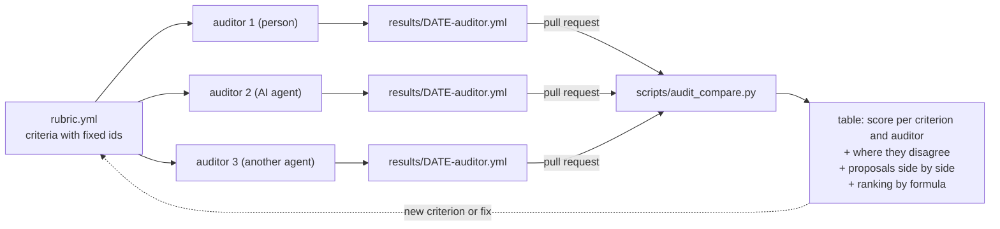

# Self-audit: how to check this repo yourself

This project says it is deterministic, grounded and reproducible. You should not have to take our word for it.
The audit is the template we use to check the repo against its own principles
([docs/PRINCIPLES.md](../PRINCIPLES.md)), published so that anyone, a person or an AI agent, can run it, get
their own answer, and tell us where we are wrong.

**What it is.** A fixed list of criteria ([`rubric.yml`](rubric.yml)), each with a question and how to verify it.
An auditor scores **every** criterion `0`, `1` or `2`, backs each score with **verifiable evidence** (a file and
line, or a command and its short output) and **always** attaches a proposal to improve it, even when the score is 2.
A criterion without a proposal does not count: [`scripts/audit_compare.py`](../../scripts/audit_compare.py)
refuses it.

The scale:

| Score | Meaning |
| :-- | :-- |
| 0 | only stated in docs, or missing (also: "could not verify") |
| 1 | partial, only warns, or manual |
| 2 | enforced: a CI gate, or generated and checked with `--check` |

The audit is not a certificate. It is a way to make disagreement visible: when two auditors score the same
criterion differently, either the rubric is ambiguous or somebody read the repo wrong, and both are worth fixing.



## Run it

1. Clone the repo and note the commit you audit: `git rev-parse HEAD`.
2. Read [`rubric.yml`](rubric.yml). Work read-only; if you cannot verify something, score it `0` and write
   "not verified" in the note. Do not guess. When a criterion asks for a sample, pick it with seed `42`.
3. Write `docs/audit/results/<YYYY-MM-DD>-<auditor>.yml`:

   ```yaml
   rubric_version: 3
   auditor: your-name-or-agent          # a person, or the model id for an AI agent
   date: 2026-10-21
   commit: <sha of main you audited>
   criteria:
     D1:
       score: 1
       evidence: "scripts/example.py:120 - the prompt is not hashed"
       note: "one line"
       proposal:
         what_to_change: "hash the prompt and store it in meta.yaml"
         implies: "2 h, low risk, no LLM credits; changes meta.yaml of every new topic"
         how_to_improve: "add the hash to check_provenance so a mismatch fails CI"
         foundations: [F3, F4]          # ids from the foundations in rubric.yml
         automatable: yes               # yes | partial | no
         effort: S                      # S | M | L
         priority: medium               # your opinion; the ranking ignores it
   ```

4. Send it as a pull request that adds only that file (see
   [CONTRIBUTING](../../CONTRIBUTING.md#run-the-audit-or-propose-a-criterion)).

An AI agent can follow the same steps; if it does, say which model and backend in `auditor`, as the
[provenance rules](../../CONTRIBUTING.md#pull-requests) ask for any other contribution.

## Compare several auditors

```bash
python3 scripts/audit_compare.py                    # every file in docs/audit/results/
python3 scripts/audit_compare.py --date 2026-10-21  # only the files of that day
```

It prints, in this order:

1. a table with one row per criterion and one column per auditor (`auditor@commit`), the average, and **yes**
   where two auditors differ by 1 or more: look at their evidence there;
2. every proposal side by side, per criterion;
3. a ranking of all proposals, computed, not opined:

   ```text
   priority = (sum of the weights of the foundations it serves) x automatable / effort
   automatable: yes 1.0 · partial 0.6 · no 0.3        effort: S 1 · M 2 · L 4
   ```

   For example, serving F1 (weight 5) and F3 (weight 4), fully automatable, small effort: `9 x 1.0 / 1 = 9.00`.
4. the mean score and the list of disagreements.

The exit code is `0` when every criterion has a proposal, `2` when some were refused, and `1` when there are no
results. It needs no network and no model, and prints the same output twice.

## Propose a new criterion

- Open an [audit criterion issue](https://github.com/villadalmine/study-cybercirujas/issues/new?template=audit-criterion.yml)
  with the question, how to verify it, the foundation it serves and why the current criteria miss it.
- Or send a PR to `rubric.yml` adding it under the fitting area.
- **A new criterion gets a new id** (the next free number in its area, or a new letter for a new area). Never reuse
  or rename an id and never change the meaning of an existing one: results from different days stay comparable only
  that way. If a criterion is wrong, add a better one and say in its note which it replaces.
- Bump `version` in `rubric.yml` when a criterion is added. Results of an older version stay valid for the ids they have.

## What is in this folder

| File | What it is |
| :-- | :-- |
| [`rubric.yml`](rubric.yml) | the criteria, the 0/1/2 scale, the foundations F1-F8 with their weights, and the priority formula |
| `results/` | the YAML each auditor submits by pull request |
| [`../../scripts/audit_compare.py`](../../scripts/audit_compare.py) | the comparison; tests in `tests/test_audit_compare.py` |
