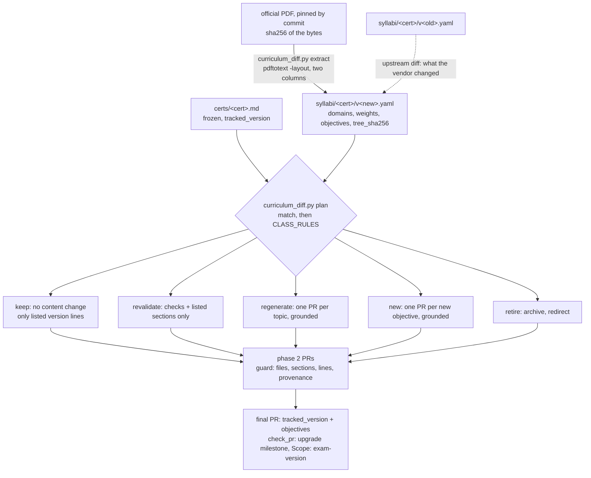

# Curriculum upgrades: deterministic, and only what changed

A curriculum version change re-evaluates the whole cert ([#63](https://github.com/villadalmine/study-cybercirujas/issues/63)).
This folder holds each upgrade's inputs, its generated plan, the proof that the plan is a function of its inputs, and
what the upgrade cost. The first real use is **CKA & CKAD v1.37** (milestone *CKA & CKAD v1.37 upgrade*,
[#51](https://github.com/villadalmine/study-cybercirujas/issues/51)).

| File | What it is | Written by |
| :--- | :--- | :--- |
| [cka-ckad-1.37.yaml](cka-ckad-1.37.yaml) | the upgrade spec: tracked syllabus, target and upstream base per cert | a person |
| [cka-ckad-1.37.plan.json](cka-ckad-1.37.plan.json) | three diffs per cert, one class per topic, the sections and lines in scope | `scripts/curriculum_diff.py plan` |
| [cka-ckad-1.37.md](cka-ckad-1.37.md) | the same plan as a report: counts, flow diagram, rules, diffs, per-topic table, sections and lines | `scripts/curriculum_diff.py render` |
| this README | the process, the proof, phase 2, efficiency and cost | a person |

The snapshots the plan reads are in `syllabi/` (`syllabi/cka/v1.37.yaml` and the others), frozen from the official PDFs.

## Result for v1.37 (2026-10-20)

| Cert | keep | revalidate | regenerate | new | retire | topic files | in scope | sections | technical version lines |
| :--- | ---: | ---: | ---: | ---: | ---: | ---: | ---: | ---: | ---: |
| cka | 26 | 1 | 0 | 0 | 0 | 216 | 54 | 0 | 168 (52 files, 26 topics): 108 in the material, 60 in labs |
| ckad | 22 | 2 | 0 | 0 | 0 | 192 | 32 | 4 | 49 (24 files, 22 topics): all in labs |

**Upstream changed no objective.** The v1.37 PDFs are byte-identical to the v1.35 ones (same sha256; cncf/curriculum
renamed the files) and the extracted trees hash the same (`tree_sha256`). The Linux Foundation exam pages say "based on
Kubernetes v1.37" since 2026-10-19 (#51): what moved is the **Kubernetes version** the exam runs on.

**The three `revalidate` topics come from our own frozen files**, not from upstream: `certs/cka.md` and `certs/ckad.md`
(snapshotted 2026-07) put three objectives in a different domain than the PDF they cite. The report shows that as
*drift* (frozen file vs its own v1.35 PDF), apart from *upstream* (v1.35 PDF vs v1.37 PDF):

| Topic | Objective | Frozen in | The PDF puts it in | Sections that name the change |
| :--- | :--- | :--- | :--- | :--- |
| cka 3.6 | Manage role based access control (RBAC) | Workloads and Scheduling | Cluster Architecture, Installation and Configuration | none: only `meta.yaml` |
| ckad 5.4 | Kustomize | Services and Networking | Application Deployment | none: only `meta.yaml` |
| ckad 2.4 | Understand API deprecations | Application Deployment | Application Observability and Maintenance | 4 titles carry the old wording |

ckad 2.4's "rewording" is the vendor's typo ("API **depreciations**"); our spelling is the correct term, so the 4 listed
title sections should stay as they are. No prose needs a model.

**What the Kubernetes version does touch** is 217 technical lines, listed one by one in the report:

- 108 in the CKA material, 11 topics (`kubeadm upgrade apply v1.35.1`, `apt-get install kubeadm=1.35.1-1.1`,
  `kubectl get nodes` outputs inside code fences, the `pkgs.k8s.io/.../v1.35` repository), most of them in 4.2 and 4.3;
- 109 in the labs of 48 topics: `lab/lab.yaml` (`kubernetes: '1.35'`, which the runner uses to pick the kind node image,
  and `runner_image: ... kindest/node v1.35.x`) and the `lab/*.sh` headers.

Besides those, 195 lines cite "Curriculum v1.35" (mostly with a dead `raw/master` link) and 43 are headings or banners:
mechanical, for the switch PR.

## Sources, pinned by commit

The v1.35 PDFs are gone from `master` of cncf/curriculum (404 since commit `b3c8508`, 2026-10-15), so every URL pins a commit.

| Cert | Version | Commit | Committed | sha256 |
| :--- | :--- | :--- | :--- | :--- |
| CKA | 1.35 | [`008b73c`](https://github.com/cncf/curriculum/raw/008b73c0ac99d04abf0d95bf7803fc5d147da54a/CKA_Curriculum_v1.35.pdf) | 2026-03-03 | `634b793704485c2ac424a90902e0f8b28f7348a49814393434f808e3e78ec18c` |
| CKA | 1.37 | [`b3c8508`](https://github.com/cncf/curriculum/raw/b3c8508b9f6cd0bcfa76c2e4b7cc9b6a2f109bec/CKA_Curriculum_v1.37.pdf) | 2026-10-15 | `634b793704485c2ac424a90902e0f8b28f7348a49814393434f808e3e78ec18c` |
| CKAD | 1.35 | [`d50919e`](https://github.com/cncf/curriculum/raw/d50919e585e1b643d91bdfb738f995544fbb7e90/CKAD_Curriculum_v1.35.pdf) | 2026-02-25 | `7736d2f0291239d62e9fc618304413ee9b6e53fc4580aac70bf4328203c1c210` |
| CKAD | 1.37 | [`f423fa4`](https://github.com/cncf/curriculum/raw/f423fa49c0cab0820533babd95b37ebe8fd89e67/CKAD_Curriculum_v1.37.pdf) | 2026-10-01 | `7736d2f0291239d62e9fc618304413ee9b6e53fc4580aac70bf4328203c1c210` |

Found with `gh api "repos/cncf/curriculum/commits?path=CKA_Curriculum_v1.37.pdf"` (and the same for each file).

## The process



1. **Freeze** each official PDF: `scripts/curriculum_diff.py extract --pdf <file> --cert <c> --version <v> --repo
   cncf/curriculum --commit <sha> --path <file> --committed <date> -o syllabi/<c>/v<v>.yaml`. It records the sha256 of
   the PDF and refuses a tree with no domains, an empty domain, or weights that do not sum to 100. The model-based
   `teach cert snapshot` (used for vendors without a PDF layout) now records the sha256 of the vendor's bytes as
   `source_sha256` and refuses a document longer than its 20,000-character window instead of truncating it.
2. **Diff**: objectives match by normalized text first, then by difflib ratio (MATCH 0.60, REWORD 0.90). Three diffs per
   cert: *upstream* (old PDF to new PDF), *drift* (our frozen file to its own PDF), *impact* (our frozen file to the new
   PDF, which drives the classes). Per-objective weights in `certs/<cert>.md` are derived (the domain weight split
   evenly) and never compared; the published domain weight is.
3. **Classify** every topic with `CLASS_RULES`, first match wins: `retire`, `regenerate`, `revalidate`, `keep`; each
   uncovered new objective is `new`. Minimal change is the default: only a new or substantively changed objective
   regenerates a topic.
4. **Scope below topic level.** For each `revalidate`/`regenerate` topic the plan lists the sections (markdown headings)
   that name what changed: the old domain name, the old objective title, a weight line. For every topic it lists the
   lines that name the tracked version, split into `curriculum`, `label` and `technical`; `# ...` lines inside code
   fences are not headings, and every version line of `lab/lab.yaml` and `lab/*.sh` is `technical`.
5. **Issues**: one per `regenerate` or `new` topic, as a sub-issue of the umbrella issue. For v1.37 there are none.
6. **Phase 2** (below), then the **switch**: the final PR moves `tracked_version` and `sources.objectives`.

Reproduce it (no network once the PDFs are downloaded, no model):

```bash
scripts/curriculum_diff.py plan docs/upgrades/cka-ckad-1.37.yaml --check
scripts/curriculum_diff.py render docs/upgrades/cka-ckad-1.37.plan.json -o docs/upgrades/cka-ckad-1.37.md --check
scripts/curriculum_diff.py diff syllabi/cka/v1.35.yaml syllabi/cka/v1.37.yaml
scripts/curriculum_diff.py guard docs/upgrades/cka-ckad-1.37.plan.json --base origin/main
```

## Proof that the upgrade is deterministic

Run on 2026-10-20 in WSL Ubuntu 24.04, poppler `pdftotext` 24.02.0, Python 3.12.3.

**Same inputs, same bytes.** Plan, report and both upstream diffs, twice, in fresh processes with `PYTHONHASHSEED` 1 and 2:

```
44d882230a18744b4ed03928e6b6e9e9b0a0e1d8249a76cafcd4ea8834e98d88  plan1.json
44d882230a18744b4ed03928e6b6e9e9b0a0e1d8249a76cafcd4ea8834e98d88  plan2.json
3179cda4fd41a0bd4f8dd3dbca2a8824318193c7dae06823b031ddd8d5171222  report1.md
3179cda4fd41a0bd4f8dd3dbca2a8824318193c7dae06823b031ddd8d5171222  report2.md
c3849220139ae9a5181be72c2bdd9644050a98494013ba4455bdb0dd2baf80a9  up-cka1.json
c3849220139ae9a5181be72c2bdd9644050a98494013ba4455bdb0dd2baf80a9  up-cka2.json
0a89b320f9af7b3fb1a7fd627b4e0c56e93a1d13a205657e5de650881f4afe67  up-ckad1.json
0a89b320f9af7b3fb1a7fd627b4e0c56e93a1d13a205657e5de650881f4afe67  up-ckad2.json
OK: docs/upgrades/cka-ckad-1.37.plan.json is current
OK: docs/upgrades/cka-ckad-1.37.md is current
```

**The snapshots are what the pinned PDFs produce** (`extract --check` on each of the four PDFs: `OK ... is current`),
and the old and new trees hash the same: CKA `1e485720…` for v1.35 and v1.37, CKAD `90399946…` for both.
`tests/test_curriculum_diff.py` repeats the byte-identical check on every push, and compares the committed plan and report byte for byte with what their inputs produce (`plan --check` and `render --check` in CI, through `make verify-ci`), so a hand-edited plan or a stale report fails. While the upgrade is open, a PR that edits a version line of CKA or CKAD regenerates both with the two commands above.

**`keep` topics are untouched.** Phase 1 (the tool, the snapshots, `upstream:` in the catalog, this folder) changes no
topic file: `git diff --stat origin/main...HEAD -- certs/cka/ certs/ckad/` is empty, so all 48 `keep` topics and the 3
`revalidate` ones have 0 changed files. `catalog.yaml` changes only in the new `upstream:` block and `upstream_status`;
`tracked_version` and `sources.objectives` are unchanged.

**Only planned files, sections and lines change.** `guard` passes the phase-1 diff and refuses everything else. The demonstration below edits a working copy and is reverted; note that the provenance check also catches the audit's `lang` bug (`en/meta.yaml` saying `lang: es`):

```
$ scripts/curriculum_diff.py guard docs/upgrades/cka-ckad-1.37.plan.json --base origin/main
plan: docs/upgrades/cka-ckad-1.37.plan.json from the head (new in this PR, verified against its inputs)
guard: 16 changed file(s), 0 outside the plan, 0 out-of-scope edit(s), 0 provenance problem(s)

# a phase-2 edit: a listed version line rewritten (allowed), another line of the same file and a keep topic edited (refused)
$ scripts/curriculum_diff.py guard docs/upgrades/cka-ckad-1.37.plan.json --files certs/cka/4.3/es/content.md certs/cka/1.1/en/content.md
plan: docs/upgrades/cka-ckad-1.37.plan.json as committed on <base sha> (the base), not the head's copy
NOT PLANNED: certs/cka/1.1/en/content.md
OUT OF SCOPE: certs/cka/4.3/es/content.md: line(s) 5 changed but are not listed in the plan
PROVENANCE: certs/cka/1.1/en/meta.yaml: model 'claude' is not a model id
PROVENANCE: certs/cka/1.1/en/meta.yaml: effort is missing
PROVENANCE: certs/cka/1.1/en/meta.yaml: prompt_sha256 is missing
PROVENANCE: certs/cka/1.1/en/meta.yaml: lang 'es' is not its directory 'en'
PROVENANCE: certs/cka/4.3/es/meta.yaml: model 'claude' is not a model id
PROVENANCE: certs/cka/4.3/es/meta.yaml: effort is missing
PROVENANCE: certs/cka/4.3/es/meta.yaml: prompt_sha256 is missing
guard: 2 changed file(s), 1 outside the plan, 1 out-of-scope edit(s), 7 provenance problem(s)
```

## Phase 2: what will happen, and what guards it

Nothing below has started; it needs Rino's OK on the cost. For v1.37 no topic is regenerated, so phase 2 is small.

| Step | What | How | Guarded by |
| :--- | :--- | :--- | :--- |
| revalidate | cka 3.6, ckad 2.4, ckad 5.4 | every check re-run against the new objective text; result recorded in each `meta.yaml`. No prose edit: the listed sections are titles carrying our (correct) spelling | `quality_score.py --check`; `guard` (only `meta.yaml` and the listed sections) |
| version lines | 217 lines in 76 files: 108 in 22 CKA material files, 109 in 54 lab files | rewrite each listed line in place to the 1.37 equivalent, with versions read from `pkgs.k8s.io` and the kind node images (a package or image that does not exist is not written), record the edit in the topic's `meta.yaml`; then the lab of each topic on a 1.37 cluster | `guard` (any other line changed fails); `check_k8s_apis`; `check_api_facts`; lab verification |
| regenerate / new | none for v1.37 | one PR per topic. The prompt carries the frozen syllabus text and the official documentation excerpts the topic cites (grounding at write time, only for these topics) | below |
| switch | the cert | `tracked_version` 1.35 -> 1.37, `sources.objectives` -> the v1.37 PDF, `certs/<cert>.md` from the snapshot, the 195 curriculum lines re-pointed to the pinned v1.37 PDF | `check_pr`: milestone *CKA & CKAD v1.37 upgrade* and `Scope: exam-version`; every plan row done |

Every phase-2 PR that rewrites `content.md` or `exercises.md` passes, on **those files only**:

- **Scope, enforced by `guard`**: only planned files, listed sections and listed lines change. Its allowlist is the
  plan committed on the base, never the PR's own copy, so a PR cannot widen its scope by editing `plan.json`.
- **Provenance, enforced by `guard`** (audit items 1 and 4), even though the old corpus is not migrated: `model` is a
  real model id (not `claude`, `agy`, `cheap`), `lang` equals its directory, `effort` and `prompt_sha256` are present;
  a hand edit says `model: human`. A topic with listed lines may update its `meta.yaml` for that. The generator does not write `effort` and `prompt_sha256` to `meta.yaml` yet, so a
  model-written phase-2 PR needs that small generator change first.
- **Groundedness as a blocking check** on the changed files (`scripts/check_groundedness.py` on the PR's topics must
  pass, not just warn), plus `check_api_facts` and the lab verification (`teach lab validate`, the parity run).
- **A claim spot-check** against the official docs before merge: the audit's sample found 6 wrong claims in 25
  corpus-wide, which no automatic check caught.
- **The source chain**: content cites the syllabus topic; a translation records `source_sha256`.

`keep` topics are not regenerated: their objectives are byte-for-byte the same.

### Kubernetes 1.37 labs depend on Cilium

The Killercoda kubeadm image switches to Kubernetes 1.37 on 2026-10-25 (`deploy/killercoda/killercoda_envs.yaml`, as
reported) and the parity bootstrap uses Cilium (PR #162). Checked live on 2026-10-20: the latest stable Cilium,
**v1.20.3** (2026-10-15), lists Kubernetes 1.33 to 1.36 in `Documentation/network/kubernetes/compatibility.rst`; only
`main` and the pre-release **v1.21.0-pre.3** (2026-10-02) list 1.34 to 1.37 (commit `c96d528`, "Update k8s libraries
to v1.37.0", 2026-09-02). Until Cilium v1.21.0 is released, the 1.37 row cannot be proven and the k8s labs are skipped
with a warning after 2026-10-25, as PR #162 designed. The version-line labs and the switch wait for that release, or
ship verified on 1.36 with the gap written down.

## Efficiency: how this update came out

| Measure | v1.37 |
| :--- | :--- |
| Topic files in CKA + CKAD | 408 |
| Topic files phase 1 changed | 0 |
| Topic files in scope for phase 2 | 86 (21 %): 6 `meta.yaml` of revalidated topics, 4 files with a listed section, 22 material files and 54 lab files with technical version lines (plus the `meta.yaml` where each edit records its provenance) |
| Sections in scope | 4 (titles; recommended: no edit) |
| Lines in scope | 217 technical version lines: 108 of 56,484 lines of CKA + CKAD material (0.19 %), 109 in labs |
| Topics regenerated | 0 of 51 |
| Model tokens spent in phase 1 | 0 (no paid call: extraction, diff, plan and guard need no model) |
| Plan + report regeneration time | 0.3 s |
| Agent time for phase 1 | about 3 h, almost all of it building the tool once, plus one review round (scan of fences and labs, guard allowlist from the base, CI check of the plan); the next upgrade reuses it |

Phase 2 fills in the measured cost and time per PR from `scripts/topic_cost.py` here.

### Cost: scoped edits versus full regeneration

The generator is `claude-opus-5` at effort `xhigh` (`pipeline.yaml`), priced in `models.yaml` at 5 USD per million input
tokens and 25 USD per million output tokens. Authoring a topic is about two completions (~30 k input, ~40 k output
with thinking each) plus one translation (~15 k in, ~15 k out): about 2.8 USD per topic in en + es (range 1.5 to 5).
A scoped edit of one file (the listed lines or section, the syllabus text and the excerpt, ~6 k in, ~1.5 k out) is
about 0.07 USD.

| Approach | Model work | Estimate |
| :--- | :--- | ---: |
| regenerate all of CKA + CKAD | 51 topics | ~140 USD (75 to 255) |
| regenerate the 3 topics the syllabus diff touches | 3 topics | ~8.5 USD (5 to 15) |
| **this plan: scoped edits** | 0 prose edits; 217 version lines in 76 files, by hand or one scoped completion per file | **0 to ~5 USD** |

Revalidation itself costs nothing in model credits (groundedness runs a local pinned classifier). On the subscription
the figures are quota, not a bill.

## Topic ids at the switch

Snapshot ids are positional (domains in header order, top to bottom then left to right). CNCF does not number
objectives, and the frozen files used two different orders, so new ids differ from today's directory names for most
topics (the report's *Maps to* column). The switch should keep today's directory names and update each topic's domain
and title in `certs/<cert>.md`; renumbering would rename 51 directories and break every link for no change in content.
That is the maintainer's call, in the switch PR.
