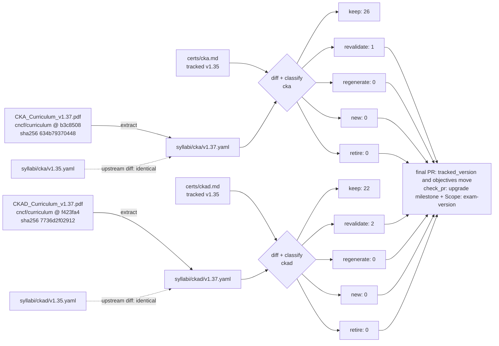

# Upgrade plan: CKA & CKAD v1.37

<!-- Generated by scripts/curriculum_diff.py render from docs/upgrades/cka-ckad-1.37.yaml. Do not edit by hand. -->

Milestone: *CKA & CKAD v1.37 upgrade* · umbrella issue #51

## Counts

| Cert | keep | revalidate | regenerate | new | retire | topic files | planned | sections to edit | version lines (curriculum / label / technical) |
| :--- | ---: | ---: | ---: | ---: | ---: | ---: | ---: | ---: | ---: |
| cka | 26 | 1 | 0 | 0 | 0 | 216 | 54 | 0 | 106 / 19 / 171 |
| ckad | 22 | 2 | 0 | 0 | 0 | 192 | 32 | 4 | 89 / 24 / 49 |

## Flow

## Rules (from the code, not judgment)

Thresholds: MATCH = 0.6, REWORD = 0.9 (difflib ratio on normalized text). The first rule that applies wins.

| Class | Rule | What happens | Files it may change |
| :--- | :--- | :--- | :--- |
| `retire` | its objective is not in the new syllabus (removed, or below MATCH similarity to every new one) | archive the topic directory; redirect its links | `certs/<cert>/<topic>/**` |
| `regenerate` | its objective changed: best match has MATCH (0.6) <= similarity < REWORD (0.9) | one PR through the whole content process (content, exercises, lab, translations) | `certs/<cert>/<topic>/**` |
| `revalidate` | its objective was reworded (REWORD <= similarity < 1), moved to another domain, or its domain's published weight changed | re-run every check against the new text; record the result in meta.yaml; a failed check makes it regenerate | `certs/<cert>/<topic>/<lang>/meta.yaml`, the listed sections and the listed technical version lines |
| `keep` | its objective text, domain and domain weight are identical | no content change; only its listed technical version lines may be rewritten in place, by the version bump | the listed technical version lines, in place |
| `new` | an objective of the new syllabus that no topic covers | a new topic directory, through the whole content process | `certs/<cert>/<new topic>/**` |

## cka

- Tracked (what the material was built against): `certs/cka.md` v1.35, sha256 `26f02fa23273…`
- Target: `syllabi/cka/v1.37.yaml` v1.37, from [CKA_Curriculum_v1.37.pdf](https://github.com/cncf/curriculum/raw/b3c8508b9f6cd0bcfa76c2e4b7cc9b6a2f109bec/CKA_Curriculum_v1.37.pdf) @ `b3c8508`, PDF sha256 `634b793704485c2ac424a90902e0f8b28f7348a49814393434f808e3e78ec18c`
- Upstream base: `syllabi/cka/v1.35.yaml` v1.35, from [CKA_Curriculum_v1.35.pdf](https://github.com/cncf/curriculum/raw/008b73c0ac99d04abf0d95bf7803fc5d147da54a/CKA_Curriculum_v1.35.pdf) @ `008b73c`, PDF sha256 `634b793704485c2ac424a90902e0f8b28f7348a49814393434f808e3e78ec18c`

### What upstream changed (v1.35 PDF -> v1.37 PDF)

- identical: no domain, weight or objective changed

### Drift: frozen `certs/cka.md` vs its own v1.35 PDF

- moved: 3.6 -> 4.1 "Manage role based access control (RBAC)" (Workloads and Scheduling -> Cluster Architecture, Installation and Configuration)

### Impact: frozen `certs/cka.md` -> v1.37 (drives the classes)

- moved: 3.6 -> 4.1 "Manage role based access control (RBAC)" (Workloads and Scheduling -> Cluster Architecture, Installation and Configuration)

### Per-topic plan

| Topic | Objective | Class | Why | Maps to | Sections to edit | Version lines (c/l/t) | Langs | Lab |
| :--- | :--- | :--- | :--- | :--- | ---: | :--- | :--- | :--- |
| 1.1 | Implement storage classes and dynamic volume provisioning | `keep` | unchanged | 1.1 | 0 | 4/2/4 | en,es | yes |
| 1.2 | Configure volume types, access modes and reclaim policies | `keep` | unchanged | 1.2 | 0 | 4/2/2 | en,es | yes |
| 1.3 | Manage persistent volumes and persistent volume claims | `keep` | unchanged | 1.3 | 0 | 4/0/2 | en,es | yes |
| 2.1 | Troubleshoot clusters and nodes | `keep` | unchanged | 2.1 | 0 | 4/0/12 | en,es | yes |
| 2.2 | Troubleshoot cluster components | `keep` | unchanged | 2.2 | 0 | 4/2/6 | en,es | yes |
| 2.3 | Monitor cluster and application resource usage | `keep` | unchanged | 2.3 | 0 | 4/0/2 | en,es | yes |
| 2.4 | Manage and evaluate container output streams | `keep` | unchanged | 2.4 | 0 | 4/0/2 | en,es | yes |
| 2.5 | Troubleshoot services and networking | `keep` | unchanged | 2.5 | 0 | 4/2/2 | en,es | yes |
| 3.1 | Understand application deployments and how to perform rolling update and rollbacks | `keep` | unchanged | 3.1 | 0 | 4/1/1 | en,es | yes |
| 3.2 | Use ConfigMaps and Secrets to configure applications | `keep` | unchanged | 3.2 | 0 | 4/1/2 | en,es | yes |
| 3.3 | Configure workload autoscaling | `keep` | unchanged | 3.3 | 0 | 4/1/7 | en,es | yes |
| 3.4 | Understand the primitives used to create robust, self-healing, application deployments | `keep` | unchanged | 3.4 | 0 | 3/2/4 | en,es | yes |
| 3.5 | Configure Pod admission and scheduling (limits, node affinity, etc.) | `keep` | unchanged | 3.5 | 0 | 4/0/5 | en,es | yes |
| 3.6 | Manage role based access control (RBAC) | `revalidate` | moved: Workloads and Scheduling -> Cluster Architecture, Installation and Configuration | 4.1 | 0 | 4/1/0 | en,es | yes |
| 4.1 | Prepare underlying infrastructure for installing a Kubernetes cluster | `keep` | unchanged | 4.2 | 0 | 4/1/11 | en,es | yes |
| 4.2 | Create and manage Kubernetes clusters using kubeadm | `keep` | unchanged | 4.3 | 0 | 3/0/22 | en,es | yes |
| 4.3 | Manage the lifecycle of Kubernetes clusters | `keep` | unchanged | 4.4 | 0 | 4/0/52 | en,es | yes |
| 4.4 | Implement and configure a highly-available control plane | `keep` | unchanged | 4.5 | 0 | 4/1/10 | en,es | yes |
| 4.5 | Use Helm and Kustomize to install cluster components | `keep` | unchanged | 4.6 | 0 | 4/0/2 | en,es | yes |
| 4.6 | Understand extension interfaces (CNI, CSI, CRI, etc.) | `keep` | unchanged | 4.7 | 0 | 4/0/6 | en,es | yes |
| 4.7 | Understand CRDs, install and configure operators | `keep` | unchanged | 4.8 | 0 | 4/0/3 | en,es | yes |
| 5.1 | Understand connectivity between Pods | `keep` | unchanged | 5.1 | 0 | 4/0/2 | en,es | yes |
| 5.2 | Define and enforce Network Policies | `keep` | unchanged | 5.2 | 0 | 4/1/2 | en,es | yes |
| 5.3 | Use ClusterIP, NodePort, LoadBalancer service types and endpoints | `keep` | unchanged | 5.3 | 0 | 4/0/2 | en,es | yes |
| 5.4 | Use the Gateway API to manage Ingress traffic | `keep` | unchanged | 5.4 | 0 | 4/1/3 | en,es | yes |
| 5.5 | Know how to use Ingress controllers and Ingress resources | `keep` | unchanged | 5.5 | 0 | 4/0/3 | en,es | yes |
| 5.6 | Understand and use CoreDNS | `keep` | unchanged | 5.6 | 0 | 4/1/2 | en,es | yes |

### Technical lines that name v1.35

Commands, outputs or prose about that Kubernetes version: the only version lines a bump may need to rewrite by hand (the curriculum and label lines are mechanical).

- `certs/cka/1.1/lab/break_fix.sh:3`
- `certs/cka/1.1/lab/break_fix.sh:8`
- `certs/cka/1.1/lab/lab.yaml:15`
- `certs/cka/1.1/lab/lab.yaml:49`
- `certs/cka/1.2/lab/break_fix.sh:3`
- `certs/cka/1.2/lab/break_fix.sh:5`
- `certs/cka/1.3/lab/break_fix.sh:5`
- `certs/cka/1.3/lab/break_fix.sh:7`
- `certs/cka/2.1/en/content.md:22`
- `certs/cka/2.1/en/content.md:23`
- `certs/cka/2.1/en/content.md:24`
- `certs/cka/2.1/en/content.md:226`
- `certs/cka/2.1/en/content.md:243`
- `certs/cka/2.1/es/content.md:22`
- `certs/cka/2.1/es/content.md:23`
- `certs/cka/2.1/es/content.md:24`
- `certs/cka/2.1/es/content.md:226`
- `certs/cka/2.1/es/content.md:243`
- `certs/cka/2.1/lab/break_fix.sh:5`
- `certs/cka/2.1/lab/break_fix.sh:6`
- `certs/cka/2.2/en/content.md:39`
- `certs/cka/2.2/en/content.md:40`
- `certs/cka/2.2/es/content.md:39`
- `certs/cka/2.2/es/content.md:40`
- `certs/cka/2.2/lab/break_fix.sh:3`
- `certs/cka/2.2/lab/break_fix.sh:4`
- `certs/cka/2.3/lab/break_fix.sh:3`
- `certs/cka/2.3/lab/break_fix.sh:5`
- `certs/cka/2.4/lab/break_fix.sh:2`
- `certs/cka/2.4/lab/break_fix.sh:3`
- `certs/cka/2.5/lab/break_fix.sh:3`
- `certs/cka/2.5/lab/break_fix.sh:8`
- `certs/cka/3.1/lab/break_fix.sh:3`
- `certs/cka/3.2/lab/break_fix.sh:3`
- `certs/cka/3.2/lab/break_fix.sh:4`
- `certs/cka/3.3/en/exercises.md:56`
- `certs/cka/3.3/en/exercises.md:218`
- `certs/cka/3.3/es/exercises.md:58`
- `certs/cka/3.3/lab/break_fix.sh:5`
- `certs/cka/3.3/lab/break_fix.sh:6`
- `certs/cka/3.3/lab/lab.yaml:15`
- `certs/cka/3.3/lab/lab.yaml:42`
- `certs/cka/3.4/lab/break_fix.sh:5`
- `certs/cka/3.4/lab/break_fix.sh:10`
- `certs/cka/3.4/lab/lab.yaml:16`
- `certs/cka/3.4/lab/lab.yaml:45`
- `certs/cka/3.5/es/exercises.md:3`
- `certs/cka/3.5/lab/break_fix.sh:3`
- `certs/cka/3.5/lab/break_fix.sh:6`
- `certs/cka/3.5/lab/lab.yaml:15`
- `certs/cka/3.5/lab/lab.yaml:46`
- `certs/cka/4.1/en/exercises.md:155`
- `certs/cka/4.1/en/exercises.md:159`
- `certs/cka/4.1/en/exercises.md:161`
- `certs/cka/4.1/en/exercises.md:181`
- `certs/cka/4.1/es/exercises.md:197`
- `certs/cka/4.1/es/exercises.md:201`
- `certs/cka/4.1/es/exercises.md:206`
- `certs/cka/4.1/es/exercises.md:226`
- `certs/cka/4.1/es/exercises.md:243`
- `certs/cka/4.1/lab/break_fix.sh:4`
- `certs/cka/4.1/lab/break_fix.sh:5`
- `certs/cka/4.2/en/content.md:64`
- `certs/cka/4.2/en/content.md:97`
- `certs/cka/4.2/en/content.md:188`
- `certs/cka/4.2/en/content.md:197`
- `certs/cka/4.2/en/content.md:212`
- `certs/cka/4.2/en/content.md:222`
- `certs/cka/4.2/es/content.md:62`
- `certs/cka/4.2/es/content.md:95`
- `certs/cka/4.2/es/content.md:191`
- `certs/cka/4.2/es/content.md:201`
- `certs/cka/4.2/es/content.md:203`
- `certs/cka/4.2/es/content.md:205`
- `certs/cka/4.2/es/content.md:206`
- `certs/cka/4.2/es/content.md:207`
- `certs/cka/4.2/es/content.md:208`
- `certs/cka/4.2/es/content.md:212`
- `certs/cka/4.2/es/content.md:217`
- `certs/cka/4.2/es/content.md:232`
- `certs/cka/4.2/es/content.md:242`
- `certs/cka/4.2/es/content.md:267`
- `certs/cka/4.2/lab/break_fix.sh:5`
- `certs/cka/4.2/lab/break_fix.sh:8`
- `certs/cka/4.3/en/content.md:18`
- `certs/cka/4.3/en/content.md:38`
- `certs/cka/4.3/en/content.md:39`
- `certs/cka/4.3/en/content.md:47`
- `certs/cka/4.3/en/content.md:57`
- `certs/cka/4.3/en/content.md:58`
- `certs/cka/4.3/en/content.md:62`
- `certs/cka/4.3/en/content.md:63`
- `certs/cka/4.3/en/content.md:64`
- `certs/cka/4.3/en/content.md:65`
- `certs/cka/4.3/en/content.md:70`
- `certs/cka/4.3/en/content.md:74`
- `certs/cka/4.3/en/content.md:97`
- `certs/cka/4.3/en/content.md:120`
- `certs/cka/4.3/en/content.md:126`
- `certs/cka/4.3/en/content.md:145`
- `certs/cka/4.3/en/content.md:146`
- `certs/cka/4.3/en/content.md:147`
- `certs/cka/4.3/en/exercises.md:27`
- `certs/cka/4.3/en/exercises.md:66`
- `certs/cka/4.3/en/exercises.md:74`
- `certs/cka/4.3/en/exercises.md:92`
- `certs/cka/4.3/en/exercises.md:112`
- `certs/cka/4.3/en/exercises.md:117`
- `certs/cka/4.3/es/content.md:9`
- `certs/cka/4.3/es/content.md:16`
- `certs/cka/4.3/es/content.md:34`
- `certs/cka/4.3/es/content.md:35`
- `certs/cka/4.3/es/content.md:43`
- `certs/cka/4.3/es/content.md:53`
- `certs/cka/4.3/es/content.md:54`
- `certs/cka/4.3/es/content.md:58`
- `certs/cka/4.3/es/content.md:59`
- `certs/cka/4.3/es/content.md:60`
- `certs/cka/4.3/es/content.md:61`
- `certs/cka/4.3/es/content.md:66`
- `certs/cka/4.3/es/content.md:70`
- `certs/cka/4.3/es/content.md:93`
- `certs/cka/4.3/es/content.md:116`
- `certs/cka/4.3/es/content.md:122`
- `certs/cka/4.3/es/content.md:141`
- `certs/cka/4.3/es/content.md:142`
- `certs/cka/4.3/es/content.md:143`
- `certs/cka/4.3/es/exercises.md:29`
- `certs/cka/4.3/es/exercises.md:66`
- `certs/cka/4.3/es/exercises.md:69`
- `certs/cka/4.3/es/exercises.md:77`
- `certs/cka/4.3/es/exercises.md:98`
- `certs/cka/4.3/es/exercises.md:129`
- `certs/cka/4.3/es/exercises.md:137`
- `certs/cka/4.3/lab/break_fix.sh:3`
- `certs/cka/4.3/lab/break_fix.sh:4`
- `certs/cka/4.4/en/content.md:147`
- `certs/cka/4.4/en/content.md:148`
- `certs/cka/4.4/en/content.md:149`
- `certs/cka/4.4/en/content.md:150`
- `certs/cka/4.4/es/content.md:140`
- `certs/cka/4.4/es/content.md:141`
- `certs/cka/4.4/es/content.md:142`
- `certs/cka/4.4/es/content.md:143`
- `certs/cka/4.4/lab/break_fix.sh:5`
- `certs/cka/4.4/lab/break_fix.sh:9`
- `certs/cka/4.5/lab/break_fix.sh:4`
- `certs/cka/4.5/lab/break_fix.sh:5`
- `certs/cka/4.6/en/content.md:67`
- `certs/cka/4.6/es/content.md:80`
- `certs/cka/4.6/es/content.md:81`
- `certs/cka/4.6/es/exercises.md:3`
- `certs/cka/4.6/lab/break_fix.sh:4`
- `certs/cka/4.6/lab/break_fix.sh:7`
- `certs/cka/4.7/es/content.md:238`
- `certs/cka/4.7/lab/break_fix.sh:4`
- `certs/cka/4.7/lab/break_fix.sh:5`
- `certs/cka/5.1/lab/break_fix.sh:3`
- `certs/cka/5.1/lab/break_fix.sh:5`
- `certs/cka/5.2/lab/break_fix.sh:3`
- `certs/cka/5.2/lab/break_fix.sh:4`
- `certs/cka/5.3/lab/break_fix.sh:3`
- `certs/cka/5.3/lab/break_fix.sh:5`
- `certs/cka/5.4/lab/break_fix.sh:3`
- `certs/cka/5.4/lab/break_fix.sh:7`
- `certs/cka/5.4/lab/break_fix.sh:200`
- `certs/cka/5.5/es/content.md:235`
- `certs/cka/5.5/lab/break_fix.sh:3`
- `certs/cka/5.5/lab/break_fix.sh:4`
- `certs/cka/5.6/lab/break_fix.sh:3`
- `certs/cka/5.6/lab/break_fix.sh:6`

## ckad

- Tracked (what the material was built against): `certs/ckad.md` v1.35, sha256 `f2ca2261d8ee…`
- Target: `syllabi/ckad/v1.37.yaml` v1.37, from [CKAD_Curriculum_v1.37.pdf](https://github.com/cncf/curriculum/raw/f423fa49c0cab0820533babd95b37ebe8fd89e67/CKAD_Curriculum_v1.37.pdf) @ `f423fa4`, PDF sha256 `7736d2f0291239d62e9fc618304413ee9b6e53fc4580aac70bf4328203c1c210`
- Upstream base: `syllabi/ckad/v1.35.yaml` v1.35, from [CKAD_Curriculum_v1.35.pdf](https://github.com/cncf/curriculum/raw/d50919e585e1b643d91bdfb738f995544fbb7e90/CKAD_Curriculum_v1.35.pdf) @ `d50919e`, PDF sha256 `7736d2f0291239d62e9fc618304413ee9b6e53fc4580aac70bf4328203c1c210`

### What upstream changed (v1.35 PDF -> v1.37 PDF)

- identical: no domain, weight or objective changed

### Drift: frozen `certs/ckad.md` vs its own v1.35 PDF

- moved: 2.4 -> 5.1 "Understand API depreciations" (Application Deployment -> Application Observability and Maintenance)
- moved: 5.4 -> 3.4 "Kustomize" (Services and Networking -> Application Deployment)
- reworded (0.9818): 2.4 "Understand API deprecations" -> 5.1 "Understand API depreciations"

### Impact: frozen `certs/ckad.md` -> v1.37 (drives the classes)

- moved: 2.4 -> 5.1 "Understand API depreciations" (Application Deployment -> Application Observability and Maintenance)
- moved: 5.4 -> 3.4 "Kustomize" (Services and Networking -> Application Deployment)
- reworded (0.9818): 2.4 "Understand API deprecations" -> 5.1 "Understand API depreciations"

### Per-topic plan

| Topic | Objective | Class | Why | Maps to | Sections to edit | Version lines (c/l/t) | Langs | Lab |
| :--- | :--- | :--- | :--- | :--- | ---: | :--- | :--- | :--- |
| 1.1 | Define, build and modify container images | `keep` | unchanged | 1.1 | 0 | 5/3/2 | en,es | yes |
| 1.2 | Choose and use the right workload resource (Deployment, DaemonSet, CronJob, etc.) | `keep` | unchanged | 1.2 | 0 | 4/1/2 | en,es | yes |
| 1.3 | Understand multi-container Pod design patterns (e.g. sidecar, init and others) | `keep` | unchanged | 1.3 | 0 | 5/0/2 | en,es | yes |
| 1.4 | Utilize persistent and ephemeral volumes | `keep` | unchanged | 1.4 | 0 | 4/0/2 | en,es | yes |
| 2.1 | Use Kubernetes primitives to implement common deployment strategies (e.g. blue/green or canary) | `keep` | unchanged | 3.1 | 0 | 4/0/1 | en,es | yes |
| 2.2 | Understand Deployments and how to perform rolling updates | `keep` | unchanged | 3.2 | 0 | 4/0/3 | en,es | yes |
| 2.3 | Use the Helm package manager to deploy existing packages | `keep` | unchanged | 3.3 | 0 | 4/2/0 | en,es | yes |
| 2.4 | Understand API deprecations | `revalidate` | objective reworded (similarity 0.9818); moved: Application Deployment -> Application Observability and Maintenance | 5.1 | 4 | 2/2/2 | en,es | yes |
| 3.1 | Implement probes and health checks | `keep` | unchanged | 5.2 | 0 | 4/0/3 | en,es | yes |
| 3.2 | Use built-in CLI tools to monitor Kubernetes applications | `keep` | unchanged | 5.3 | 0 | 4/0/3 | en,es | yes |
| 3.3 | Utilize container logs | `keep` | unchanged | 5.4 | 0 | 4/2/2 | en,es | yes |
| 3.4 | Debugging in Kubernetes | `keep` | unchanged | 5.5 | 0 | 4/0/2 | en,es | yes |
| 4.1 | Discover and use resources that extend Kubernetes (CRD, Operators) | `keep` | unchanged | 2.1 | 0 | 3/0/1 | en,es | yes |
| 4.2 | Understand authentication, authorization and admission control | `keep` | unchanged | 2.2 | 0 | 4/0/2 | en,es | yes |
| 4.3 | Understand requests, limits, quotas | `keep` | unchanged | 2.3 | 0 | 4/2/2 | en,es | yes |
| 4.4 | Define resource requirements | `keep` | unchanged | 2.4 | 0 | 3/0/4 | en,es | yes |
| 4.5 | Understand ConfigMaps | `keep` | unchanged | 2.5 | 0 | 4/2/2 | en,es | yes |
| 4.6 | Create & consume Secrets | `keep` | unchanged | 2.6 | 0 | 3/0/2 | en,es | yes |
| 4.7 | Understand ServiceAccounts | `keep` | unchanged | 2.7 | 0 | 2/4/2 | en,es | yes |
| 4.8 | Understand Application Security (SecurityContexts, Capabilities, etc.) | `keep` | unchanged | 2.8 | 0 | 4/2/0 | en,es | yes |
| 5.1 | Demonstrate basic understanding of NetworkPolicies | `keep` | unchanged | 4.1 | 0 | 3/2/3 | en,es | yes |
| 5.2 | Provide and troubleshoot access to applications via services | `keep` | unchanged | 4.2 | 0 | 4/0/3 | en,es | yes |
| 5.3 | Use Ingress rules to expose applications | `keep` | unchanged | 4.3 | 0 | 4/2/2 | en,es | yes |
| 5.4 | Kustomize | `revalidate` | moved: Services and Networking -> Application Deployment | 3.4 | 0 | 3/0/2 | en,es | yes |

### Sections that name what changed

- 2.4: `certs/ckad/2.4/en/content.md` line 1 "2.4 Understand API deprecations" (old objective title)
- 2.4: `certs/ckad/2.4/en/exercises.md` line 1 "Exercises: 2.4 Understand API deprecations (CKAD v1.35)" (old objective title)
- 2.4: `certs/ckad/2.4/es/content.md` line 1 "2.4 Understand API deprecations" (old objective title)
- 2.4: `certs/ckad/2.4/es/exercises.md` line 1 "Ejercicios: 2.4 Understand API deprecations (CKAD v1.35)" (old objective title)

### Technical lines that name v1.35

Commands, outputs or prose about that Kubernetes version: the only version lines a bump may need to rewrite by hand (the curriculum and label lines are mechanical).

- `certs/ckad/1.1/lab/break_fix.sh:3`
- `certs/ckad/1.1/lab/break_fix.sh:4`
- `certs/ckad/1.2/lab/break_fix.sh:18`
- `certs/ckad/1.2/lab/break_fix.sh:19`
- `certs/ckad/1.3/lab/break_fix.sh:4`
- `certs/ckad/1.3/lab/break_fix.sh:8`
- `certs/ckad/1.4/lab/break_fix.sh:3`
- `certs/ckad/1.4/lab/break_fix.sh:4`
- `certs/ckad/2.1/lab/break_fix.sh:7`
- `certs/ckad/2.2/lab/break_fix.sh:7`
- `certs/ckad/2.2/lab/break_fix.sh:22`
- `certs/ckad/2.2/lab/break_fix.sh:23`
- `certs/ckad/2.4/lab/break_fix.sh:3`
- `certs/ckad/2.4/lab/break_fix.sh:9`
- `certs/ckad/3.1/lab/break_fix.sh:3`
- `certs/ckad/3.1/lab/break_fix.sh:15`
- `certs/ckad/3.1/lab/break_fix.sh:16`
- `certs/ckad/3.2/lab/break_fix.sh:5`
- `certs/ckad/3.2/lab/break_fix.sh:20`
- `certs/ckad/3.2/lab/break_fix.sh:21`
- `certs/ckad/3.3/lab/break_fix.sh:4`
- `certs/ckad/3.3/lab/break_fix.sh:5`
- `certs/ckad/3.4/lab/break_fix.sh:2`
- `certs/ckad/3.4/lab/break_fix.sh:5`
- `certs/ckad/4.1/lab/break_fix.sh:3`
- `certs/ckad/4.2/lab/break_fix.sh:5`
- `certs/ckad/4.2/lab/break_fix.sh:8`
- `certs/ckad/4.3/lab/break_fix.sh:3`
- `certs/ckad/4.3/lab/break_fix.sh:4`
- `certs/ckad/4.4/lab/break_fix.sh:3`
- `certs/ckad/4.4/lab/break_fix.sh:20`
- `certs/ckad/4.4/lab/break_fix.sh:21`
- `certs/ckad/4.4/lab/lab.yaml:36`
- `certs/ckad/4.5/lab/break_fix.sh:3`
- `certs/ckad/4.5/lab/break_fix.sh:9`
- `certs/ckad/4.6/lab/break_fix.sh:15`
- `certs/ckad/4.6/lab/break_fix.sh:16`
- `certs/ckad/4.7/lab/break_fix.sh:3`
- `certs/ckad/4.7/lab/break_fix.sh:4`
- `certs/ckad/5.1/lab/break_fix.sh:4`
- `certs/ckad/5.1/lab/break_fix.sh:23`
- `certs/ckad/5.1/lab/break_fix.sh:276`
- `certs/ckad/5.2/lab/break_fix.sh:3`
- `certs/ckad/5.2/lab/break_fix.sh:8`
- `certs/ckad/5.2/lab/lab.yaml:38`
- `certs/ckad/5.3/lab/break_fix.sh:3`
- `certs/ckad/5.3/lab/break_fix.sh:10`
- `certs/ckad/5.4/lab/break_fix.sh:3`
- `certs/ckad/5.4/lab/break_fix.sh:7`
