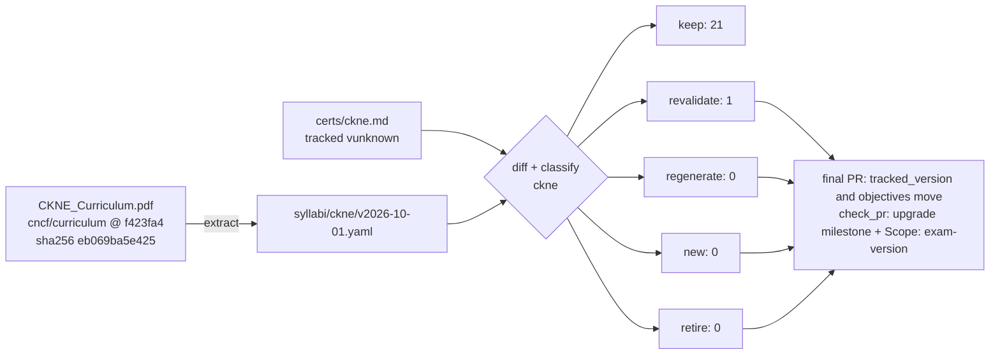

# Upgrade plan: CKNE GA

<!-- Generated by scripts/curriculum_diff.py render from docs/upgrades/ckne-ga.yaml. Do not edit by hand. -->

Milestone: *v0.6.10* · umbrella issue #285

## Counts

| Cert | keep | revalidate | regenerate | new | retire | topic files | planned | sections to edit | version lines (curriculum / label / technical) |
| :--- | ---: | ---: | ---: | ---: | ---: | ---: | ---: | ---: | ---: |
| ckne | 21 | 1 | 0 | 0 | 0 | 110 | 1 | 0 | 0 / 0 / 0 |

## Flow

## Rules (from the code, not judgment)

Thresholds: MATCH = 0.6, REWORD = 0.9 (difflib ratio on normalized text). The first rule that applies wins.

| Class | Rule | What happens | Files it may change |
| :--- | :--- | :--- | :--- |
| `retire` | its objective is not in the new syllabus (removed, or below MATCH similarity to every new one) | archive the topic directory; redirect its links | `certs/<cert>/<topic>/**` |
| `regenerate` | its objective changed: best match has MATCH (0.6) <= similarity < REWORD (0.9) | one PR through the whole content process (content, exercises, lab, translations) | `certs/<cert>/<topic>/**` |
| `revalidate` | its objective was reworded (REWORD <= similarity < 1), moved to another domain, or its domain's published weight changed | re-run every check against the new text; record the result in meta.yaml; a failed check makes it regenerate | `certs/<cert>/<topic>/<lang>/meta.yaml`, the listed sections and the listed technical version lines |
| `keep` | its objective text, domain and domain weight are identical | no content change; only its listed technical version lines may be rewritten in place, by the version bump | the listed technical version lines, in place |
| `new` | an objective of the new syllabus that no topic covers | a new topic directory, through the whole content process | `certs/<cert>/<new topic>/**` |

## ckne

- Tracked (what the material was built against): `certs/ckne.md` vunknown, sha256 `4b49c4e17c20…`
- Target: `syllabi/ckne/v2026-10-01.yaml` v2026-10-01, from [CKNE_Curriculum.pdf](https://github.com/cncf/curriculum/raw/f423fa49c0cab0820533babd95b37ebe8fd89e67/CKNE_Curriculum.pdf) @ `f423fa4`, PDF sha256 `eb069ba5e425043bb3d396303c8df0c58812803677d393be66cebbd67ca733d3`

### Impact: frozen `certs/ckne.md` -> v2026-10-01 (drives the classes)

- reworded (0.9661): 5.2 "Troubleshooting End to End Network Performance with Tracing" -> 4.2 "Troubleshooting End-to-End Network Performance with Tracing"

### Per-topic plan

| Topic | Objective | Class | Why | Maps to | Sections to edit | Version lines (c/l/t) | Langs | Lab |
| :--- | :--- | :--- | :--- | :--- | ---: | :--- | :--- | :--- |
| 1.1 | Installing and Configuring CNI Plugins | `keep` | unchanged | 1.1 | 0 | 0/0/0 | en | yes |
| 1.2 | Managing IPAM and Pod CIDR Allocation | `keep` | unchanged | 1.2 | 0 | 0/0/0 | en | yes |
| 1.3 | Using Linux Tools (iptables, ip, tcpdump) for Packet-level Issues | `keep` | unchanged | 1.3 | 0 | 0/0/0 | en | yes |
| 1.4 | Troubleshooting Pod Connectivity (DNS, pod-to-pod) | `keep` | unchanged | 1.4 | 0 | 0/0/0 | en | yes |
| 1.5 | Configuring Multi-interface Pods | `keep` | unchanged | 1.5 | 0 | 0/0/0 | en | yes |
| 2.1 | Configuring L4 Services | `keep` | unchanged | 2.1 | 0 | 0/0/0 | en | yes |
| 2.2 | Understanding kube-proxy and CNI Alternatives | `keep` | unchanged | 2.2 | 0 | 0/0/0 | en | yes |
| 2.3 | Customizing coreDNS for Services | `keep` | unchanged | 2.3 | 0 | 0/0/0 | en | yes |
| 2.4 | Troubleshooting Service Network Traffic | `keep` | unchanged | 2.4 | 0 | 0/0/0 | en | yes |
| 2.5 | Configuring Pod Endpoint Availability | `keep` | unchanged | 2.5 | 0 | 0/0/0 | en | yes |
| 2.6 | Managing Traffic with the Gateway API (Gateway, HTTPRoutes) | `keep` | unchanged | 2.6 | 0 | 0/0/0 | en | yes |
| 3.1 | Optimizing LLM Traffic | `keep` | unchanged | 3.1 | 0 | 0/0/0 | en | yes |
| 3.2 | Implementing Routing to Expose Networks | `keep` | unchanged | 3.2 | 0 | 0/0/0 | en | yes |
| 3.3 | Configuring Egress Gateways for Cluster Exit Traffic | `keep` | unchanged | 3.3 | 0 | 0/0/0 | en | yes |
| 3.4 | Implementing Cross Cluster Service Discovery and Load Balancing | `keep` | unchanged | 3.4 | 0 | 0/0/0 | en | yes |
| 4.1 | Securing Traffic with Network Policies | `keep` | unchanged | 5.1 | 0 | 0/0/0 | en | yes |
| 4.2 | Implementing Node and Pod Level Encryption | `keep` | unchanged | 5.2 | 0 | 0/0/0 | en | yes |
| 4.3 | Managing TLS Certificates for Gateway API | `keep` | unchanged | 5.3 | 0 | 0/0/0 | en | yes |
| 4.4 | Implementing Pod-level Authentication and Authorization | `keep` | unchanged | 5.4 | 0 | 0/0/0 | en | yes |
| 5.1 | Analyzing Network Health Using Metrics | `keep` | unchanged | 4.1 | 0 | 0/0/0 | en | yes |
| 5.2 | Troubleshooting End to End Network Performance with Tracing | `revalidate` | objective reworded (similarity 0.9661) | 4.2 | 0 | 0/0/0 | en | yes |
| 5.3 | Auditing Traffic with Logs | `keep` | unchanged | 4.3 | 0 | 0/0/0 | en | yes |
