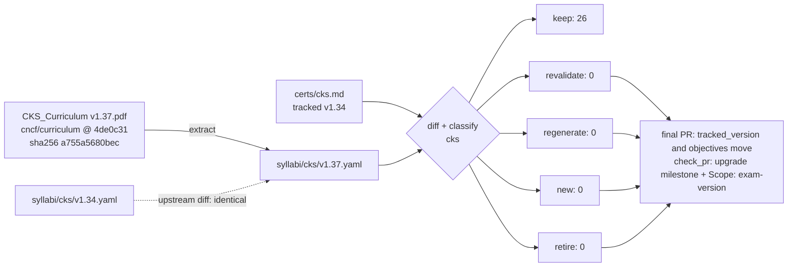

# Upgrade plan: CKS v1.37

<!-- Generated by scripts/curriculum_diff.py render from docs/upgrades/cks-1.37.yaml. Do not edit by hand. -->

Milestone: *CKS v1.37 upgrade* · umbrella issue #287

## Counts

| Cert | keep | revalidate | regenerate | new | retire | topic files | planned | sections to edit | version lines (curriculum / label / technical) |
| :--- | ---: | ---: | ---: | ---: | ---: | ---: | ---: | ---: | ---: |
| cks | 26 | 0 | 0 | 0 | 0 | 208 | 98 | 0 | 108 / 92 / 706 |

## Flow

## Rules (from the code, not judgment)

Thresholds: MATCH = 0.6, REWORD = 0.9 (difflib ratio on normalized text). The first rule that applies wins.

| Class | Rule | What happens | Files it may change |
| :--- | :--- | :--- | :--- |
| `retire` | its objective is not in the new syllabus (removed, or below MATCH similarity to every new one) | archive the topic directory; redirect its links | `certs/<cert>/<topic>/**` |
| `regenerate` | its objective changed: best match has MATCH (0.6) <= similarity < REWORD (0.9) | one PR through the whole content process (content, exercises, lab, translations) | `certs/<cert>/<topic>/**` |
| `revalidate` | its objective was reworded (REWORD <= similarity < 1), moved to another domain, or its domain's published weight changed | re-run every check against the new text; record the result in meta.yaml; a failed check makes it regenerate | `certs/<cert>/<topic>/<lang>/meta.yaml`, the listed sections and the listed technical version lines |
| `keep` | its objective text, domain and domain weight are identical | no content change; only its listed technical version lines may be rewritten in place, by the version bump | the listed technical version lines, in place |
| `new` | an objective of the new syllabus that no topic covers | a new topic directory, through the whole content process | `certs/<cert>/<new topic>/**` |

## cks

- Tracked (what the material was built against): `certs/cks.md` v1.34, sha256 `f9c9bbc6b547…`
- Target: `syllabi/cks/v1.37.yaml` v1.37, from [CKS_Curriculum v1.37.pdf](https://github.com/cncf/curriculum/raw/4de0c318883d34f6070e760bf55df1f8dd5846eb/CKS_Curriculum%20v1.37.pdf) @ `4de0c31`, PDF sha256 `a755a5680bec6978de4a3074d7f0c7fe978bd7a9ad5e4f1681597aedda6f6637`
- Upstream base: `syllabi/cks/v1.34.yaml` v1.34, from [CKS_Curriculum v1.34.pdf](https://github.com/cncf/curriculum/raw/94f35b01ae65763117de7fd5fcd5d57feacae68c/CKS_Curriculum%20v1.34.pdf) @ `94f35b0`, PDF sha256 `a755a5680bec6978de4a3074d7f0c7fe978bd7a9ad5e4f1681597aedda6f6637`

### What upstream changed (v1.34 PDF -> v1.37 PDF)

- identical: no domain, weight or objective changed

### Drift: frozen `certs/cks.md` vs its own v1.34 PDF

- identical: no domain, weight or objective changed

### Impact: frozen `certs/cks.md` -> v1.37 (drives the classes)

- identical: no domain, weight or objective changed

### Per-topic plan

| Topic | Objective | Class | Why | Maps to | Sections to edit | Version lines (c/l/t) | Langs | Lab |
| :--- | :--- | :--- | :--- | :--- | ---: | :--- | :--- | :--- |
| 1.1 | Use Network security policies to restrict cluster level access | `keep` | unchanged | 1.1 | 0 | 4/0/4 | en,es | yes |
| 1.2 | Use CIS benchmark to review the security configuration of Kubernetes components (etcd, kubelet, kubedns, kubeapi) | `keep` | unchanged | 1.2 | 0 | 4/0/4 | en,es | yes |
| 1.3 | Properly set up Ingress objects with TLS | `keep` | unchanged | 1.3 | 0 | 4/2/2 | en,es | yes |
| 1.4 | Protect node metadata and endpoints | `keep` | unchanged | 1.4 | 0 | 4/2/2 | en,es | yes |
| 1.5 | Verify platform binaries before deploying | `keep` | unchanged | 1.5 | 0 | 4/0/59 | en,es | yes |
| 2.1 | Use appropriate pod security standards | `keep` | unchanged | 2.1 | 0 | 4/4/34 | en,es | yes |
| 2.2 | Manage kubernetes secrets | `keep` | unchanged | 2.2 | 0 | 4/2/2 | en,es | yes |
| 2.3 | Understand and implement isolation techniques (multi-tenancy, sandboxed containers, etc.) | `keep` | unchanged | 2.3 | 0 | 4/6/12 | en,es | yes |
| 2.4 | Implement Pod-to-Pod encryption (Cilium, Istio) | `keep` | unchanged | 2.4 | 0 | 4/2/3 | en,es | yes |
| 3.1 | Use Role Based Access Controls to minimize exposure | `keep` | unchanged | 3.1 | 0 | 5/3/8 | en,es | yes |
| 3.2 | Exercise caution in using service accounts e.g. disable defaults, minimize permissions on newly created ones | `keep` | unchanged | 3.2 | 0 | 4/4/6 | en,es | yes |
| 3.3 | Restrict access to Kubernetes API | `keep` | unchanged | 3.3 | 0 | 4/4/14 | en,es | yes |
| 3.4 | Upgrade Kubernetes to avoid vulnerabilities | `keep` | unchanged | 3.4 | 0 | 4/26/399 | en,es | yes |
| 4.1 | Minimize base image footprint | `keep` | unchanged | 4.1 | 0 | 4/4/14 | en,es | yes |
| 4.2 | Understand your supply chain (e.g. SBOM, CI/CD, artifact repositories) | `keep` | unchanged | 4.2 | 0 | 5/2/8 | en,es | yes |
| 4.3 | Secure your supply chain (permitted registries, sign and validate artifacts, etc.) | `keep` | unchanged | 4.3 | 0 | 7/1/12 | en,es | yes |
| 4.4 | Perform static analysis of user workloads and container images (e.g. Kubesec, KubeLinter) | `keep` | unchanged | 4.4 | 0 | 4/6/14 | en,es | yes |
| 5.1 | Minimize host OS footprint (reduce attack surface) | `keep` | unchanged | 5.1 | 0 | 4/2/9 | en,es | yes |
| 5.2 | Using least-privilege identity and access management | `keep` | unchanged | 5.2 | 0 | 2/0/7 | en,es | yes |
| 5.3 | Minimize external access to the network | `keep` | unchanged | 5.3 | 0 | 4/4/20 | en,es | yes |
| 5.4 | Appropriately use kernel hardening tools such as AppArmor, seccomp | `keep` | unchanged | 5.4 | 0 | 5/1/11 | en,es | yes |
| 6.1 | Perform behavioral analytics to detect malicious activities | `keep` | unchanged | 6.1 | 0 | 4/4/6 | en,es | yes |
| 6.2 | Detect threats within physical infrastructure, apps, networks, data, users and workloads | `keep` | unchanged | 6.2 | 0 | 5/2/9 | en,es | yes |
| 6.3 | Investigate and identify phases of attack and bad actors within the environment | `keep` | unchanged | 6.3 | 0 | 2/4/9 | en,es | yes |
| 6.4 | Ensure immutability of containers at runtime | `keep` | unchanged | 6.4 | 0 | 5/3/20 | en,es | yes |
| 6.5 | Use Kubernetes audit logs to monitor access | `keep` | unchanged | 6.5 | 0 | 4/4/18 | en,es | yes |

### Technical lines that name v1.34

Commands, outputs or prose about that Kubernetes version: the only version lines a bump may need to rewrite by hand (the curriculum and label lines are mechanical).

- `certs/cks/1.1/en/exercises.md:15`
- `certs/cks/1.1/es/exercises.md:15`
- `certs/cks/1.1/lab/break_fix.sh:3`
- `certs/cks/1.1/lab/break_fix.sh:6`
- `certs/cks/1.2/en/exercises.md:9`
- `certs/cks/1.2/es/exercises.md:9`
- `certs/cks/1.2/lab/break_fix.sh:3`
- `certs/cks/1.2/lab/break_fix.sh:8`
- `certs/cks/1.3/lab/break_fix.sh:3`
- `certs/cks/1.3/lab/break_fix.sh:6`
- `certs/cks/1.4/lab/break_fix.sh:3`
- `certs/cks/1.4/lab/break_fix.sh:5`
- `certs/cks/1.5/en/content.md:35`
- `certs/cks/1.5/en/content.md:38`
- `certs/cks/1.5/en/content.md:49`
- `certs/cks/1.5/en/content.md:89`
- `certs/cks/1.5/en/content.md:98`
- `certs/cks/1.5/en/content.md:116`
- `certs/cks/1.5/en/content.md:137`
- `certs/cks/1.5/en/content.md:143`
- `certs/cks/1.5/en/content.md:171`
- `certs/cks/1.5/en/content.md:178`
- `certs/cks/1.5/en/content.md:179`
- `certs/cks/1.5/en/content.md:197`
- `certs/cks/1.5/en/content.md:198`
- `certs/cks/1.5/en/content.md:204`
- `certs/cks/1.5/en/content.md:214`
- `certs/cks/1.5/en/content.md:215`
- `certs/cks/1.5/en/content.md:233`
- `certs/cks/1.5/en/content.md:294`
- `certs/cks/1.5/en/exercises.md:26`
- `certs/cks/1.5/en/exercises.md:30`
- `certs/cks/1.5/en/exercises.md:36`
- `certs/cks/1.5/en/exercises.md:55`
- `certs/cks/1.5/en/exercises.md:97`
- `certs/cks/1.5/en/exercises.md:311`
- `certs/cks/1.5/en/exercises.md:312`
- `certs/cks/1.5/en/exercises.md:319`
- `certs/cks/1.5/en/exercises.md:326`
- `certs/cks/1.5/en/exercises.md:612`
- `certs/cks/1.5/es/content.md:35`
- `certs/cks/1.5/es/content.md:38`
- `certs/cks/1.5/es/content.md:49`
- `certs/cks/1.5/es/content.md:89`
- `certs/cks/1.5/es/content.md:98`
- `certs/cks/1.5/es/content.md:116`
- `certs/cks/1.5/es/content.md:137`
- `certs/cks/1.5/es/content.md:143`
- `certs/cks/1.5/es/content.md:171`
- `certs/cks/1.5/es/content.md:178`
- `certs/cks/1.5/es/content.md:179`
- `certs/cks/1.5/es/content.md:197`
- `certs/cks/1.5/es/content.md:198`
- `certs/cks/1.5/es/content.md:204`
- `certs/cks/1.5/es/content.md:214`
- `certs/cks/1.5/es/content.md:215`
- `certs/cks/1.5/es/content.md:233`
- `certs/cks/1.5/es/content.md:294`
- `certs/cks/1.5/es/exercises.md:26`
- `certs/cks/1.5/es/exercises.md:30`
- `certs/cks/1.5/es/exercises.md:36`
- `certs/cks/1.5/es/exercises.md:55`
- `certs/cks/1.5/es/exercises.md:97`
- `certs/cks/1.5/es/exercises.md:311`
- `certs/cks/1.5/es/exercises.md:312`
- `certs/cks/1.5/es/exercises.md:319`
- `certs/cks/1.5/es/exercises.md:326`
- `certs/cks/1.5/es/exercises.md:612`
- `certs/cks/1.5/lab/break_fix.sh:5`
- `certs/cks/1.5/lab/break_fix.sh:10`
- `certs/cks/1.5/lab/break_fix.sh:251`
- `certs/cks/2.1/en/content.md:76`
- `certs/cks/2.1/en/content.md:126`
- `certs/cks/2.1/en/content.md:142`
- `certs/cks/2.1/en/content.md:289`
- `certs/cks/2.1/en/content.md:375`
- `certs/cks/2.1/en/content.md:445`
- `certs/cks/2.1/en/content.md:455`
- `certs/cks/2.1/en/content.md:472`
- `certs/cks/2.1/en/exercises.md:3`
- `certs/cks/2.1/en/exercises.md:22`
- `certs/cks/2.1/en/exercises.md:104`
- `certs/cks/2.1/en/exercises.md:150`
- `certs/cks/2.1/en/exercises.md:322`
- `certs/cks/2.1/en/exercises.md:339`
- `certs/cks/2.1/en/exercises.md:341`
- `certs/cks/2.1/en/exercises.md:343`
- `certs/cks/2.1/es/content.md:76`
- `certs/cks/2.1/es/content.md:126`
- `certs/cks/2.1/es/content.md:142`
- `certs/cks/2.1/es/content.md:289`
- `certs/cks/2.1/es/content.md:375`
- `certs/cks/2.1/es/content.md:445`
- `certs/cks/2.1/es/content.md:455`
- `certs/cks/2.1/es/content.md:472`
- `certs/cks/2.1/es/exercises.md:3`
- `certs/cks/2.1/es/exercises.md:22`
- `certs/cks/2.1/es/exercises.md:104`
- `certs/cks/2.1/es/exercises.md:150`
- `certs/cks/2.1/es/exercises.md:322`
- `certs/cks/2.1/es/exercises.md:339`
- `certs/cks/2.1/es/exercises.md:341`
- `certs/cks/2.1/es/exercises.md:343`
- `certs/cks/2.1/lab/break_fix.sh:3`
- `certs/cks/2.1/lab/break_fix.sh:9`
- `certs/cks/2.2/lab/break_fix.sh:261`
- `certs/cks/2.2/lab/break_fix.sh:262`
- `certs/cks/2.3/en/content.md:93`
- `certs/cks/2.3/en/content.md:619`
- `certs/cks/2.3/en/exercises.md:31`
- `certs/cks/2.3/en/exercises.md:64`
- `certs/cks/2.3/en/exercises.md:969`
- `certs/cks/2.3/es/content.md:93`
- `certs/cks/2.3/es/content.md:619`
- `certs/cks/2.3/es/exercises.md:31`
- `certs/cks/2.3/es/exercises.md:64`
- `certs/cks/2.3/es/exercises.md:969`
- `certs/cks/2.3/lab/break_fix.sh:3`
- `certs/cks/2.3/lab/break_fix.sh:7`
- `certs/cks/2.4/lab/break_fix.sh:3`
- `certs/cks/2.4/lab/break_fix.sh:5`
- `certs/cks/2.4/lab/break_fix.sh:255`
- `certs/cks/3.1/en/content.md:120`
- `certs/cks/3.1/en/content.md:350`
- `certs/cks/3.1/en/exercises.md:11`
- `certs/cks/3.1/es/content.md:120`
- `certs/cks/3.1/es/content.md:350`
- `certs/cks/3.1/es/exercises.md:11`
- `certs/cks/3.1/lab/break_fix.sh:3`
- `certs/cks/3.1/lab/break_fix.sh:7`
- `certs/cks/3.2/en/exercises.md:12`
- `certs/cks/3.2/en/exercises.md:317`
- `certs/cks/3.2/es/exercises.md:12`
- `certs/cks/3.2/es/exercises.md:317`
- `certs/cks/3.2/lab/break_fix.sh:3`
- `certs/cks/3.2/lab/break_fix.sh:8`
- `certs/cks/3.3/en/content.md:116`
- `certs/cks/3.3/en/content.md:445`
- `certs/cks/3.3/en/exercises.md:82`
- `certs/cks/3.3/en/exercises.md:135`
- `certs/cks/3.3/en/exercises.md:159`
- `certs/cks/3.3/en/exercises.md:583`
- `certs/cks/3.3/es/content.md:116`
- `certs/cks/3.3/es/content.md:445`
- `certs/cks/3.3/es/exercises.md:82`
- `certs/cks/3.3/es/exercises.md:135`
- `certs/cks/3.3/es/exercises.md:159`
- `certs/cks/3.3/es/exercises.md:583`
- `certs/cks/3.3/lab/break_fix.sh:5`
- `certs/cks/3.3/lab/break_fix.sh:10`
- `certs/cks/3.4/en/content.md:3`
- `certs/cks/3.4/en/content.md:31`
- `certs/cks/3.4/en/content.md:54`
- `certs/cks/3.4/en/content.md:91`
- `certs/cks/3.4/en/content.md:218`
- `certs/cks/3.4/en/content.md:404`
- `certs/cks/3.4/en/content.md:408`
- `certs/cks/3.4/en/content.md:452`
- `certs/cks/3.4/en/content.md:485`
- `certs/cks/3.4/en/content.md:509`
- `certs/cks/3.4/en/content.md:522`
- `certs/cks/3.4/en/content.md:531`
- `certs/cks/3.4/en/content.md:532`
- `certs/cks/3.4/en/content.md:533`
- `certs/cks/3.4/en/content.md:534`
- `certs/cks/3.4/en/content.md:535`
- `certs/cks/3.4/en/content.md:538`
- `certs/cks/3.4/en/content.md:540`
- `certs/cks/3.4/en/content.md:580`
- `certs/cks/3.4/en/content.md:581`
- `certs/cks/3.4/en/content.md:584`
- `certs/cks/3.4/en/content.md:586`
- `certs/cks/3.4/en/content.md:597`
- `certs/cks/3.4/en/content.md:600`
- `certs/cks/3.4/en/content.md:601`
- `certs/cks/3.4/en/content.md:643`
- `certs/cks/3.4/en/content.md:645`
- `certs/cks/3.4/en/content.md:649`
- `certs/cks/3.4/en/content.md:650`
- `certs/cks/3.4/en/content.md:655`
- `certs/cks/3.4/en/content.md:656`
- `certs/cks/3.4/en/content.md:664`
- `certs/cks/3.4/en/content.md:669`
- `certs/cks/3.4/en/content.md:674`
- `certs/cks/3.4/en/content.md:686`
- `certs/cks/3.4/en/content.md:687`
- `certs/cks/3.4/en/content.md:688`
- `certs/cks/3.4/en/content.md:689`
- `certs/cks/3.4/en/content.md:693`
- `certs/cks/3.4/en/content.md:694`
- `certs/cks/3.4/en/content.md:695`
- `certs/cks/3.4/en/content.md:696`
- `certs/cks/3.4/en/content.md:697`
- `certs/cks/3.4/en/content.md:702`
- `certs/cks/3.4/en/content.md:703`
- `certs/cks/3.4/en/content.md:704`
- `certs/cks/3.4/en/content.md:705`
- `certs/cks/3.4/en/content.md:706`
- `certs/cks/3.4/en/content.md:707`
- `certs/cks/3.4/en/content.md:708`
- `certs/cks/3.4/en/content.md:709`
- `certs/cks/3.4/en/content.md:710`
- `certs/cks/3.4/en/content.md:717`
- `certs/cks/3.4/en/content.md:735`
- `certs/cks/3.4/en/content.md:743`
- `certs/cks/3.4/en/content.md:744`
- `certs/cks/3.4/en/content.md:753`
- `certs/cks/3.4/en/content.md:754`
- `certs/cks/3.4/en/content.md:755`
- `certs/cks/3.4/en/content.md:756`
- `certs/cks/3.4/en/content.md:757`
- `certs/cks/3.4/en/content.md:762`
- `certs/cks/3.4/en/content.md:763`
- `certs/cks/3.4/en/content.md:764`
- `certs/cks/3.4/en/content.md:765`
- `certs/cks/3.4/en/content.md:766`
- `certs/cks/3.4/en/content.md:775`
- `certs/cks/3.4/en/content.md:779`
- `certs/cks/3.4/en/content.md:780`
- `certs/cks/3.4/en/content.md:781`
- `certs/cks/3.4/en/content.md:785`
- `certs/cks/3.4/en/content.md:822`
- `certs/cks/3.4/en/content.md:842`
- `certs/cks/3.4/en/content.md:869`
- `certs/cks/3.4/en/content.md:984`
- `certs/cks/3.4/en/content.md:1001`
- `certs/cks/3.4/en/content.md:1009`
- `certs/cks/3.4/en/content.md:1010`
- `certs/cks/3.4/en/content.md:1017`
- `certs/cks/3.4/en/content.md:1071`
- `certs/cks/3.4/en/content.md:1073`
- `certs/cks/3.4/en/content.md:1086`
- `certs/cks/3.4/en/content.md:1152`
- `certs/cks/3.4/en/content.md:1153`
- `certs/cks/3.4/en/content.md:1154`
- `certs/cks/3.4/en/content.md:1155`
- `certs/cks/3.4/en/content.md:1156`
- `certs/cks/3.4/en/content.md:1159`
- `certs/cks/3.4/en/content.md:1161`
- `certs/cks/3.4/en/content.md:1188`
- `certs/cks/3.4/en/content.md:1339`
- `certs/cks/3.4/en/content.md:1341`
- `certs/cks/3.4/en/content.md:1348`
- `certs/cks/3.4/en/content.md:1410`
- `certs/cks/3.4/en/content.md:1416`
- `certs/cks/3.4/en/content.md:1418`
- `certs/cks/3.4/en/content.md:1489`
- `certs/cks/3.4/en/content.md:1490`
- `certs/cks/3.4/en/content.md:1492`
- `certs/cks/3.4/en/content.md:1496`
- `certs/cks/3.4/en/content.md:1505`
- `certs/cks/3.4/en/content.md:1506`
- `certs/cks/3.4/en/content.md:1508`
- `certs/cks/3.4/en/exercises.md:18`
- `certs/cks/3.4/en/exercises.md:19`
- `certs/cks/3.4/en/exercises.md:20`
- `certs/cks/3.4/en/exercises.md:25`
- `certs/cks/3.4/en/exercises.md:27`
- `certs/cks/3.4/en/exercises.md:47`
- `certs/cks/3.4/en/exercises.md:48`
- `certs/cks/3.4/en/exercises.md:49`
- `certs/cks/3.4/en/exercises.md:59`
- `certs/cks/3.4/en/exercises.md:61`
- `certs/cks/3.4/en/exercises.md:71`
- `certs/cks/3.4/en/exercises.md:85`
- `certs/cks/3.4/en/exercises.md:86`
- `certs/cks/3.4/en/exercises.md:87`
- `certs/cks/3.4/en/exercises.md:98`
- `certs/cks/3.4/en/exercises.md:135`
- `certs/cks/3.4/en/exercises.md:136`
- `certs/cks/3.4/en/exercises.md:137`
- `certs/cks/3.4/en/exercises.md:138`
- `certs/cks/3.4/en/exercises.md:140`
- `certs/cks/3.4/en/exercises.md:219`
- `certs/cks/3.4/en/exercises.md:256`
- `certs/cks/3.4/en/exercises.md:263`
- `certs/cks/3.4/en/exercises.md:269`
- `certs/cks/3.4/en/exercises.md:293`
- `certs/cks/3.4/en/exercises.md:319`
- `certs/cks/3.4/en/exercises.md:391`
- `certs/cks/3.4/en/exercises.md:395`
- `certs/cks/3.4/en/exercises.md:408`
- `certs/cks/3.4/en/exercises.md:418`
- `certs/cks/3.4/en/exercises.md:423`
- `certs/cks/3.4/en/exercises.md:425`
- `certs/cks/3.4/en/exercises.md:436`
- `certs/cks/3.4/en/exercises.md:439`
- `certs/cks/3.4/en/exercises.md:452`
- `certs/cks/3.4/en/exercises.md:453`
- `certs/cks/3.4/en/exercises.md:460`
- `certs/cks/3.4/en/exercises.md:467`
- `certs/cks/3.4/en/exercises.md:472`
- `certs/cks/3.4/en/exercises.md:486`
- `certs/cks/3.4/en/exercises.md:487`
- `certs/cks/3.4/en/exercises.md:488`
- `certs/cks/3.4/en/exercises.md:489`
- `certs/cks/3.4/en/exercises.md:494`
- `certs/cks/3.4/en/exercises.md:495`
- `certs/cks/3.4/en/exercises.md:496`
- `certs/cks/3.4/en/exercises.md:501`
- `certs/cks/3.4/en/exercises.md:502`
- `certs/cks/3.4/en/exercises.md:503`
- `certs/cks/3.4/en/exercises.md:504`
- `certs/cks/3.4/en/exercises.md:510`
- `certs/cks/3.4/en/exercises.md:520`
- `certs/cks/3.4/en/exercises.md:523`
- `certs/cks/3.4/en/exercises.md:530`
- `certs/cks/3.4/en/exercises.md:544`
- `certs/cks/3.4/en/exercises.md:551`
- `certs/cks/3.4/en/exercises.md:552`
- `certs/cks/3.4/en/exercises.md:553`
- `certs/cks/3.4/en/exercises.md:556`
- `certs/cks/3.4/en/exercises.md:569`
- `certs/cks/3.4/en/exercises.md:574`
- `certs/cks/3.4/en/exercises.md:585`
- `certs/cks/3.4/en/exercises.md:588`
- `certs/cks/3.4/en/exercises.md:589`
- `certs/cks/3.4/en/exercises.md:590`
- `certs/cks/3.4/en/exercises.md:593`
- `certs/cks/3.4/en/exercises.md:615`
- `certs/cks/3.4/en/exercises.md:621`
- `certs/cks/3.4/en/exercises.md:642`
- `certs/cks/3.4/en/exercises.md:643`
- `certs/cks/3.4/en/exercises.md:644`
- `certs/cks/3.4/en/exercises.md:662`
- `certs/cks/3.4/en/exercises.md:684`
- `certs/cks/3.4/en/exercises.md:728`
- `certs/cks/3.4/en/exercises.md:738`
- `certs/cks/3.4/en/exercises.md:752`
- `certs/cks/3.4/en/exercises.md:772`
- `certs/cks/3.4/en/exercises.md:812`
- `certs/cks/3.4/en/exercises.md:813`
- `certs/cks/3.4/en/exercises.md:824`
- `certs/cks/3.4/en/exercises.md:849`
- `certs/cks/3.4/en/exercises.md:863`
- `certs/cks/3.4/en/exercises.md:891`
- `certs/cks/3.4/en/exercises.md:898`
- `certs/cks/3.4/en/exercises.md:935`
- `certs/cks/3.4/en/exercises.md:937`
- `certs/cks/3.4/en/exercises.md:942`
- `certs/cks/3.4/en/exercises.md:946`
- `certs/cks/3.4/en/exercises.md:951`
- `certs/cks/3.4/en/exercises.md:961`
- `certs/cks/3.4/en/exercises.md:967`
- `certs/cks/3.4/en/exercises.md:984`
- `certs/cks/3.4/en/exercises.md:997`
- `certs/cks/3.4/en/exercises.md:1007`
- `certs/cks/3.4/en/exercises.md:1055`
- `certs/cks/3.4/es/content.md:3`
- `certs/cks/3.4/es/content.md:31`
- `certs/cks/3.4/es/content.md:54`
- `certs/cks/3.4/es/content.md:91`
- `certs/cks/3.4/es/content.md:218`
- `certs/cks/3.4/es/content.md:404`
- `certs/cks/3.4/es/content.md:408`
- `certs/cks/3.4/es/content.md:452`
- `certs/cks/3.4/es/content.md:485`
- `certs/cks/3.4/es/content.md:509`
- `certs/cks/3.4/es/content.md:522`
- `certs/cks/3.4/es/content.md:531`
- `certs/cks/3.4/es/content.md:532`
- `certs/cks/3.4/es/content.md:533`
- `certs/cks/3.4/es/content.md:534`
- `certs/cks/3.4/es/content.md:535`
- `certs/cks/3.4/es/content.md:538`
- `certs/cks/3.4/es/content.md:540`
- `certs/cks/3.4/es/content.md:580`
- `certs/cks/3.4/es/content.md:581`
- `certs/cks/3.4/es/content.md:584`
- `certs/cks/3.4/es/content.md:586`
- `certs/cks/3.4/es/content.md:597`
- `certs/cks/3.4/es/content.md:600`
- `certs/cks/3.4/es/content.md:601`
- `certs/cks/3.4/es/content.md:643`
- `certs/cks/3.4/es/content.md:645`
- `certs/cks/3.4/es/content.md:649`
- `certs/cks/3.4/es/content.md:650`
- `certs/cks/3.4/es/content.md:655`
- `certs/cks/3.4/es/content.md:656`
- `certs/cks/3.4/es/content.md:664`
- `certs/cks/3.4/es/content.md:669`
- `certs/cks/3.4/es/content.md:674`
- `certs/cks/3.4/es/content.md:686`
- `certs/cks/3.4/es/content.md:687`
- `certs/cks/3.4/es/content.md:688`
- `certs/cks/3.4/es/content.md:689`
- `certs/cks/3.4/es/content.md:693`
- `certs/cks/3.4/es/content.md:694`
- `certs/cks/3.4/es/content.md:695`
- `certs/cks/3.4/es/content.md:696`
- `certs/cks/3.4/es/content.md:697`
- `certs/cks/3.4/es/content.md:702`
- `certs/cks/3.4/es/content.md:703`
- `certs/cks/3.4/es/content.md:704`
- `certs/cks/3.4/es/content.md:705`
- `certs/cks/3.4/es/content.md:706`
- `certs/cks/3.4/es/content.md:707`
- `certs/cks/3.4/es/content.md:708`
- `certs/cks/3.4/es/content.md:709`
- `certs/cks/3.4/es/content.md:710`
- `certs/cks/3.4/es/content.md:717`
- `certs/cks/3.4/es/content.md:735`
- `certs/cks/3.4/es/content.md:743`
- `certs/cks/3.4/es/content.md:744`
- `certs/cks/3.4/es/content.md:753`
- `certs/cks/3.4/es/content.md:754`
- `certs/cks/3.4/es/content.md:755`
- `certs/cks/3.4/es/content.md:756`
- `certs/cks/3.4/es/content.md:757`
- `certs/cks/3.4/es/content.md:762`
- `certs/cks/3.4/es/content.md:763`
- `certs/cks/3.4/es/content.md:764`
- `certs/cks/3.4/es/content.md:765`
- `certs/cks/3.4/es/content.md:766`
- `certs/cks/3.4/es/content.md:775`
- `certs/cks/3.4/es/content.md:779`
- `certs/cks/3.4/es/content.md:780`
- `certs/cks/3.4/es/content.md:781`
- `certs/cks/3.4/es/content.md:785`
- `certs/cks/3.4/es/content.md:822`
- `certs/cks/3.4/es/content.md:842`
- `certs/cks/3.4/es/content.md:869`
- `certs/cks/3.4/es/content.md:984`
- `certs/cks/3.4/es/content.md:1001`
- `certs/cks/3.4/es/content.md:1009`
- `certs/cks/3.4/es/content.md:1010`
- `certs/cks/3.4/es/content.md:1017`
- `certs/cks/3.4/es/content.md:1071`
- `certs/cks/3.4/es/content.md:1073`
- `certs/cks/3.4/es/content.md:1086`
- `certs/cks/3.4/es/content.md:1152`
- `certs/cks/3.4/es/content.md:1153`
- `certs/cks/3.4/es/content.md:1154`
- `certs/cks/3.4/es/content.md:1155`
- `certs/cks/3.4/es/content.md:1156`
- `certs/cks/3.4/es/content.md:1159`
- `certs/cks/3.4/es/content.md:1161`
- `certs/cks/3.4/es/content.md:1188`
- `certs/cks/3.4/es/content.md:1339`
- `certs/cks/3.4/es/content.md:1341`
- `certs/cks/3.4/es/content.md:1348`
- `certs/cks/3.4/es/content.md:1410`
- `certs/cks/3.4/es/content.md:1416`
- `certs/cks/3.4/es/content.md:1418`
- `certs/cks/3.4/es/content.md:1489`
- `certs/cks/3.4/es/content.md:1490`
- `certs/cks/3.4/es/content.md:1492`
- `certs/cks/3.4/es/content.md:1496`
- `certs/cks/3.4/es/content.md:1505`
- `certs/cks/3.4/es/content.md:1506`
- `certs/cks/3.4/es/content.md:1508`
- `certs/cks/3.4/es/exercises.md:18`
- `certs/cks/3.4/es/exercises.md:19`
- `certs/cks/3.4/es/exercises.md:20`
- `certs/cks/3.4/es/exercises.md:25`
- `certs/cks/3.4/es/exercises.md:27`
- `certs/cks/3.4/es/exercises.md:47`
- `certs/cks/3.4/es/exercises.md:48`
- `certs/cks/3.4/es/exercises.md:49`
- `certs/cks/3.4/es/exercises.md:59`
- `certs/cks/3.4/es/exercises.md:61`
- `certs/cks/3.4/es/exercises.md:71`
- `certs/cks/3.4/es/exercises.md:85`
- `certs/cks/3.4/es/exercises.md:86`
- `certs/cks/3.4/es/exercises.md:87`
- `certs/cks/3.4/es/exercises.md:98`
- `certs/cks/3.4/es/exercises.md:135`
- `certs/cks/3.4/es/exercises.md:136`
- `certs/cks/3.4/es/exercises.md:137`
- `certs/cks/3.4/es/exercises.md:138`
- `certs/cks/3.4/es/exercises.md:140`
- `certs/cks/3.4/es/exercises.md:219`
- `certs/cks/3.4/es/exercises.md:256`
- `certs/cks/3.4/es/exercises.md:263`
- `certs/cks/3.4/es/exercises.md:269`
- `certs/cks/3.4/es/exercises.md:293`
- `certs/cks/3.4/es/exercises.md:319`
- `certs/cks/3.4/es/exercises.md:391`
- `certs/cks/3.4/es/exercises.md:395`
- `certs/cks/3.4/es/exercises.md:408`
- `certs/cks/3.4/es/exercises.md:418`
- `certs/cks/3.4/es/exercises.md:423`
- `certs/cks/3.4/es/exercises.md:425`
- `certs/cks/3.4/es/exercises.md:436`
- `certs/cks/3.4/es/exercises.md:439`
- `certs/cks/3.4/es/exercises.md:452`
- `certs/cks/3.4/es/exercises.md:453`
- `certs/cks/3.4/es/exercises.md:460`
- `certs/cks/3.4/es/exercises.md:467`
- `certs/cks/3.4/es/exercises.md:472`
- `certs/cks/3.4/es/exercises.md:486`
- `certs/cks/3.4/es/exercises.md:487`
- `certs/cks/3.4/es/exercises.md:488`
- `certs/cks/3.4/es/exercises.md:489`
- `certs/cks/3.4/es/exercises.md:494`
- `certs/cks/3.4/es/exercises.md:495`
- `certs/cks/3.4/es/exercises.md:496`
- `certs/cks/3.4/es/exercises.md:501`
- `certs/cks/3.4/es/exercises.md:502`
- `certs/cks/3.4/es/exercises.md:503`
- `certs/cks/3.4/es/exercises.md:504`
- `certs/cks/3.4/es/exercises.md:510`
- `certs/cks/3.4/es/exercises.md:520`
- `certs/cks/3.4/es/exercises.md:523`
- `certs/cks/3.4/es/exercises.md:530`
- `certs/cks/3.4/es/exercises.md:544`
- `certs/cks/3.4/es/exercises.md:551`
- `certs/cks/3.4/es/exercises.md:552`
- `certs/cks/3.4/es/exercises.md:553`
- `certs/cks/3.4/es/exercises.md:556`
- `certs/cks/3.4/es/exercises.md:569`
- `certs/cks/3.4/es/exercises.md:574`
- `certs/cks/3.4/es/exercises.md:585`
- `certs/cks/3.4/es/exercises.md:588`
- `certs/cks/3.4/es/exercises.md:589`
- `certs/cks/3.4/es/exercises.md:590`
- `certs/cks/3.4/es/exercises.md:593`
- `certs/cks/3.4/es/exercises.md:615`
- `certs/cks/3.4/es/exercises.md:621`
- `certs/cks/3.4/es/exercises.md:642`
- `certs/cks/3.4/es/exercises.md:643`
- `certs/cks/3.4/es/exercises.md:644`
- `certs/cks/3.4/es/exercises.md:662`
- `certs/cks/3.4/es/exercises.md:684`
- `certs/cks/3.4/es/exercises.md:728`
- `certs/cks/3.4/es/exercises.md:738`
- `certs/cks/3.4/es/exercises.md:752`
- `certs/cks/3.4/es/exercises.md:772`
- `certs/cks/3.4/es/exercises.md:812`
- `certs/cks/3.4/es/exercises.md:813`
- `certs/cks/3.4/es/exercises.md:824`
- `certs/cks/3.4/es/exercises.md:849`
- `certs/cks/3.4/es/exercises.md:863`
- `certs/cks/3.4/es/exercises.md:891`
- `certs/cks/3.4/es/exercises.md:898`
- `certs/cks/3.4/es/exercises.md:935`
- `certs/cks/3.4/es/exercises.md:937`
- `certs/cks/3.4/es/exercises.md:942`
- `certs/cks/3.4/es/exercises.md:946`
- `certs/cks/3.4/es/exercises.md:951`
- `certs/cks/3.4/es/exercises.md:961`
- `certs/cks/3.4/es/exercises.md:967`
- `certs/cks/3.4/es/exercises.md:984`
- `certs/cks/3.4/es/exercises.md:997`
- `certs/cks/3.4/es/exercises.md:1007`
- `certs/cks/3.4/es/exercises.md:1055`
- `certs/cks/3.4/lab/break_fix.sh:3`
- `certs/cks/3.4/lab/break_fix.sh:4`
- `certs/cks/3.4/lab/break_fix.sh:56`
- `certs/cks/4.1/en/content.md:761`
- `certs/cks/4.1/en/content.md:763`
- `certs/cks/4.1/en/content.md:765`
- `certs/cks/4.1/en/content.md:770`
- `certs/cks/4.1/en/exercises.md:11`
- `certs/cks/4.1/en/exercises.md:455`
- `certs/cks/4.1/es/content.md:761`
- `certs/cks/4.1/es/content.md:763`
- `certs/cks/4.1/es/content.md:765`
- `certs/cks/4.1/es/content.md:770`
- `certs/cks/4.1/es/exercises.md:11`
- `certs/cks/4.1/es/exercises.md:455`
- `certs/cks/4.1/lab/break_fix.sh:3`
- `certs/cks/4.1/lab/break_fix.sh:5`
- `certs/cks/4.2/en/content.md:1162`
- `certs/cks/4.2/en/content.md:1219`
- `certs/cks/4.2/es/content.md:3`
- `certs/cks/4.2/es/content.md:1162`
- `certs/cks/4.2/es/content.md:1219`
- `certs/cks/4.2/lab/break_fix.sh:5`
- `certs/cks/4.2/lab/break_fix.sh:15`
- `certs/cks/4.2/lab/break_fix.sh:244`
- `certs/cks/4.3/en/content.md:1165`
- `certs/cks/4.3/en/exercises.md:5`
- `certs/cks/4.3/en/exercises.md:16`
- `certs/cks/4.3/en/exercises.md:202`
- `certs/cks/4.3/en/exercises.md:283`
- `certs/cks/4.3/es/content.md:1165`
- `certs/cks/4.3/es/exercises.md:5`
- `certs/cks/4.3/es/exercises.md:16`
- `certs/cks/4.3/es/exercises.md:202`
- `certs/cks/4.3/es/exercises.md:283`
- `certs/cks/4.3/lab/break_fix.sh:3`
- `certs/cks/4.3/lab/break_fix.sh:19`
- `certs/cks/4.4/en/content.md:7`
- `certs/cks/4.4/en/content.md:193`
- `certs/cks/4.4/en/content.md:531`
- `certs/cks/4.4/en/content.md:1385`
- `certs/cks/4.4/en/exercises.md:4`
- `certs/cks/4.4/en/exercises.md:394`
- `certs/cks/4.4/es/content.md:7`
- `certs/cks/4.4/es/content.md:193`
- `certs/cks/4.4/es/content.md:531`
- `certs/cks/4.4/es/content.md:1385`
- `certs/cks/4.4/es/exercises.md:4`
- `certs/cks/4.4/es/exercises.md:394`
- `certs/cks/4.4/lab/break_fix.sh:3`
- `certs/cks/4.4/lab/break_fix.sh:7`
- `certs/cks/5.1/en/content.md:3`
- `certs/cks/5.1/en/content.md:189`
- `certs/cks/5.1/en/content.md:1708`
- `certs/cks/5.1/es/content.md:3`
- `certs/cks/5.1/es/content.md:189`
- `certs/cks/5.1/es/content.md:1708`
- `certs/cks/5.1/lab/break_fix.sh:4`
- `certs/cks/5.1/lab/break_fix.sh:48`
- `certs/cks/5.1/lab/break_fix.sh:49`
- `certs/cks/5.2/en/content.md:3`
- `certs/cks/5.2/en/exercises.md:3`
- `certs/cks/5.2/es/content.md:3`
- `certs/cks/5.2/es/exercises.md:3`
- `certs/cks/5.2/lab/break_fix.sh:3`
- `certs/cks/5.2/lab/break_fix.sh:24`
- `certs/cks/5.2/lab/break_fix.sh:25`
- `certs/cks/5.3/en/content.md:3`
- `certs/cks/5.3/en/content.md:144`
- `certs/cks/5.3/en/content.md:253`
- `certs/cks/5.3/en/content.md:622`
- `certs/cks/5.3/en/content.md:944`
- `certs/cks/5.3/en/content.md:946`
- `certs/cks/5.3/en/content.md:948`
- `certs/cks/5.3/en/content.md:954`
- `certs/cks/5.3/en/exercises.md:11`
- `certs/cks/5.3/es/content.md:3`
- `certs/cks/5.3/es/content.md:144`
- `certs/cks/5.3/es/content.md:253`
- `certs/cks/5.3/es/content.md:622`
- `certs/cks/5.3/es/content.md:944`
- `certs/cks/5.3/es/content.md:946`
- `certs/cks/5.3/es/content.md:948`
- `certs/cks/5.3/es/content.md:954`
- `certs/cks/5.3/es/exercises.md:11`
- `certs/cks/5.3/lab/break_fix.sh:3`
- `certs/cks/5.3/lab/break_fix.sh:8`
- `certs/cks/5.4/en/content.md:3`
- `certs/cks/5.4/en/content.md:567`
- `certs/cks/5.4/es/content.md:3`
- `certs/cks/5.4/es/content.md:567`
- `certs/cks/5.4/lab/break_fix.sh:3`
- `certs/cks/5.4/lab/break_fix.sh:30`
- `certs/cks/5.4/lab/break_fix.sh:39`
- `certs/cks/5.4/lab/break_fix.sh:40`
- `certs/cks/5.4/lab/break_fix.sh:297`
- `certs/cks/5.4/lab/break_fix.sh:722`
- `certs/cks/5.4/lab/break_fix.sh:1047`
- `certs/cks/6.1/en/exercises.md:4`
- `certs/cks/6.1/es/exercises.md:4`
- `certs/cks/6.1/lab/break_fix.sh:4`
- `certs/cks/6.1/lab/break_fix.sh:10`
- `certs/cks/6.1/lab/break_fix.sh:385`
- `certs/cks/6.1/lab/break_fix.sh:664`
- `certs/cks/6.2/en/content.md:575`
- `certs/cks/6.2/en/exercises.md:3`
- `certs/cks/6.2/en/exercises.md:28`
- `certs/cks/6.2/es/content.md:4`
- `certs/cks/6.2/es/content.md:575`
- `certs/cks/6.2/es/exercises.md:3`
- `certs/cks/6.2/es/exercises.md:28`
- `certs/cks/6.2/lab/break_fix.sh:4`
- `certs/cks/6.2/lab/break_fix.sh:11`
- `certs/cks/6.3/en/content.md:394`
- `certs/cks/6.3/en/content.md:1481`
- `certs/cks/6.3/en/content.md:1627`
- `certs/cks/6.3/es/content.md:394`
- `certs/cks/6.3/es/content.md:1481`
- `certs/cks/6.3/es/content.md:1627`
- `certs/cks/6.3/lab/break_fix.sh:4`
- `certs/cks/6.3/lab/break_fix.sh:30`
- `certs/cks/6.3/lab/break_fix.sh:31`
- `certs/cks/6.4/en/content.md:225`
- `certs/cks/6.4/en/content.md:227`
- `certs/cks/6.4/en/content.md:229`
- `certs/cks/6.4/en/exercises.md:12`
- `certs/cks/6.4/en/exercises.md:18`
- `certs/cks/6.4/en/exercises.md:19`
- `certs/cks/6.4/en/exercises.md:525`
- `certs/cks/6.4/en/exercises.md:534`
- `certs/cks/6.4/es/content.md:225`
- `certs/cks/6.4/es/content.md:227`
- `certs/cks/6.4/es/content.md:229`
- `certs/cks/6.4/es/exercises.md:12`
- `certs/cks/6.4/es/exercises.md:18`
- `certs/cks/6.4/es/exercises.md:19`
- `certs/cks/6.4/es/exercises.md:525`
- `certs/cks/6.4/es/exercises.md:534`
- `certs/cks/6.4/lab/break_fix.sh:4`
- `certs/cks/6.4/lab/break_fix.sh:9`
- `certs/cks/6.4/lab/break_fix.sh:100`
- `certs/cks/6.4/lab/break_fix.sh:858`
- `certs/cks/6.5/en/content.md:520`
- `certs/cks/6.5/en/content.md:616`
- `certs/cks/6.5/en/content.md:997`
- `certs/cks/6.5/en/content.md:1027`
- `certs/cks/6.5/en/content.md:1043`
- `certs/cks/6.5/en/exercises.md:5`
- `certs/cks/6.5/en/exercises.md:167`
- `certs/cks/6.5/es/content.md:520`
- `certs/cks/6.5/es/content.md:616`
- `certs/cks/6.5/es/content.md:997`
- `certs/cks/6.5/es/content.md:1027`
- `certs/cks/6.5/es/content.md:1043`
- `certs/cks/6.5/es/exercises.md:5`
- `certs/cks/6.5/es/exercises.md:167`
- `certs/cks/6.5/lab/break_fix.sh:4`
- `certs/cks/6.5/lab/break_fix.sh:30`
- `certs/cks/6.5/lab/break_fix.sh:31`
- `certs/cks/6.5/lab/break_fix.sh:850`
