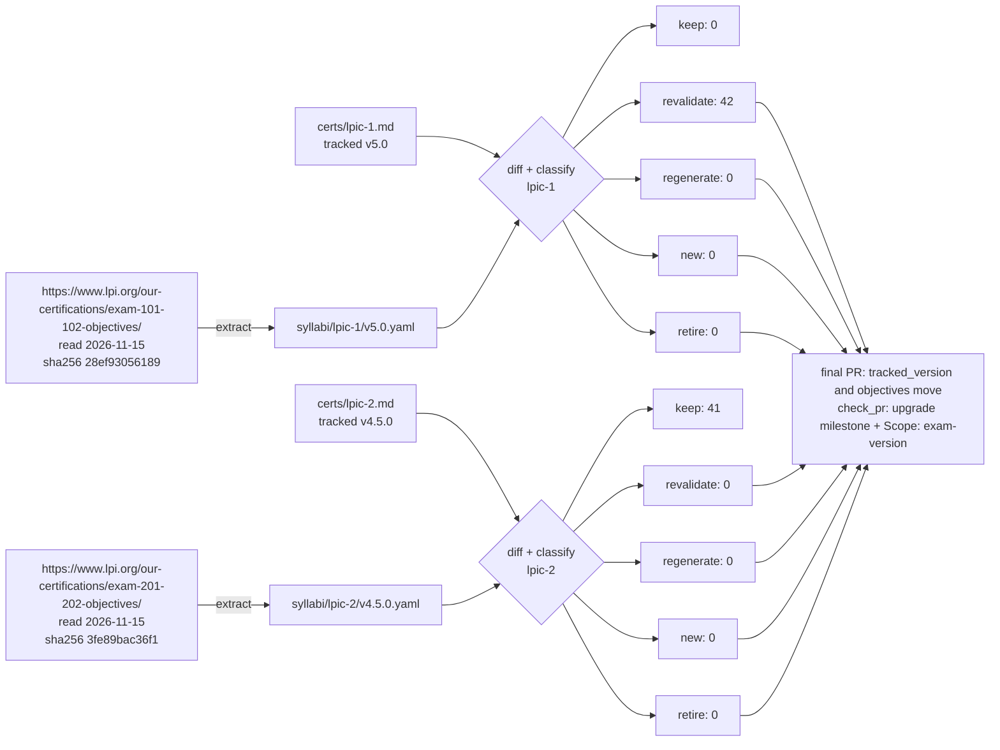

# Upgrade plan: LPIC canonical objective pages

<!-- Generated by scripts/curriculum_diff.py render from docs/upgrades/lpic-canonical-pages.yaml. Do not edit by hand. -->

Milestone: *v0.6.11* · umbrella issue #235

## Counts

| Cert | keep | revalidate | regenerate | new | retire | topic files | planned | sections to edit | version lines (curriculum / label / technical) |
| :--- | ---: | ---: | ---: | ---: | ---: | ---: | ---: | ---: | ---: |
| lpic-1 | 0 | 42 | 0 | 0 | 0 | 336 | 267 | 112 | 0 / 0 / 322 |
| lpic-2 | 41 | 0 | 0 | 0 | 0 | 9 | 4 | 0 | 0 / 0 / 8 |

## Flow

## Rules (from the code, not judgment)

Thresholds: MATCH = 0.6, REWORD = 0.9 (difflib ratio on normalized text). The first rule that applies wins.

| Class | Rule | What happens | Files it may change |
| :--- | :--- | :--- | :--- |
| `retire` | its objective is not in the new syllabus (removed, or below MATCH similarity to every new one) | archive the topic directory; redirect its links | `certs/<cert>/<topic>/**` |
| `regenerate` | its objective changed: best match has MATCH (0.6) <= similarity < REWORD (0.9) | one PR through the whole content process (content, exercises, lab, translations) | `certs/<cert>/<topic>/**` |
| `revalidate` | its objective was reworded (REWORD <= similarity < 1), moved to another domain, or its domain's published weight changed | re-run every check against the new text; record the result in meta.yaml; a failed check makes it regenerate | `certs/<cert>/<topic>/<lang>/meta.yaml`, the listed sections and the listed technical version lines |
| `keep` | its objective text, domain and domain weight are identical | no content change; only its listed technical version lines may be rewritten in place, by the version bump | the listed technical version lines, in place |
| `new` | an objective of the new syllabus that no topic covers | a new topic directory, through the whole content process | `certs/<cert>/<new topic>/**` |

## lpic-1

- Tracked (what the material was built against): `certs/lpic-1.md` v5.0, sha256 `45d706998e1b…`
- Target: `syllabi/lpic-1/v5.0.yaml` v5.0, from [https://www.lpi.org/our-certifications/exam-101-102-objectives/](https://www.lpi.org/our-certifications/exam-101-102-objectives/) @ `read 2026-11-15`, page sha256 `28ef9305618980d8a06789ab876f49d33d74f3b2f9c800caecf06113b48abc7d`

### Impact: frozen `certs/lpic-1.md` -> v5.0 (drives the classes)

- domain weight: System Architecture 12.51% -> 6.67%
- domain weight: Linux Installation and Package Management 18.76% -> 10%
- domain weight: GNU and Unix Commands 40.62% -> 21.67%
- domain weight: Devices, Linux Filesystems, Filesystem Hierarchy Standard 21.86% -> 11.67%
- domain weight: Shells and Shell Scripting 6.25% -> 6.67%
- domain weight: User Interfaces and Desktops 0% -> 3.33%
- domain weight: Administrative Tasks 0% -> 10%
- domain weight: Essential System Services 0% -> 10%
- domain weight: Networking Fundamentals 0% -> 11.66%
- domain weight: Security 0% -> 8.33%

### Per-topic plan

| Topic | Objective | Class | Why | Maps to | Sections to edit | Version lines (c/l/t) | Langs | Lab |
| :--- | :--- | :--- | :--- | :--- | ---: | :--- | :--- | :--- |
| 101.1 | Determine and configure hardware settings | `revalidate` | domain weight 12.51% -> 6.67% | 101.1 | 2 | 0/0/7 | en,es | yes |
| 101.2 | Boot the system | `revalidate` | domain weight 12.51% -> 6.67% | 101.2 | 6 | 0/0/11 | en,es | yes |
| 101.3 | Change runlevels / boot targets and shutdown or reboot system | `revalidate` | domain weight 12.51% -> 6.67% | 101.3 | 4 | 0/0/13 | en,es | yes |
| 102.1 | Design hard disk layout | `revalidate` | domain weight 18.76% -> 10% | 102.1 | 2 | 0/0/5 | en,es | yes |
| 102.2 | Install a boot manager | `revalidate` | domain weight 18.76% -> 10% | 102.2 | 2 | 0/0/9 | en,es | yes |
| 102.3 | Manage shared libraries | `revalidate` | domain weight 18.76% -> 10% | 102.3 | 2 | 0/0/5 | en,es | yes |
| 102.4 | Use Debian package management | `revalidate` | domain weight 18.76% -> 10% | 102.4 | 3 | 0/0/7 | en,es | yes |
| 102.5 | Use RPM and YUM package management | `revalidate` | domain weight 18.76% -> 10% | 102.5 | 2 | 0/0/11 | en,es | yes |
| 102.6 | Linux as a virtualization guest | `revalidate` | domain weight 18.76% -> 10% | 102.6 | 4 | 0/0/12 | en,es | yes |
| 103.1 | Work on the command line | `revalidate` | domain weight 40.62% -> 21.67% | 103.1 | 2 | 0/0/5 | en,es | yes |
| 103.2 | Process text streams using filters | `revalidate` | domain weight 40.62% -> 21.67% | 103.2 | 2 | 0/0/7 | en,es | yes |
| 103.3 | Perform basic file management | `revalidate` | domain weight 40.62% -> 21.67% | 103.3 | 2 | 0/0/9 | en,es | yes |
| 103.4 | Use streams, pipes and redirects | `revalidate` | domain weight 40.62% -> 21.67% | 103.4 | 1 | 0/0/7 | en,es | yes |
| 103.5 | Create, monitor and kill processes | `revalidate` | domain weight 40.62% -> 21.67% | 103.5 | 2 | 0/0/11 | en,es | yes |
| 103.6 | Modify process execution priorities | `revalidate` | domain weight 40.62% -> 21.67% | 103.6 | 38 | 0/0/11 | en,es | yes |
| 103.7 | Search text files using regular expressions | `revalidate` | domain weight 40.62% -> 21.67% | 103.7 | 2 | 0/0/10 | en,es | yes |
| 103.8 | Basic file editing | `revalidate` | domain weight 40.62% -> 21.67% | 103.8 | 1 | 0/0/7 | en,es | yes |
| 104.1 | Create partitions and filesystems | `revalidate` | domain weight 21.86% -> 11.67% | 104.1 | 4 | 0/0/7 | en,es | yes |
| 104.2 | Maintain the integrity of filesystems | `revalidate` | domain weight 21.86% -> 11.67% | 104.2 | 2 | 0/0/7 | en,es | yes |
| 104.3 | Control mounting and unmounting of filesystems | `revalidate` | domain weight 21.86% -> 11.67% | 104.3 | 2 | 0/0/3 | en,es | yes |
| 104.5 | Manage file permissions and ownership | `revalidate` | domain weight 21.86% -> 11.67% | 104.5 | 2 | 0/0/9 | en,es | yes |
| 104.6 | Create and change hard and symbolic links | `revalidate` | domain weight 21.86% -> 11.67% | 104.6 | 2 | 0/0/7 | en,es | yes |
| 104.7 | Find system files and place files in the correct location | `revalidate` | domain weight 21.86% -> 11.67% | 104.7 | 2 | 0/0/7 | en,es | yes |
| 105.1 | Customize and use the shell environment | `revalidate` | domain weight 6.25% -> 6.67% | 105.1 | 3 | 0/0/11 | en,es | yes |
| 105.2 | Customize or write simple scripts | `revalidate` | domain weight 6.25% -> 6.67% | 105.2 | 0 | 0/0/7 | en,es | yes |
| 106.1 | Install and configure X11 | `revalidate` | domain weight 0% -> 3.33% | 106.1 | 1 | 0/0/11 | en,es | yes |
| 106.2 | Graphical Desktops | `revalidate` | domain weight 0% -> 3.33% | 106.2 | 1 | 0/0/6 | en,es | yes |
| 106.3 | Accessibility | `revalidate` | domain weight 0% -> 3.33% | 106.3 | 1 | 0/0/12 | en,es | yes |
| 107.1 | Manage user and group accounts and related system files | `revalidate` | domain weight 0% -> 10% | 107.1 | 1 | 0/0/5 | en,es | yes |
| 107.2 | Automate system administration tasks by scheduling jobs | `revalidate` | domain weight 0% -> 10% | 107.2 | 7 | 0/0/8 | en,es | yes |
| 107.3 | Localisation and internationalisation | `revalidate` | domain weight 0% -> 10% | 107.3 | 1 | 0/0/7 | en,es | yes |
| 108.1 | Maintain system time | `revalidate` | domain weight 0% -> 10% | 108.1 | 1 | 0/0/7 | en,es | yes |
| 108.2 | System logging | `revalidate` | domain weight 0% -> 10% | 108.2 | 0 | 0/0/4 | en,es | yes |
| 108.3 | Mail Transfer Agent (MTA) basics | `revalidate` | domain weight 0% -> 10% | 108.3 | 0 | 0/0/9 | en,es | yes |
| 108.4 | Manage printers and printing | `revalidate` | domain weight 0% -> 10% | 108.4 | 1 | 0/0/3 | en,es | yes |
| 109.1 | Fundamentals of internet protocols | `revalidate` | domain weight 0% -> 11.66% | 109.1 | 0 | 0/0/4 | en,es | yes |
| 109.2 | Persistent network configuration | `revalidate` | domain weight 0% -> 11.66% | 109.2 | 0 | 0/0/11 | en,es | yes |
| 109.3 | Basic network troubleshooting | `revalidate` | domain weight 0% -> 11.66% | 109.3 | 1 | 0/0/11 | en,es | yes |
| 109.4 | Configure client side DNS | `revalidate` | domain weight 0% -> 11.66% | 109.4 | 0 | 0/0/6 | en,es | yes |
| 110.1 | Perform security administration tasks | `revalidate` | domain weight 0% -> 8.33% | 110.1 | 2 | 0/0/5 | en,es | yes |
| 110.2 | Setup host security | `revalidate` | domain weight 0% -> 8.33% | 110.2 | 1 | 0/0/3 | en,es | yes |
| 110.3 | Securing data with encryption | `revalidate` | domain weight 0% -> 8.33% | 110.3 | 0 | 0/0/5 | en,es | yes |

### Sections that name what changed

- 101.1: `certs/lpic-1/101.1/en/content.md` line 1 "101.1 — Determine and Configure Hardware Settings" (weight)
- 101.1: `certs/lpic-1/101.1/en/exercises.md` line 2 "Guided Exercises (LPIC-1, exam 101-500, syllabus v5.0 — weight 3.13)" (weight)
- 101.2: `certs/lpic-1/101.2/en/content.md` line 1 "101.2 — Boot the System" (weight)
- 101.2: `certs/lpic-1/101.2/en/content.md` line 798 "5.1 Comparative table" (weight)
- 101.2: `certs/lpic-1/101.2/en/content.md` line 1051 "5.4 systemd" (weight)
- 101.2: `certs/lpic-1/101.2/en/exercises.md` line 2 "Guided Exercises (Exam 101-500, syllabus v5.0 — weight 4.69)" (weight)
- 101.2: `certs/lpic-1/101.2/es/content.md` line 798 "5.1 Tabla comparativa" (weight)
- 101.2: `certs/lpic-1/101.2/es/content.md` line 1051 "5.4 systemd" (weight)
- 101.3: `certs/lpic-1/101.3/en/content.md` line 1 "101.3 — Change runlevels / boot targets and shutdown or reboot system" (weight)
- 101.3: `certs/lpic-1/101.3/en/content.md` line 294 "2.4 Trade-off comparison" (weight)
- 101.3: `certs/lpic-1/101.3/en/exercises.md` line 1 "101.3 — Change runlevels / boot targets and shutdown or reboot system" (weight)
- 101.3: `certs/lpic-1/101.3/es/content.md` line 294 "2.4 Comparación de compromisos" (weight)
- 102.1: `certs/lpic-1/102.1/en/content.md` line 1 "102.1 — Design Hard Disk Layout" (weight)
- 102.1: `certs/lpic-1/102.1/en/exercises.md` line 2 "Guided Exercises (Exam 101-500, version 5.0 · Weight: 3.13)" (weight)
- 102.2: `certs/lpic-1/102.2/en/content.md` line 1 "LPIC-1 · Topic 102.2 — Install a Boot Manager" (weight)
- 102.2: `certs/lpic-1/102.2/en/exercises.md` line 2 "Guided exercises (production depth)" (weight)
- 102.3: `certs/lpic-1/102.3/en/content.md` line 1 "102.3 — Manage Shared Libraries" (weight)
- 102.3: `certs/lpic-1/102.3/en/exercises.md` line 1 "102.3 — Manage Shared Libraries: Guided Exercises" (weight)
- 102.4: `certs/lpic-1/102.4/en/content.md` line 1 "102.4 — Use Debian Package Management" (weight)
- 102.4: `certs/lpic-1/102.4/en/content.md` line 2157 "8.4 `reprepro` — the lightweight alternative" (weight)
- 102.4: `certs/lpic-1/102.4/en/exercises.md` line 2 "Guided Lab Exercises" (weight)
- 102.5: `certs/lpic-1/102.5/en/content.md` line 1 "102.5 — Use RPM and YUM Package Management" (weight)
- 102.5: `certs/lpic-1/102.5/en/exercises.md` line 2 "Guided Exercises" (weight)
- 102.6: `certs/lpic-1/102.6/en/content.md` line 1 "102.6 — Linux as a Virtualization Guest" (weight)
- 102.6: `certs/lpic-1/102.6/en/content.md` line 53 "2.2 System container vs application container" (weight)
- 102.6: `certs/lpic-1/102.6/en/exercises.md` line 2 "Guided Exercises (Exam 101-500, syllabus version 5.0 — weight 1)" (weight)
- 102.6: `certs/lpic-1/102.6/en/exercises.md` line 1282 "Exercise 5" (weight)
- 103.1: `certs/lpic-1/103.1/en/content.md` line 1 "LPIC-1 · Topic 103.1 — Work on the Command Line" (weight)
- 103.1: `certs/lpic-1/103.1/en/content.md` line 9 "1. Motivation: the architectural problem behind "just run a command"" (weight)
- 103.2: `certs/lpic-1/103.2/en/content.md` line 1 "LPIC-1 · Exam 101-500 · Objective 103.2 — Process text streams using filters" (weight)
- 103.2: `certs/lpic-1/103.2/en/exercises.md` line 1 "LPIC-1 103.2 — Process text streams using filters" (weight)
- 103.3: `certs/lpic-1/103.3/en/content.md` line 1 "103.3 — Perform Basic File Management" (weight)
- 103.3: `certs/lpic-1/103.3/en/exercises.md` line 2 "Guided Exercises (LPIC-1, exam 101-500, v5.0 — weight 6.25)" (weight)
- 103.4: `certs/lpic-1/103.4/en/content.md` line 1 "103.4 — Use Streams, Pipes and Redirects" (weight)
- 103.5: `certs/lpic-1/103.5/en/content.md` line 1 "103.5 — Create, monitor and kill processes" (weight)
- 103.5: `certs/lpic-1/103.5/en/content.md` line 829 "6.3 `ps` vs `top` vs the alternatives" (weight)
- 103.6: `certs/lpic-1/103.6/en/content.md` line 1 "103.6 — Modify Process Execution Priorities" (weight)
- 103.6: `certs/lpic-1/103.6/en/content.md` line 7 "1. Motivation: the architectural problem" (weight)
- 103.6: `certs/lpic-1/103.6/en/content.md` line 76 "2.2 What a nice value actually buys you" (weight)
- 103.6: `certs/lpic-1/103.6/en/content.md` line 115 "2.3 CFS, EEVDF and where nice went" (weight)
- 103.6: `certs/lpic-1/103.6/en/content.md` line 307 "4. Why your `nice` did nothing: autogroups" (weight)
- 103.6: `certs/lpic-1/103.6/en/content.md` line 386 "5.1 Policy comparison" (weight)
- 103.6: `certs/lpic-1/103.6/en/content.md` line 535 "6.2 cgroup v2 — the layer that actually holds in production" (weight)
- 103.6: `certs/lpic-1/103.6/en/content.md` line 598 "7.1 systemd unit — the low-latency API" (weight)
- 103.6: `certs/lpic-1/103.6/en/content.md` line 728 "7.2 Kubernetes: what maps to what" (weight)
- 103.6: `certs/lpic-1/103.6/en/content.md` line 914 "8.1 The verification ladder" (weight)
- 103.6: `certs/lpic-1/103.6/en/content.md` line 978 "8.2 Reproducible lab" (weight)
- 103.6: `certs/lpic-1/103.6/en/content.md` line 1038 "8.3 Failure catalogue" (weight)
- 103.6: `certs/lpic-1/103.6/en/content.md` line 1094 "9. Command reference" (weight)
- 103.6: `certs/lpic-1/103.6/en/content.md` line 1126 "10. Referencias" (weight)
- 103.6: `certs/lpic-1/103.6/en/exercises.md` line 1 "103.6 — Modify Process Execution Priorities" (weight)
- 103.6: `certs/lpic-1/103.6/en/exercises.md` line 260 "Exercise 4 — Measuring what nice actually buys you" (weight)
- 103.6: `certs/lpic-1/103.6/en/exercises.md` line 471 "Exercise 7 — Why `nice` sometimes appears to do nothing: autogroups and cgroups" (weight)
- 103.6: `certs/lpic-1/103.6/en/exercises.md` line 695 "Sources" (weight)
- 103.6: `certs/lpic-1/103.6/en/exercises.md` line 762 "Exercise 4" (weight)
- 103.6: `certs/lpic-1/103.6/en/exercises.md` line 786 "Exercise 6" (weight)
- 103.6: `certs/lpic-1/103.6/en/exercises.md` line 796 "Exercise 7" (weight)
- 103.6: `certs/lpic-1/103.6/en/exercises.md` line 808 "Exercise 8" (weight)
- 103.6: `certs/lpic-1/103.6/es/content.md` line 7 "1. Motivación: el problema arquitectónico" (weight)
- 103.6: `certs/lpic-1/103.6/es/content.md` line 76 "2.2 Qué te compra realmente un valor de nice" (weight)
- 103.6: `certs/lpic-1/103.6/es/content.md` line 115 "2.3 CFS, EEVDF y adónde fue a parar nice" (weight)
- 103.6: `certs/lpic-1/103.6/es/content.md` line 535 "6.2 cgroup v2 — la capa que realmente aguanta en producción" (weight)
- 103.6: `certs/lpic-1/103.6/es/content.md` line 598 "7.1 Unit de systemd — la API de baja latencia" (weight)
- 103.6: `certs/lpic-1/103.6/es/content.md` line 728 "7.2 Kubernetes: qué mapea a qué" (weight)
- 103.6: `certs/lpic-1/103.6/es/content.md` line 914 "8.1 La escalera de verificación" (weight)
- 103.6: `certs/lpic-1/103.6/es/content.md` line 978 "8.2 Laboratorio reproducible" (weight)
- 103.6: `certs/lpic-1/103.6/es/content.md` line 1038 "8.3 Catálogo de fallas" (weight)
- 103.6: `certs/lpic-1/103.6/es/content.md` line 1094 "9. Referencia de comandos" (weight)
- 103.6: `certs/lpic-1/103.6/es/content.md` line 1126 "10. Referencias" (weight)
- 103.6: `certs/lpic-1/103.6/es/exercises.md` line 471 "Ejercicio 7 — Por qué `nice` a veces parece no hacer nada: autogroups y cgroups" (weight)
- 103.6: `certs/lpic-1/103.6/es/exercises.md` line 695 "Fuentes" (weight)
- 103.6: `certs/lpic-1/103.6/es/exercises.md` line 786 "Ejercicio 6" (weight)
- 103.6: `certs/lpic-1/103.6/es/exercises.md` line 796 "Ejercicio 7" (weight)
- 103.6: `certs/lpic-1/103.6/es/exercises.md` line 808 "Ejercicio 8" (weight)
- 103.7: `certs/lpic-1/103.7/en/content.md` line 1 "103.7 — Search text files using regular expressions" (weight)
- 103.7: `certs/lpic-1/103.7/en/exercises.md` line 2 "Guided lab exercises (weight 4.69)" (weight)
- 103.8: `certs/lpic-1/103.8/en/content.md` line 1 "LPIC-1 103.8 — Basic file editing" (weight)
- 104.1: `certs/lpic-1/104.1/en/content.md` line 1 "104.1 — Create Partitions and Filesystems" (weight)
- 104.1: `certs/lpic-1/104.1/en/content.md` line 1230 "8.3 systemd-repart — declarative, growable GPT" (weight)
- 104.1: `certs/lpic-1/104.1/en/exercises.md` line 2 "Guided exercises (Exam 101-500, weight 3)" (weight)
- 104.1: `certs/lpic-1/104.1/es/content.md` line 1230 "8.3 systemd-repart — GPT declarativa y expansible" (weight)
- 104.2: `certs/lpic-1/104.2/en/content.md` line 1 "104.2 — Maintain the Integrity of Filesystems" (weight)
- 104.2: `certs/lpic-1/104.2/en/exercises.md` line 1 "LPIC-1 · Topic 104.2 — Maintain the Integrity of Filesystems" (weight)
- 104.3: `certs/lpic-1/104.3/en/content.md` line 1 "104.3 — Control mounting and unmounting of filesystems" (weight)
- 104.3: `certs/lpic-1/104.3/en/exercises.md` line 2 "Guided Exercises (Exam 101-500, weight 4)" (weight)
- 104.5: `certs/lpic-1/104.5/en/content.md` line 1 "LPIC-1 · 104.5 — Manage file permissions and ownership" (weight)
- 104.5: `certs/lpic-1/104.5/en/exercises.md` line 1 "LPIC-1 · Exam 101-500 · Topic 104.5 — Manage file permissions and ownership" (weight)
- 104.6: `certs/lpic-1/104.6/en/content.md` line 1 "104.6 — Create and Change Hard and Symbolic Links" (weight)
- 104.6: `certs/lpic-1/104.6/en/exercises.md` line 1 "LPIC-1 · 104.6 — Create and change hard and symbolic links" (weight)
- 104.7: `certs/lpic-1/104.7/en/content.md` line 1 "LPIC-1 · Topic 104.7 — Find System Files and Place Files in the Correct Location" (weight)
- 104.7: `certs/lpic-1/104.7/en/exercises.md` line 1 "LPIC-1 — 104.7 Find System Files and Place Files in the Correct Location" (weight)
- 105.1: `certs/lpic-1/105.1/en/content.md` line 1 "105.1 — Customize and Use the Shell Environment" (weight)
- 105.1: `certs/lpic-1/105.1/en/content.md` line 355 "4.1 Semantics you must be exact about" (weight)
- 105.1: `certs/lpic-1/105.1/en/exercises.md` line 3 "Guided Exercises" (weight)
- 106.1: `certs/lpic-1/106.1/en/content.md` line 1 "106.1 — Install and Configure X11" (weight)
- 106.2: `certs/lpic-1/106.2/en/exercises.md` line 2 "Guided Exercises" (weight)
- 106.3: `certs/lpic-1/106.3/en/content.md` line 1 "106.3 Accessibility" (weight)
- 107.1: `certs/lpic-1/107.1/en/content.md` line 1 "LPIC-1 · Topic 107.1 — Manage user and group accounts and related system files" (weight)
- 107.2: `certs/lpic-1/107.2/en/content.md` line 1 "LPIC-1 · Topic 107.2 — Automate system administration tasks by scheduling jobs" (weight)
- 107.2: `certs/lpic-1/107.2/en/content.md` line 34 "2.1 Trade-off matrix" (weight)
- 107.2: `certs/lpic-1/107.2/en/content.md` line 665 "7.1 The two-unit model" (weight)
- 107.2: `certs/lpic-1/107.2/en/content.md` line 904 "8.1 Ansible role — idempotent, declarative scheduling" (weight)
- 107.2: `certs/lpic-1/107.2/es/content.md` line 34 "2.1 Matriz de compromisos" (weight)
- 107.2: `certs/lpic-1/107.2/es/content.md` line 665 "7.1 El modelo de dos unidades" (weight)
- 107.2: `certs/lpic-1/107.2/es/content.md` line 904 "8.1 Rol de Ansible — planificación idempotente y declarativa" (weight)
- 107.3: `certs/lpic-1/107.3/en/content.md` line 1 "107.3 — Localisation and Internationalisation" (weight)
- 108.1: `certs/lpic-1/108.1/en/content.md` line 703 "7.2 `/etc/ntp.conf` (reference `ntpd`)" (weight)
- 108.4: `certs/lpic-1/108.4/en/content.md` line 1 "108.4 — Manage Printers and Printing" (weight)
- 109.3: `certs/lpic-1/109.3/en/content.md` line 319 "5.4 Reachability: `ping`" (weight)
- 110.1: `certs/lpic-1/110.1/en/content.md` line 890 "5.4 systemd — the layer that actually governs services" (weight)
- 110.1: `certs/lpic-1/110.1/es/content.md` line 890 "5.4 systemd — la capa que realmente gobierna los servicios" (weight)
- 110.2: `certs/lpic-1/110.2/en/exercises.md` line 3 "Guided Exercises" (weight)

### Technical lines that name v5.0

Commands, outputs or prose about that Kubernetes version: the only version lines a bump may need to rewrite by hand (the curriculum and label lines are mechanical).

- `certs/lpic-1/101.1/en/content.md:1928`
- `certs/lpic-1/101.1/en/exercises.md:2`
- `certs/lpic-1/101.1/en/exercises.md:1126`
- `certs/lpic-1/101.1/es/content.md:1928`
- `certs/lpic-1/101.1/es/exercises.md:2`
- `certs/lpic-1/101.1/es/exercises.md:1126`
- `certs/lpic-1/101.1/lab/break_fix.sh:4`
- `certs/lpic-1/101.2/en/content.md:3`
- `certs/lpic-1/101.2/en/content.md:2405`
- `certs/lpic-1/101.2/en/content.md:2450`
- `certs/lpic-1/101.2/en/exercises.md:2`
- `certs/lpic-1/101.2/en/exercises.md:1198`
- `certs/lpic-1/101.2/es/content.md:3`
- `certs/lpic-1/101.2/es/content.md:2405`
- `certs/lpic-1/101.2/es/content.md:2450`
- `certs/lpic-1/101.2/es/exercises.md:2`
- `certs/lpic-1/101.2/es/exercises.md:1198`
- `certs/lpic-1/101.2/lab/break_fix.sh:4`
- `certs/lpic-1/101.3/en/content.md:3`
- `certs/lpic-1/101.3/en/content.md:314`
- `certs/lpic-1/101.3/en/content.md:1921`
- `certs/lpic-1/101.3/en/content.md:1964`
- `certs/lpic-1/101.3/en/exercises.md:3`
- `certs/lpic-1/101.3/en/exercises.md:1077`
- `certs/lpic-1/101.3/es/content.md:3`
- `certs/lpic-1/101.3/es/content.md:314`
- `certs/lpic-1/101.3/es/content.md:1921`
- `certs/lpic-1/101.3/es/content.md:1964`
- `certs/lpic-1/101.3/es/exercises.md:3`
- `certs/lpic-1/101.3/es/exercises.md:1077`
- `certs/lpic-1/101.3/lab/break_fix.sh:4`
- `certs/lpic-1/102.1/en/content.md:3`
- `certs/lpic-1/102.1/en/exercises.md:2`
- `certs/lpic-1/102.1/es/content.md:3`
- `certs/lpic-1/102.1/es/exercises.md:2`
- `certs/lpic-1/102.1/lab/break_fix.sh:4`
- `certs/lpic-1/102.2/en/content.md:3`
- `certs/lpic-1/102.2/en/content.md:2135`
- `certs/lpic-1/102.2/en/exercises.md:4`
- `certs/lpic-1/102.2/en/exercises.md:1104`
- `certs/lpic-1/102.2/es/content.md:3`
- `certs/lpic-1/102.2/es/content.md:2135`
- `certs/lpic-1/102.2/es/exercises.md:4`
- `certs/lpic-1/102.2/es/exercises.md:1104`
- `certs/lpic-1/102.2/lab/break_fix.sh:4`
- `certs/lpic-1/102.3/en/content.md:1807`
- `certs/lpic-1/102.3/en/content.md:1808`
- `certs/lpic-1/102.3/es/content.md:1807`
- `certs/lpic-1/102.3/es/content.md:1808`
- `certs/lpic-1/102.3/lab/break_fix.sh:4`
- `certs/lpic-1/102.4/en/content.md:3`
- `certs/lpic-1/102.4/en/content.md:2210`
- `certs/lpic-1/102.4/en/content.md:2664`
- `certs/lpic-1/102.4/es/content.md:3`
- `certs/lpic-1/102.4/es/content.md:2210`
- `certs/lpic-1/102.4/es/content.md:2664`
- `certs/lpic-1/102.4/lab/break_fix.sh:4`
- `certs/lpic-1/102.5/en/content.md:2398`
- `certs/lpic-1/102.5/en/content.md:2399`
- `certs/lpic-1/102.5/en/exercises.md:4`
- `certs/lpic-1/102.5/en/exercises.md:1488`
- `certs/lpic-1/102.5/en/exercises.md:1489`
- `certs/lpic-1/102.5/es/content.md:2398`
- `certs/lpic-1/102.5/es/content.md:2399`
- `certs/lpic-1/102.5/es/exercises.md:4`
- `certs/lpic-1/102.5/es/exercises.md:1488`
- `certs/lpic-1/102.5/es/exercises.md:1489`
- `certs/lpic-1/102.5/lab/break_fix.sh:6`
- `certs/lpic-1/102.6/en/content.md:3`
- `certs/lpic-1/102.6/en/content.md:2112`
- `certs/lpic-1/102.6/en/content.md:2113`
- `certs/lpic-1/102.6/en/exercises.md:2`
- `certs/lpic-1/102.6/en/exercises.md:1381`
- `certs/lpic-1/102.6/en/exercises.md:1382`
- `certs/lpic-1/102.6/es/content.md:3`
- `certs/lpic-1/102.6/es/content.md:2112`
- `certs/lpic-1/102.6/es/content.md:2113`
- `certs/lpic-1/102.6/es/exercises.md:2`
- `certs/lpic-1/102.6/es/exercises.md:1381`
- `certs/lpic-1/102.6/es/exercises.md:1382`
- `certs/lpic-1/103.1/en/content.md:559`
- `certs/lpic-1/103.1/en/exercises.md:2`
- `certs/lpic-1/103.1/es/content.md:559`
- `certs/lpic-1/103.1/es/exercises.md:2`
- `certs/lpic-1/103.1/lab/break_fix.sh:4`
- `certs/lpic-1/103.2/en/content.md:3`
- `certs/lpic-1/103.2/en/content.md:1332`
- `certs/lpic-1/103.2/en/exercises.md:3`
- `certs/lpic-1/103.2/es/content.md:3`
- `certs/lpic-1/103.2/es/content.md:1332`
- `certs/lpic-1/103.2/es/exercises.md:3`
- `certs/lpic-1/103.2/lab/break_fix.sh:3`
- `certs/lpic-1/103.3/en/content.md:3`
- `certs/lpic-1/103.3/en/content.md:2005`
- `certs/lpic-1/103.3/en/exercises.md:2`
- `certs/lpic-1/103.3/en/exercises.md:1809`
- `certs/lpic-1/103.3/es/content.md:3`
- `certs/lpic-1/103.3/es/content.md:2005`
- `certs/lpic-1/103.3/es/exercises.md:2`
- `certs/lpic-1/103.3/es/exercises.md:1809`
- `certs/lpic-1/103.3/lab/break_fix.sh:3`
- `certs/lpic-1/103.4/en/content.md:3`
- `certs/lpic-1/103.4/en/content.md:1318`
- `certs/lpic-1/103.4/en/exercises.md:2`
- `certs/lpic-1/103.4/es/content.md:3`
- `certs/lpic-1/103.4/es/content.md:1318`
- `certs/lpic-1/103.4/es/exercises.md:2`
- `certs/lpic-1/103.4/lab/break_fix.sh:5`
- `certs/lpic-1/103.5/en/content.md:3`
- `certs/lpic-1/103.5/en/content.md:859`
- `certs/lpic-1/103.5/en/content.md:895`
- `certs/lpic-1/103.5/en/content.md:2064`
- `certs/lpic-1/103.5/en/exercises.md:1396`
- `certs/lpic-1/103.5/es/content.md:3`
- `certs/lpic-1/103.5/es/content.md:859`
- `certs/lpic-1/103.5/es/content.md:895`
- `certs/lpic-1/103.5/es/content.md:2064`
- `certs/lpic-1/103.5/es/exercises.md:1396`
- `certs/lpic-1/103.5/lab/break_fix.sh:4`
- `certs/lpic-1/103.6/en/content.md:3`
- `certs/lpic-1/103.6/en/content.md:515`
- `certs/lpic-1/103.6/en/exercises.md:3`
- `certs/lpic-1/103.6/en/exercises.md:697`
- `certs/lpic-1/103.6/en/exercises.md:814`
- `certs/lpic-1/103.6/es/content.md:3`
- `certs/lpic-1/103.6/es/content.md:515`
- `certs/lpic-1/103.6/es/exercises.md:3`
- `certs/lpic-1/103.6/es/exercises.md:697`
- `certs/lpic-1/103.6/es/exercises.md:814`
- `certs/lpic-1/103.6/lab/break_fix.sh:3`
- `certs/lpic-1/103.7/en/content.md:3`
- `certs/lpic-1/103.7/en/content.md:186`
- `certs/lpic-1/103.7/en/content.md:988`
- `certs/lpic-1/103.7/en/content.md:992`
- `certs/lpic-1/103.7/en/content.md:1470`
- `certs/lpic-1/103.7/es/content.md:3`
- `certs/lpic-1/103.7/es/content.md:186`
- `certs/lpic-1/103.7/es/content.md:988`
- `certs/lpic-1/103.7/es/content.md:992`
- `certs/lpic-1/103.7/es/content.md:1470`
- `certs/lpic-1/103.8/en/content.md:3`
- `certs/lpic-1/103.8/en/exercises.md:3`
- `certs/lpic-1/103.8/en/exercises.md:1250`
- `certs/lpic-1/103.8/es/content.md:3`
- `certs/lpic-1/103.8/es/exercises.md:3`
- `certs/lpic-1/103.8/es/exercises.md:1250`
- `certs/lpic-1/103.8/lab/break_fix.sh:4`
- `certs/lpic-1/104.1/en/content.md:3`
- `certs/lpic-1/104.1/en/content.md:1042`
- `certs/lpic-1/104.1/en/content.md:1929`
- `certs/lpic-1/104.1/es/content.md:3`
- `certs/lpic-1/104.1/es/content.md:1042`
- `certs/lpic-1/104.1/es/content.md:1929`
- `certs/lpic-1/104.1/lab/break_fix.sh:4`
- `certs/lpic-1/104.2/en/content.md:3`
- `certs/lpic-1/104.2/en/content.md:1650`
- `certs/lpic-1/104.2/en/exercises.md:3`
- `certs/lpic-1/104.2/es/content.md:3`
- `certs/lpic-1/104.2/es/content.md:1650`
- `certs/lpic-1/104.2/es/exercises.md:3`
- `certs/lpic-1/104.2/lab/break_fix.sh:5`
- `certs/lpic-1/104.3/en/content.md:1421`
- `certs/lpic-1/104.3/es/content.md:1421`
- `certs/lpic-1/104.3/lab/break_fix.sh:4`
- `certs/lpic-1/104.5/en/content.md:3`
- `certs/lpic-1/104.5/en/content.md:1461`
- `certs/lpic-1/104.5/en/content.md:1462`
- `certs/lpic-1/104.5/en/exercises.md:1297`
- `certs/lpic-1/104.5/es/content.md:3`
- `certs/lpic-1/104.5/es/content.md:1461`
- `certs/lpic-1/104.5/es/content.md:1462`
- `certs/lpic-1/104.5/es/exercises.md:1297`
- `certs/lpic-1/104.5/lab/break_fix.sh:4`
- `certs/lpic-1/104.6/en/content.md:3`
- `certs/lpic-1/104.6/en/content.md:1239`
- `certs/lpic-1/104.6/en/exercises.md:1119`
- `certs/lpic-1/104.6/es/content.md:3`
- `certs/lpic-1/104.6/es/content.md:1239`
- `certs/lpic-1/104.6/es/exercises.md:1119`
- `certs/lpic-1/104.6/lab/break_fix.sh:4`
- `certs/lpic-1/104.7/en/content.md:3`
- `certs/lpic-1/104.7/en/content.md:2036`
- `certs/lpic-1/104.7/en/exercises.md:3`
- `certs/lpic-1/104.7/es/content.md:3`
- `certs/lpic-1/104.7/es/content.md:2036`
- `certs/lpic-1/104.7/es/exercises.md:3`
- `certs/lpic-1/104.7/lab/break_fix.sh:4`
- `certs/lpic-1/105.1/en/content.md:3`
- `certs/lpic-1/105.1/en/content.md:2452`
- `certs/lpic-1/105.1/en/exercises.md:5`
- `certs/lpic-1/105.1/en/exercises.md:1594`
- `certs/lpic-1/105.1/en/exercises.md:1595`
- `certs/lpic-1/105.1/es/content.md:3`
- `certs/lpic-1/105.1/es/content.md:2452`
- `certs/lpic-1/105.1/es/exercises.md:5`
- `certs/lpic-1/105.1/es/exercises.md:1594`
- `certs/lpic-1/105.1/es/exercises.md:1595`
- `certs/lpic-1/105.1/lab/break_fix.sh:3`
- `certs/lpic-1/105.2/en/content.md:3`
- `certs/lpic-1/105.2/en/content.md:2107`
- `certs/lpic-1/105.2/en/content.md:2108`
- `certs/lpic-1/105.2/es/content.md:3`
- `certs/lpic-1/105.2/es/content.md:2107`
- `certs/lpic-1/105.2/es/content.md:2108`
- `certs/lpic-1/105.2/lab/break_fix.sh:5`
- `certs/lpic-1/106.1/en/content.md:4`
- `certs/lpic-1/106.1/en/content.md:330`
- `certs/lpic-1/106.1/en/content.md:331`
- `certs/lpic-1/106.1/en/content.md:1289`
- `certs/lpic-1/106.1/en/exercises.md:1139`
- `certs/lpic-1/106.1/es/content.md:4`
- `certs/lpic-1/106.1/es/content.md:330`
- `certs/lpic-1/106.1/es/content.md:331`
- `certs/lpic-1/106.1/es/content.md:1289`
- `certs/lpic-1/106.1/es/exercises.md:1139`
- `certs/lpic-1/106.1/lab/break_fix.sh:5`
- `certs/lpic-1/106.2/en/exercises.md:4`
- `certs/lpic-1/106.2/en/exercises.md:970`
- `certs/lpic-1/106.2/en/exercises.md:971`
- `certs/lpic-1/106.2/es/exercises.md:4`
- `certs/lpic-1/106.2/es/exercises.md:970`
- `certs/lpic-1/106.2/es/exercises.md:971`
- `certs/lpic-1/106.3/en/content.md:5`
- `certs/lpic-1/106.3/en/content.md:166`
- `certs/lpic-1/106.3/en/exercises.md:2`
- `certs/lpic-1/106.3/en/exercises.md:1335`
- `certs/lpic-1/106.3/en/exercises.md:1336`
- `certs/lpic-1/106.3/es/content.md:5`
- `certs/lpic-1/106.3/es/content.md:166`
- `certs/lpic-1/106.3/es/exercises.md:2`
- `certs/lpic-1/106.3/es/exercises.md:1335`
- `certs/lpic-1/106.3/es/exercises.md:1336`
- `certs/lpic-1/106.3/lab/break_fix.sh:4`
- `certs/lpic-1/106.3/lab/break_fix.sh:6`
- `certs/lpic-1/107.1/en/exercises.md:2`
- `certs/lpic-1/107.1/en/exercises.md:968`
- `certs/lpic-1/107.1/es/exercises.md:2`
- `certs/lpic-1/107.1/es/exercises.md:968`
- `certs/lpic-1/107.1/lab/break_fix.sh:4`
- `certs/lpic-1/107.2/en/content.md:3`
- `certs/lpic-1/107.2/en/exercises.md:4`
- `certs/lpic-1/107.2/en/exercises.md:1272`
- `certs/lpic-1/107.2/en/exercises.md:1273`
- `certs/lpic-1/107.2/es/content.md:3`
- `certs/lpic-1/107.2/es/exercises.md:4`
- `certs/lpic-1/107.2/es/exercises.md:1272`
- `certs/lpic-1/107.2/es/exercises.md:1273`
- `certs/lpic-1/107.3/en/content.md:3`
- `certs/lpic-1/107.3/en/exercises.md:899`
- `certs/lpic-1/107.3/en/exercises.md:900`
- `certs/lpic-1/107.3/es/content.md:3`
- `certs/lpic-1/107.3/es/exercises.md:899`
- `certs/lpic-1/107.3/es/exercises.md:900`
- `certs/lpic-1/107.3/lab/break_fix.sh:5`
- `certs/lpic-1/108.1/en/content.md:3`
- `certs/lpic-1/108.1/en/exercises.md:841`
- `certs/lpic-1/108.1/en/exercises.md:842`
- `certs/lpic-1/108.1/es/content.md:3`
- `certs/lpic-1/108.1/es/exercises.md:841`
- `certs/lpic-1/108.1/es/exercises.md:842`
- `certs/lpic-1/108.1/lab/break_fix.sh:4`
- `certs/lpic-1/108.2/en/content.md:3`
- `certs/lpic-1/108.2/es/content.md:3`
- `certs/lpic-1/108.2/lab/break_fix.sh:4`
- `certs/lpic-1/108.2/lab/break_fix.sh:7`
- `certs/lpic-1/108.3/en/content.md:3`
- `certs/lpic-1/108.3/en/exercises.md:2`
- `certs/lpic-1/108.3/en/exercises.md:881`
- `certs/lpic-1/108.3/en/exercises.md:882`
- `certs/lpic-1/108.3/es/content.md:3`
- `certs/lpic-1/108.3/es/exercises.md:2`
- `certs/lpic-1/108.3/es/exercises.md:881`
- `certs/lpic-1/108.3/es/exercises.md:882`
- `certs/lpic-1/108.3/lab/break_fix.sh:4`
- `certs/lpic-1/108.4/en/content.md:3`
- `certs/lpic-1/108.4/es/content.md:3`
- `certs/lpic-1/108.4/lab/break_fix.sh:4`
- `certs/lpic-1/109.1/en/content.md:3`
- `certs/lpic-1/109.1/en/content.md:1360`
- `certs/lpic-1/109.1/es/content.md:3`
- `certs/lpic-1/109.1/es/content.md:1360`
- `certs/lpic-1/109.2/en/content.md:3`
- `certs/lpic-1/109.2/en/content.md:1304`
- `certs/lpic-1/109.2/en/content.md:1305`
- `certs/lpic-1/109.2/en/exercises.md:2`
- `certs/lpic-1/109.2/en/exercises.md:971`
- `certs/lpic-1/109.2/es/content.md:3`
- `certs/lpic-1/109.2/es/content.md:1304`
- `certs/lpic-1/109.2/es/content.md:1305`
- `certs/lpic-1/109.2/es/exercises.md:2`
- `certs/lpic-1/109.2/es/exercises.md:971`
- `certs/lpic-1/109.2/lab/break_fix.sh:4`
- `certs/lpic-1/109.3/en/content.md:3`
- `certs/lpic-1/109.3/en/content.md:73`
- `certs/lpic-1/109.3/en/content.md:1719`
- `certs/lpic-1/109.3/en/content.md:1742`
- `certs/lpic-1/109.3/en/content.md:1743`
- `certs/lpic-1/109.3/es/content.md:3`
- `certs/lpic-1/109.3/es/content.md:73`
- `certs/lpic-1/109.3/es/content.md:1719`
- `certs/lpic-1/109.3/es/content.md:1742`
- `certs/lpic-1/109.3/es/content.md:1743`
- `certs/lpic-1/109.3/lab/break_fix.sh:4`
- `certs/lpic-1/109.4/en/exercises.md:3`
- `certs/lpic-1/109.4/en/exercises.md:937`
- `certs/lpic-1/109.4/en/exercises.md:938`
- `certs/lpic-1/109.4/es/exercises.md:3`
- `certs/lpic-1/109.4/es/exercises.md:937`
- `certs/lpic-1/109.4/es/exercises.md:938`
- `certs/lpic-1/110.1/en/content.md:3`
- `certs/lpic-1/110.1/en/exercises.md:3`
- `certs/lpic-1/110.1/es/content.md:3`
- `certs/lpic-1/110.1/es/exercises.md:3`
- `certs/lpic-1/110.1/lab/break_fix.sh:3`
- `certs/lpic-1/110.2/en/content.md:3`
- `certs/lpic-1/110.2/es/content.md:3`
- `certs/lpic-1/110.2/lab/break_fix.sh:3`
- `certs/lpic-1/110.3/en/content.md:3`
- `certs/lpic-1/110.3/en/exercises.md:3`
- `certs/lpic-1/110.3/es/content.md:3`
- `certs/lpic-1/110.3/es/exercises.md:3`
- `certs/lpic-1/110.3/lab/break_fix.sh:3`

## lpic-2

- Tracked (what the material was built against): `certs/lpic-2.md` v4.5.0, sha256 `73123cc969f7…`
- Target: `syllabi/lpic-2/v4.5.0.yaml` v4.5.0, from [https://www.lpi.org/our-certifications/exam-201-202-objectives/](https://www.lpi.org/our-certifications/exam-201-202-objectives/) @ `read 2026-11-15`, page sha256 `3fe89bac36f1f4253e58aaadcfb474eb405fcd5c6da8dcbf816a0a5ae3aa21be`

### Impact: frozen `certs/lpic-2.md` -> v4.5.0 (drives the classes)

- identical: no domain, weight or objective changed

### Per-topic plan

| Topic | Objective | Class | Why | Maps to | Sections to edit | Version lines (c/l/t) | Langs | Lab |
| :--- | :--- | :--- | :--- | :--- | ---: | :--- | :--- | :--- |
| 200.1 | Measure and Troubleshoot Resource Usage | `keep` | unchanged | 200.1 | 0 | 0/0/8 | en,es | yes |
| 200.2 | Predict Future Resource Needs | `keep` | unchanged | 200.2 | 0 | 0/0/0 |  | no |
| 201.1 | Kernel components | `keep` | unchanged | 201.1 | 0 | 0/0/0 |  | no |
| 201.2 | Compiling a Linux kernel | `keep` | unchanged | 201.2 | 0 | 0/0/0 |  | no |
| 201.3 | Kernel runtime management and troubleshooting | `keep` | unchanged | 201.3 | 0 | 0/0/0 |  | no |
| 202.1 | Customizing system startup | `keep` | unchanged | 202.1 | 0 | 0/0/0 |  | no |
| 202.2 | System recovery | `keep` | unchanged | 202.2 | 0 | 0/0/0 |  | no |
| 202.3 | Alternate Bootloaders | `keep` | unchanged | 202.3 | 0 | 0/0/0 |  | no |
| 203.1 | Operating the Linux filesystem | `keep` | unchanged | 203.1 | 0 | 0/0/0 |  | no |
| 203.2 | Maintaining a Linux filesystem | `keep` | unchanged | 203.2 | 0 | 0/0/0 |  | no |
| 203.3 | Creating and configuring filesystem options | `keep` | unchanged | 203.3 | 0 | 0/0/0 |  | no |
| 204.1 | Configuring RAID | `keep` | unchanged | 204.1 | 0 | 0/0/0 |  | no |
| 204.2 | Adjusting Storage Device Access | `keep` | unchanged | 204.2 | 0 | 0/0/0 |  | no |
| 204.3 | Logical Volume Manager | `keep` | unchanged | 204.3 | 0 | 0/0/0 |  | no |
| 205.1 | Basic networking configuration | `keep` | unchanged | 205.1 | 0 | 0/0/0 |  | no |
| 205.2 | Advanced Network Configuration | `keep` | unchanged | 205.2 | 0 | 0/0/0 |  | no |
| 205.3 | Troubleshooting network issues | `keep` | unchanged | 205.3 | 0 | 0/0/0 |  | no |
| 206.1 | Make and install programs from source | `keep` | unchanged | 206.1 | 0 | 0/0/0 |  | no |
| 206.2 | Backup operations | `keep` | unchanged | 206.2 | 0 | 0/0/0 |  | no |
| 206.3 | Notify users on system-related issues | `keep` | unchanged | 206.3 | 0 | 0/0/0 |  | no |
| 207.1 | Basic DNS server configuration | `keep` | unchanged | 207.1 | 0 | 0/0/0 |  | no |
| 207.2 | Create and maintain DNS zones | `keep` | unchanged | 207.2 | 0 | 0/0/0 |  | no |
| 207.3 | Securing a DNS server | `keep` | unchanged | 207.3 | 0 | 0/0/0 |  | no |
| 208.1 | Basic Apache configuration | `keep` | unchanged | 208.1 | 0 | 0/0/0 |  | no |
| 208.2 | Apache configuration for HTTPS | `keep` | unchanged | 208.2 | 0 | 0/0/0 |  | no |
| 208.3 | Implementing Squid as a caching proxy | `keep` | unchanged | 208.3 | 0 | 0/0/0 |  | no |
| 208.4 | Implementing Nginx as a web server and a reverse proxy | `keep` | unchanged | 208.4 | 0 | 0/0/0 |  | no |
| 209.1 | Samba Server Configuration | `keep` | unchanged | 209.1 | 0 | 0/0/0 |  | no |
| 209.2 | NFS Server Configuration | `keep` | unchanged | 209.2 | 0 | 0/0/0 |  | no |
| 210.1 | DHCP configuration | `keep` | unchanged | 210.1 | 0 | 0/0/0 |  | no |
| 210.2 | PAM authentication | `keep` | unchanged | 210.2 | 0 | 0/0/0 |  | no |
| 210.3 | LDAP client usage | `keep` | unchanged | 210.3 | 0 | 0/0/0 |  | no |
| 210.4 | Configuring an OpenLDAP server | `keep` | unchanged | 210.4 | 0 | 0/0/0 |  | no |
| 211.1 | Using e-mail servers | `keep` | unchanged | 211.1 | 0 | 0/0/0 |  | no |
| 211.2 | Managing E-Mail Delivery | `keep` | unchanged | 211.2 | 0 | 0/0/0 |  | no |
| 211.3 | Managing Mailbox Access | `keep` | unchanged | 211.3 | 0 | 0/0/0 |  | no |
| 212.1 | Configuring a router | `keep` | unchanged | 212.1 | 0 | 0/0/0 |  | no |
| 212.2 | Managing FTP servers | `keep` | unchanged | 212.2 | 0 | 0/0/0 |  | no |
| 212.3 | Secure shell (SSH) | `keep` | unchanged | 212.3 | 0 | 0/0/0 |  | no |
| 212.4 | Security tasks | `keep` | unchanged | 212.4 | 0 | 0/0/0 |  | no |
| 212.5 | OpenVPN | `keep` | unchanged | 212.5 | 0 | 0/0/0 |  | no |

### Technical lines that name v4.5.0

Commands, outputs or prose about that Kubernetes version: the only version lines a bump may need to rewrite by hand (the curriculum and label lines are mechanical).

- `certs/lpic-2/200.1/en/content.md:3`
- `certs/lpic-2/200.1/en/content.md:2577`
- `certs/lpic-2/200.1/en/exercises.md:2`
- `certs/lpic-2/200.1/en/exercises.md:1458`
- `certs/lpic-2/200.1/es/content.md:3`
- `certs/lpic-2/200.1/es/content.md:2577`
- `certs/lpic-2/200.1/es/exercises.md:2`
- `certs/lpic-2/200.1/es/exercises.md:1458`
